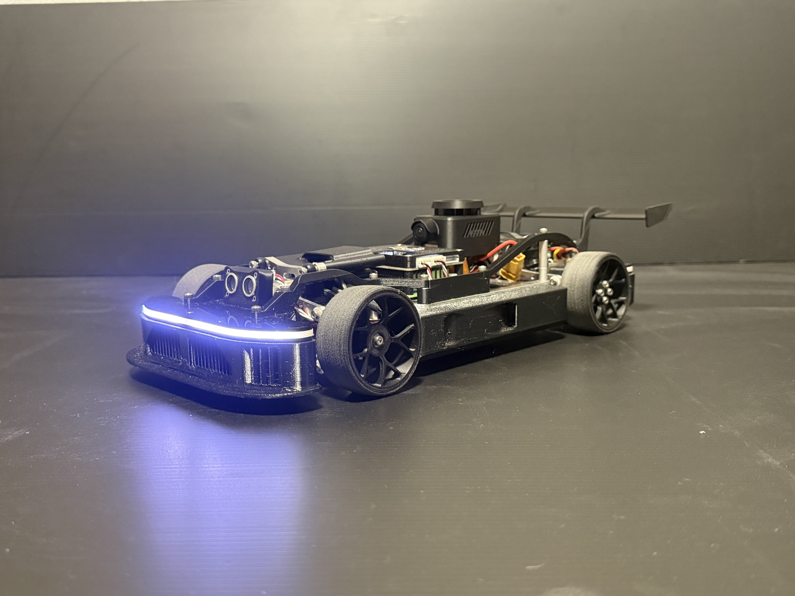
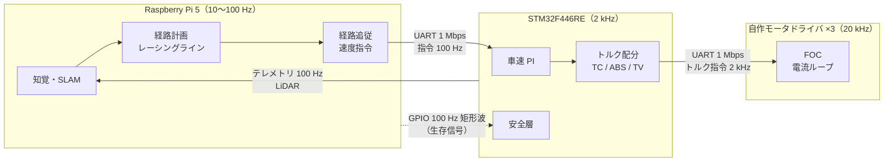

# SURGE Mark.2 とは

!!! summary "要点"
    - SURGE Mark.2 は、**10 種類以上の自動運転の方式を 1 台に載せ、同じ車・同じ安全機構で比べられる**自律走行ミニカーです。
    - 後輪は**インホイール・ダイレクトドライブ**で、左右の後輪のトルクを 1 輪ずつ制御します。
    - 頭脳は Raspberry Pi 5（判断）と STM32（リアルタイム制御）の 2 つで、Raspberry Pi が止まっても STM32 が単独で車を止めます。

<iframe src="https://www.youtube-nocookie.com/embed/Tv3HFxTQJk8" title="SURGE Mark.2 の走行動画" loading="lazy" allow="accelerometer; encrypted-media; gyroscope; picture-in-picture; fullscreen" allowfullscreen></iframe>

<figure markdown>
{ loading=lazy }
<figcaption>SURGE Mark.2。前方のライトは灯火・エンコーダ基板で光らせています。</figcaption>
</figure>

## 主要な数字

2.0<small>kg</small>

質量

0.37 × 0.18<small>m</small>

長さ × 幅

0.23<small>m</small>

ホイールベース

18<small>km/h</small>

最高速度（5.0 m/s）

3<small>個</small>

BLDC モータ（後輪 2・操舵 1）

2<small>系統</small>

電源（駆動用・信号用）

ほかの数字は [主要諸元](../reference/specs.md) にまとめています。

## 3 つの層

- **Raspberry Pi は「どこへ・どれだけの速さで」を決めます。** 自己位置推定、地図、走行ライン、障害物の回避。
- **STM32 は「どうやってタイヤにトルクを伝えるか」を決めます。** 車速の制御、スリップの制御、左右のトルク配分、安全停止。
- **モータドライバは電流だけを見ます。** 狙ったトルクを、相電流を測りながら正確に出します。

「上位が落ちても下位が単独で車を止められること」が設計の出発点です。詳しくは [システム構成](system.md)。

## もっと知る

<a class="sg-card" href="story/">
なぜ作ったのか

「自動運転の手法を、1 台で全部走らせて比べたい」から始まった話と、こだわり。

生まれた理由とこだわり →
</a>
<a class="sg-card" href="tour/">
1 周の間に何が起きているか

LiDAR が壁を見てから、タイヤにトルクが出るまでを順に追う。

1 周を追いかける →
</a>
<a class="sg-card" href="modes/">
どんな方式で走れるか

地図を作る、壁を避ける、カメラで見る、学習する。走らせ方の一覧。

走らせ方の一覧 →
</a>

---

**出典**: 寸法・質量は [`vehicle.toml`][vehicle-toml]、最高速度は STM32 ファームの `DRIVE_MAX_SPEED_M_S`、方式の数は `PROTOPEDIA.md`、周期は STM32 ファームと MD ファーム。

[vehicle-toml]: https://github.com/banbatakumi/AutonomousCar_RasPi/blob/master/surge_mk2/config/vehicle.toml
