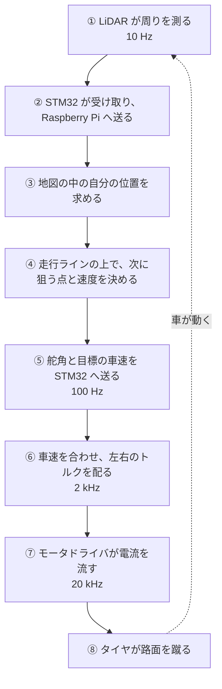

# 1 周を追いかける

!!! summary "要点"
    - 地図を使う走行モードで、**LiDAR が壁を見てから、タイヤにトルクが出るまで**を順に追います。
    - 1 回のスキャンは、**Raspberry Pi で「どこにいて、どこへ向かうか」**に変わり、**STM32 で「左右の後輪に何 N·m」**に変わり、**モータドライバで「各相に何 A」**に変わります。
    - 段が下がるほど周期が速くなります（10 Hz → 100 Hz → 2 kHz → 20 kHz）。各段から、詳しいページへ枝分かれできます。

## ① 周りを測る — LiDAR

車体の上の LiDAR（LD06）が、1 秒に 10 回転しながら周囲の距離を測ります。
LiDAR は裏向きに付いているので、点群は鏡像になっています。あとで向きを戻します。

1 回転の 100 ms の間にも車は進むので、点群は少しゆがみます。
**点ごとに、その点を測った瞬間の車の位置で補正**（脱スキュー）してから使います。

→ さらに深く: [センサ](../hardware/sensors.md)、[地図と自己位置推定](../autonomy/mapping.md#1-点ごとの脱スキュー)

## ② Raspberry Pi へ届ける — UART

LiDAR のデータは、STM32 がいったん受け取り、車速・IMU などと一緒に UART（1 Mbps）で Raspberry Pi へ送ります。
Raspberry Pi の中では、`io_node` が受け取って内部のバスに流します。

STM32 の時計と Raspberry Pi の時計は別物なので、**時刻を合わせる仕組み**で換算します。
「いつ測った点か」が分からないと、①の補正ができないためです。

→ さらに深く: [UART プロトコル](../control/protocol.md)、[ノード構成と内部バス](../autonomy/index.md)

## ③ 自分の位置を知る — SLAM

最初の周回で作った地図に、いまのスキャンを重ね合わせ（ICP）、**地図の中の自分の位置と向き**を求めます。
前輪で測った車速と IMU の角速度から「たぶんこのあたり」という予測を作り、それを手がかりに合わせます。

→ さらに深く: [地図と自己位置推定](../autonomy/mapping.md)

## ④ どこへ向かうか決める — 走行ラインと追従

地図からコースの中心線と道幅を求め、**曲率がなるべく小さくなるライン**（アウト・イン・アウトが結果として出てくる）を計算してあります。
そのライン上の各点には、曲がるときの横向きの加速度の上限から決めた**目標の速度**が付いています。

いまの位置から少し先のライン上の点を狙い、舵角を決めます（Pure Pursuit）。
指令が実際に効くまでの遅れ（スキャンの完了から STM32 が指令を受け取るまで約 12 ms）も見込みます。

→ さらに深く: [レーシングライン](../autonomy/raceline.md)、[経路追従と速度指令](../autonomy/tracking.md)

## ⑤ 指令を送る — Raspberry Pi → STM32

決めた**舵角**と**目標の車速**を STM32 へ送ります。
同時に、GPIO6 からは 100 Hz の「生きている」合図（ハートビート）を出し続けています。

→ さらに深く: [上位の安全設計](../autonomy/safety.md)、[電装と電源](../hardware/electronics.md#ハートビート--通信とは別の生きている合図)

## ⑥ トルクに変える — STM32

STM32 は 1 秒に 2,000 回、次を繰り返します。

1. 前輪の角度センサと加速度センサから、**いまの車速**を推定する。
2. 目標の車速との差から、**必要なトルク**を決める（車速の PI 制御）。
3. 後輪の回転と前輪の回転を比べ、**空転していればトルクを絞る**（トラクションコントロール）。
4. 曲がっているときは、**左右の後輪にトルクを配り分ける**（トルクベクタリング）。
5. 舵角は、路面の角度からモータの角度に換算して、ステアリングのモータドライバへ送る。

→ さらに深く: [駆動制御](../control/drive.md)、[スリップ制御](../control/traction.md)、[トルクベクタリング](../control/torque-vectoring.md)、[ステアリング](../hardware/steering.md)

## ⑦ 電流を流す — モータドライバ

後輪のモータドライバは、STM32 から届いた**トルクの指令**を電流の指令に直し、1 秒に 2 万回、相電流を測りながら狙った電流を流します（FOC）。

→ さらに深く: [自作モータドライバと FOC](../hardware/motor-driver.md)

## ⑧ タイヤが路面を蹴る

モータはホイールの中にあり、ロータにホイールが直接ネジ留めされています。
ギアのガタや粘りがないので、⑥で決めたトルクがほぼそのままタイヤに届きます。

→ さらに深く: [インホイール・ダイレクトドライブ](../hardware/in-wheel-drive.md)

## 何かがおかしいとき

この流れのどこかが止まっても、車が走り続けないようにしてあります。

| 止まったもの | 何が起きるか |
|---|---|
| Raspberry Pi のソフト | ハートビートが途切れ、STM32 が車を止めて保持する |
| Raspberry Pi からの指令 | 指令が途絶えると、STM32 が止める |
| 前方の障害物 | 速度に応じて伸びる停止距離の中に障害物があれば、STM32 が自動で止める |
| モータドライバとの通信 | STM32 が検出する。モータドライバも、通信が 0.5 秒途切れれば出力を止める |

→ さらに深く: [安全層とフェイルセーフ](../control/safety.md)
