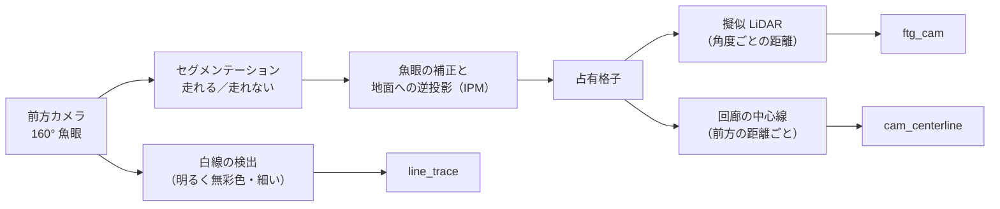

# カメラで道を見る（ftg_cam・cam_centerline・line_trace）

!!! summary "要点"
    - 前方カメラの画像から**「走れる床」か「白線」**を見つけ、それを**地面の座標**に直してから追う 3 つのモードです。
    - 走れる床の認識は、自分で教えた**セグメンテーションのモデル**（Raspberry Pi 5 の CPU で動く軽量なもの）で行います。白線は学習なしの単純な画像処理で見つけます。
    - 認識した結果は「擬似 LiDAR」や「回廊の中心線」に変えて、LiDAR のモードと同じ Pure Pursuit で追います。

!!! info "【実機確認】（動作）"
    対象: [`cam_perception_node.py`][perc-py]・[`line_perception_node.py`][line-py]・[`follow_the_gap_cam.py`][ftgcam-py]・[`cam_centerline.py`][center-py]・[`line_trace.py`][line-trace-py]、学習は [`ml_cam/`][ml-cam]。確認した版: 上位 `2d0a44e`。

## しくみ

### 画像から「地面の地図」を作る

- **セグメンテーション**は、画像の画素ごとに「走れる床か」を 0〜1 で出すモデルです。MobileNetV3-Small を土台にした軽量なモデルで、
  境界の細かさより **Raspberry Pi 5 の CPU でリアルタイムに回ること**を優先しています（[`ml_cam/model.py`][ml-cam]）。
- **IPM（逆透視変換）**は、画像の中の位置を「床の上のどこか」に直す変換です。魚眼レンズの歪みを校正値で補正してから、カメラの高さと向きを使って床の座標に投影します。
- 判断（どこへ向かうか）は、すべて走行モードの側に書いてあります。認識のノードは「事実」を作るだけです。

### Follow the Gap（カメラ）

**`plan()` を 1 行も書き換えていません。** 認識の結果を LiDAR と同じ形の「擬似スキャン」に変えて、[Follow the Gap](lidar-reactive.md#follow-the-gap) をそのまま走らせます。
ギャップの選び方がセンサを問わないことを、コードそのもので示すために、あえてこうしています。

変えたのは 2 つだけです。カメラが見ている範囲の外を「壁」と読まないよう視野を狭めたこと、
カメラの推論は LiDAR ほど速く回らないので、データが古いと判定するまでの時間を延ばしたことです。

### カメラ中心線

擬似スキャンは「車から見た角度ごとの距離」という 1 次元に潰してしまいます。カメラ中心線は、**前方の距離ごとに、走れる回廊の中心と幅**を持ったまま使います。

- 回廊の幅が「車幅＋余裕」を下回った最初の距離で打ち切り、それより手前だけを使います。
- 中心線の上で、速度に応じた距離の点を狙い、Pure Pursuit で舵角にします。速度の決め方も LiDAR のモードと同じです。
- 回廊が短すぎる・見えないときは、直前の舵のまま惰性で進まず**止まります**。

### ライントレース

白線は「明るく、色が薄い（無彩色）」という単純な特徴で見つかるので、**学習済みのモデルを使いません**。
画面の下寄り（近く）と中央寄り（遠く）の 2 つの帯で白線の位置を求め、床の座標に直した点を Pure Pursuit の目標にします。

!!! bug "毛布や段ボールを白線と間違えた"
    実車で、帯の中に毛布・カーテン・段ボールのような大きく明るい面があると、白線ではなくそちらに引っ張られました。
    白線は数 cm 幅で**細い**ので、行ごとに幅が広すぎる明るい領域を除いてから位置を求めるようにしました。

白線を見失ったら**止まります**。コースアウトの方が、止まるよりずっと危険だからです。
このモードは障害物を避けません。白線の上をたどるだけの最小構成です。

### 矢印信号を読む

地図を使う走行では、大会のルールにある**矢印信号（電光掲示板）**を前方カメラで読み、経路を切り替えます（[地図を作って走る](map-driving.md)）。
ここでも学習は使わず、**色のしきい値と形のモーメント**で左・右・中央を見分けます。

シミュレータはカメラの画像を作らないので、学習用のデータは実物を撮るしかありません。
一方で表示は「3 種類の矢印 × 薄い色 3 系統」という閉じた問題なので、古典的な処理で足りる、という判断です。決められた色に入らない点灯は無視し、今の経路のまま走ります。

## 設計の詳細

### 走れる床を教える — 半自動のアノテーション

セグメンテーションの学習には「この画素は走れる床」という正解（マスク）が要ります。
1 枚ずつ手で塗るのは重いので、**SAM（Segment Anything）**を使う半自動のツールを作りました（[`annotate.py`][annotate-py]）。

- 床を 1 クリックすると、その領域のマスクを SAM が提案します。誤って広がった所は Shift ＋クリックで除外します。
- 連続するフレームは走れる床がほぼ同じ場所にあるので、**前のフレームで打った点を次のフレームに引き継ぎます**。多くは確認して Enter を押すだけです。

作業は、学習用の操作パネル（`ml_cam/app.py`）の「①フレーム抽出 → ②アノテーション → ③学習 → ④エクスポート」のタブで、ターミナルを使わずに進められます。
書き出したモデルは、実車の GUI からモデル名で選ぶと、プロセスを再起動せずに読み直します。

!!! placeholder "画面 S-03：セグメンテーションの学習パネル（ml_cam）"
    アノテーションのタブで、床を 1 クリックして SAM のマスクが重なった状態。学習のタブの学習曲線も撮れれば並べたい。

### カメラの取付高さという壁

カメラは車体の低い位置にあり、IPM で遠くの床の位置を求めると、**高さのわずかな誤差が奥行きの大きな誤差**になります。
実車で「奥行きを掴むのが難しい」と分かったことが、IPM を通さずに画像から直接舵を学ぶ[模倣学習（カメラ E2E）](imitation.md)を作った理由です。

隣のしくみへ

- [模倣学習（カメラ E2E）](imitation.md)
- [LiDAR で空いている方向へ](lidar-reactive.md)

さらに深く

- [センサ（カメラの配置と校正）](../../hardware/sensors.md)
- [経路追従と速度指令](../tracking.md)

[perc-py]: https://github.com/banbatakumi/AutonomousCar_RasPi/blob/master/surge_mk2/raspi/nodes/cam_perception_node.py
[line-py]: https://github.com/banbatakumi/AutonomousCar_RasPi/blob/master/surge_mk2/raspi/nodes/line_perception_node.py
[ftgcam-py]: https://github.com/banbatakumi/AutonomousCar_RasPi/blob/master/surge_mk2/raspi/auto/follow_the_gap_cam.py
[center-py]: https://github.com/banbatakumi/AutonomousCar_RasPi/blob/master/surge_mk2/raspi/auto/cam_centerline.py
[line-trace-py]: https://github.com/banbatakumi/AutonomousCar_RasPi/blob/master/surge_mk2/raspi/auto/line_trace.py
[ml-cam]: https://github.com/banbatakumi/AutonomousCar_RasPi/tree/master/surge_mk2/ml_cam
[annotate-py]: https://github.com/banbatakumi/AutonomousCar_RasPi/blob/master/surge_mk2/ml_cam/annotate.py
