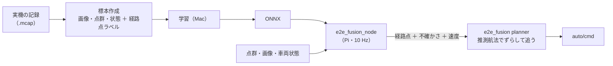

# E2E 融合（LiDAR ＋ カメラ）

!!! summary "要点"
    - **LiDAR の点群・前方カメラの画像・車両状態（車速・舵角・ヨーレート）を 1 つのモデルに入れ**、舵と速度に加えて**前方 8 m の経路点**を出させる E2E のモードです。
    - 走らせるときは、舵の直接出力ではなく**経路点を Pure Pursuit で追います**。推論の遅れを、推測航法で経路をずらして消せるためです。
    - 手本は実機の記録です。**記録を録ったコースを、地図も自己位置も使わずに走る**ためのもので、未知のコースは対象にしていません。

!!! info "【シム／ホスト検証】（記録を通したオフライン評価。実走はまだ）"
    対象: 実車側 [`e2e_fusion.py`][planner-py]・[`e2e_fusion_node.py`][node-py]、学習側 [`ml_e2e/`][ml-dir]。確認した版: 上位 `5afdd32`（2026-11-11）。
    Pi へ反映しておらず、**実走していません**。数値は学習に使っていない記録での開ループの評価です（[見る数字](#見る数字と限界)）。

## しくみ

### 入力と出力

| | 中身 |
|---|---|
| 入力: 画像 | 前方カメラ。模倣学習（[カメラ E2E](imitation.md)）と同じ前処理（224×128） |
| 入力: 点群 | 前方 270° の距離を、新しい順に 3 周分（`H=3`）。8 m で割って 0〜1 にする |
| 入力: 車両状態 | 車速・実舵角・ヨーレート |
| 出力 | 舵・速度（直接出力）と、**0.25 m 間隔の経路点 32 個**（x・y・各点の速度・各点の位置の不確かさ `b`） |

入出力の形は `raspi/core/e2e_fusion_preproc.py` の 1 か所にまとめ、**学習（Mac）と推論（Pi）が同じ関数を通ります**。
形を変えたら `PREPROC_VERSION` を上げ、古い契約で学習したモデルは読み込みを拒否します（[カメラ E2E](imitation.md) と同じ方針）。

### 入力を伏せて学ぶ

3 つの入力それぞれに「使えるか」のフラグ（`avail`）を付け、**学習中に一定の割合で入力を伏せます**（画像と点群は同時には伏せない）。伏せた入力は、中身の代わりに「無い」ことを表す学習済みベクトルを入れます。

- 楽な方の入力だけを見るモデルになるのを防ぐ
- 実車で片方の入力が途絶えても、残りで経路を出せる

### 不確かさ `b`

各経路点の誤差をラプラス分布とみなし、その幅 `b` [m] も出させます（損失は `|誤差|/b + log b`）。
分岐の手前や見通しの先のように**手本が割れる場所で大きくなる**ので、実車は `b` が大きい経路を信用せず止まります。

## 手本とラベル

記録の状況から、ラベルの作り方が自動で決まります（`ml_e2e/extract.py`）。

| 記録の状況 | 経路点 | 速度 |
|---|---|---|
| `slam2d_route` が RACE で走行中 | **地図の最適ライン**（地図上の姿勢で車体座標へ移す） | ラインの計画速度 |
| それ以外の自動運転（回避中・探索中など） | その後に実際に通った軌跡 | 実速度 |
| 人の手動運転 | その後に通った軌跡 | **手本にしない**（舵だけ手本） |

- 最適ラインのラベルは、**車が線から外れていても線へ戻る経路**になります。手本が同じ線しか走らなくても、ずれからの復帰を教えられます（カメラ E2E は画像を左右にずらして同じことをしていました）。
- 人の手動運転の速度は手本にしません。遅い走りを覚えさせないためです。このとき実車では「モデルの速度を使う」を OFF にすると、経路の曲がり具合と車の限界から速度が決まります。
- このモデル自身の走行は標本から外します（自分の誤差を増幅するだけなので）。

!!! warning "ラベルは学習の前に必ず確かめる"
    `ml_e2e.check_labels` が、**経路が壁の内側を通るか**・**経路を追った舵が記録の舵と合うか**を表にし、画像と点群への重ね描きも出します。
    ラベルが誤っていると、学習が進んで見えても誤ったものを正確に覚えるだけなので、学習より前の工程にしています。

## 走らせ方: 経路点を追う

モデルは舵・速度も直接出しますが、**既定では経路点を Pure Pursuit で追います**。

- **推論の遅れを幾何で消せる。** 経路点は画像の撮影時刻の車体座標で届きます。撮影から今までに車が動いた分を**推測航法（車速とヨーレートの積分）**で求め、経路を「今の車」から見た位置へ移してから追います。直接出力の舵は撮影時刻の舵なので、遅れた分だけ古くなります。
- **点群の合間も追える。** 推論は 10 Hz ですが、`auto/cmd` は 50 Hz で出し続け、その間も経路上の位置を進めます。
- **速度の上限を物理から掛けられる。** 経路の曲率と車の横の限界から出した速度を、モデルの速度に被せます。手本に速度の無いコースは、こちらだけで走ります。

直接出力の舵は、**経路を追った舵との食い違い**を見るのに使います。10° を超えて食い違えばモデルの中で答えが割れているとみなして、速度を 0.6 倍に落とします。

### 止まる条件（`ready=False`）

推論ノードが出せない（モデル無し・入力途絶）、値が有限でない、注視点までの経路の不確かさ `b` が上限（0.8 m）を超える、経路が車の後ろへ向いている、のとき止まります。
**固定距離の停止は持ちません**。学習データに無い場面の挙動は保証できないので、STM32 の `auto_stop` を ON にして、人が触れた瞬間の解除と合わせて受けます（他の planner と同じ、[走行モード](index.md#planner-の約束)）。

### GUI の設定

| 設定 | 役割 |
|---|---|
| 最高速度 | 速度の上限。**初めてのモデル・初めてのコースは低くして試す** |
| モデルの速度を使う | OFF にすると、経路の形と車の限界だけで速度を決める |
| 直接出力で走る（比較用） | 経路点を使わず舵の直接出力で走る。経路を追う方式との比較用 |
| E2E 融合モデル | 使うモデルを選ぶ。「自動」は `models/e2e_fusion/` の最も新しい `.onnx` |

走行中にモデルを選び直すと、engage は落ちます。

## 推論ノード

推論は planner の中ではなく、**独立したプロセス `surge-e2e-fusion`** で行います。新しい点群の 1 周が届くたびに（10 Hz）、そのとき最新の画像と組にして推論します。

- 出力の基準時刻は**画像の撮影時刻**です。点群はそれより 0.07〜0.17 s 古くなりますが、学習の標本も同じ関係になるように組んであります。
- 画像が読めない周は、点群だけで推論します。
- 点群は `scan` をそのまま使い、車体マスクやノイズ除去を通しません（学習の標本が記録の `scan` そのままなので）。
- このモードが選ばれ、DISARM でない間だけ推論します。それ以外は約 2 Hz で `ready=False` を出すだけです（節電。[カメラ E2E](imitation.md) と同じ）。

## 学習の流れ

学習は Mac で行い、操作パネル（ランチャーの「ml_e2e」）のタブは作業の順に並んでいます。

| タブ | すること |
|---|---|
| ① 標本作成 | 記録（`.mcap`）を選んで標本を作る。使わなかったコマは理由ごとに数が出る |
| ② ラベル確認 | 経路点が壁の内側を通るか、記録の舵と合うかを表と重ね描きで見る |
| ③ 学習 | 検証に回す記録を選んで学習する（既定は地図ごとに最後の 1 本）。既存モデルの重みから追加学習もできる |
| ④ エクスポート | ONNX と契約（`.json`）を書く。実車と同じ読み込みが通るか確かめる |
| ⑤ 評価 | 学習に使っていない記録を、実車と同じ推論ノードと planner に通す |

検証は**記録単位**で分けます（同じ走行の隣り合うコマを学習と検証に分けると、実力が見えないため）。

!!! note "シミュレータでは検証できない"
    シミュレータはカメラを持たないので、このモードはシムで試せません。代わりに、記録を実車と同じコードに通す `ml_e2e.eval` と、実走で確かめます。

## 見る数字と限界

最初のモデル（v1）は、2026-10-31〜11-08 の記録 18 本（3 コース・16,038 枚）のうち 15 本で学習し、残り 3 本で評価しました。

| 項目 | 結果（学習に使っていない 3 本） |
|---|---|
| 経路の誤差 | 最初の 2 m で **0.07〜0.17 m**、全 8 m で **0.25〜0.49 m** |
| 向きのずれへの応答 | 理想の **0.58〜0.77 倍** |
| planner の目標速度 | 手本の **0.84〜0.99 倍** |
| Pi での処理時間（DISARM・1.5 GHz） | 前処理 10 ms ＋ 推論 8.6 ms。10 Hz で制御系の電流 +20 mA |

「向きのずれへの応答」は、車の向きをずらした入力に対して、経路が**ずれを戻す向きにどれだけ回るか**を、理想の回り方との比で見たものです（1 に近いほど、ずれを入力から読み取れている）。

学習の最後には、入力を伏せたときの経路誤差も出します（検証の記録での値）。

| 入力 | 経路の誤差 |
|---|---|
| 全部あり | 0.260 m |
| 画像なし | 0.767 m |
| 点群なし | 0.282 m |
| 車両状態なし | 0.262 m |

**今のモデルは主に画像を見て経路を出しています。** 点群を伏せてもほとんど変わらず、画像を伏せると約 3 倍に悪化します。
LiDAR がどれだけ効いているかは、この評価では確かめられていません。

!!! warning "開ループの評価の限界"
    `ml_e2e.eval` は**開ループ**です。車は記録のとおりに動き、モデルの舵で動いた先の絵は見ていません。
    分かるのは「配線・時刻・契約が合っていること」と「ずれを戻す向きの舵が出ていること」までで、**走れるかどうかは実走でしか分かりません**。

実機で確かめることは、Pi でのサービスの作成（`install_services.sh`）、低速での engage と周回、「直接出力で走る」との比較、推論中の電流の増分、`e2e_fusion/plan` の遅れです（`PROGRESS.md`）。

## ほかのモードとの違い

| | [カメラ E2E](imitation.md) | [LiDAR E2E](reinforcement.md) | **E2E 融合** |
|---|---|---|---|
| 入力 | 画像 | 点群 | 画像・点群・車両状態 |
| 学び方 | 模倣 | 強化学習（シム） | 模倣（実機の記録） |
| 出力 | 舵 | 舵角速度・速度 | 経路点・舵・速度 |
| 走らせ方 | 舵をそのまま使う | 舵・速度をそのまま使う | 経路点を推測航法でずらして追う |
| 遅れの扱い | ラベルを時間でずらす | 制御周期を点群に合わせる | 経路を推測航法でずらす |

隣のしくみへ

- [模倣学習（カメラ E2E）](imitation.md)
- [強化学習（LiDAR E2E）](reinforcement.md)

さらに深く

- [地図を作って走る（手本になる走行）](map-driving.md)
- [補助ツール（学習の操作パネル）](../../development/tools.md)

[planner-py]: https://github.com/banbatakumi/AutonomousCar_RasPi/blob/master/surge_mk2/raspi/auto/e2e_fusion.py
[node-py]: https://github.com/banbatakumi/AutonomousCar_RasPi/blob/master/surge_mk2/raspi/nodes/e2e_fusion_node.py
[ml-dir]: https://github.com/banbatakumi/AutonomousCar_RasPi/tree/master/surge_mk2/ml_e2e
