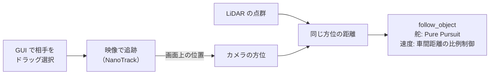
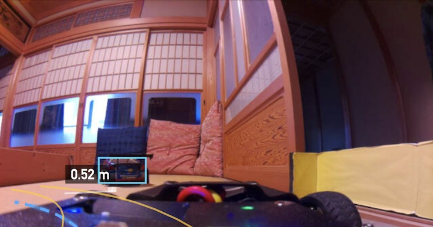

# 対象を追う（follow_object）

!!! summary "要点"
    - GUI の映像の上で**ドラッグして選んだ相手**（人や車）との距離を保って、後ろを付いていくモードです。
    - **向きはカメラ、距離は LiDAR** で測ります。カメラだけで距離を推定すると、高さのある物では誤差が大きくなるためです。
    - 初版は安全側に絞り、**前進だけ・止まるだけ**です（見失ったら止まる、近づきすぎたら止まる。後退や探索はしない）。

!!! info "【実機確認】（動作）"
    対象: [`follow_object.py`][planner-py]・[`cam_track_node.py`][track-py]。確認した版: 上位 `2d0a44e`。

## しくみ

1. GUI で、前方映像の上の相手を四角で囲みます。
2. `cam_track_node` が、軽量な追跡モデル（NanoTrack）で相手を映像の中で追い続け、その位置から**カメラで見た方位**を求めます。
3. **同じ方位の LiDAR の距離**を読み、「相手の方位と距離」として走行モードに渡します。
4. 走行モードは、相手の方位へ Pure Pursuit で舵を切り、**車間距離との差に比例**して速度を決めます。

### なぜカメラだけで距離を測らないのか

カメラの画像から地面の位置に直す方法（IPM）は、物が床に接している前提です。人や車のような**高さのある物**では、足元が床から浮いていたり傾いていたりするだけで距離が大きくずれます。
そこで、カメラは**方位を出すことだけ**に使い（レンズの焦点距離と中心だけで決まる）、距離は LiDAR で実測しています。

<figure markdown>
{ loading=lazy }
<figcaption>対象追従（実機）。前方映像の上でドラッグして選んだ相手を、水色の四角で囲んで追跡している。見失っている間は四角の色が変わる。</figcaption>
</figure>

## 設計の詳細

### 状態の移り方

追跡のノードは「追跡中か・見失っているか・見失って何秒か・方位・距離が有効か」という**事実だけ**を渡し、止まるかどうかの判断はすべて走行モードの側で行います。

| 状態 | 動き |
|---|---|
| 相手を選んでいない | 止まる |
| 見失った直後（一定時間未満） | 直前の舵を保ちながら、速度だけ 0 へ減らす（映像のちらつきを吸収する） |
| 見失ってから一定時間 | 止まる |
| 距離が分からない状態が一定時間続く | 止まる |
| 停止距離より近い | 止まる（後退はしない） |
| それ以外 | Pure Pursuit で向きを合わせ、車間距離の比例制御で速度を決める |

初版を「前進だけ・止まるだけ」に絞ったのは、見失ったときに探し回ったり、近づきすぎて下がったりする動作は、人の近くでは予想外の動きになるからです。

隣のしくみへ

- [駐車する](park.md)
- [カメラで道を見る](camera.md)

さらに深く

- [センサ](../../hardware/sensors.md)
- [上位の安全設計](../safety.md)

[planner-py]: https://github.com/banbatakumi/AutonomousCar_RasPi/blob/master/surge_mk2/raspi/auto/follow_object.py
[track-py]: https://github.com/banbatakumi/AutonomousCar_RasPi/blob/master/surge_mk2/raspi/nodes/cam_track_node.py
