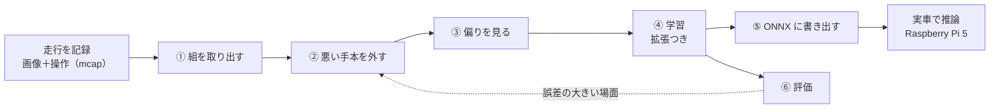
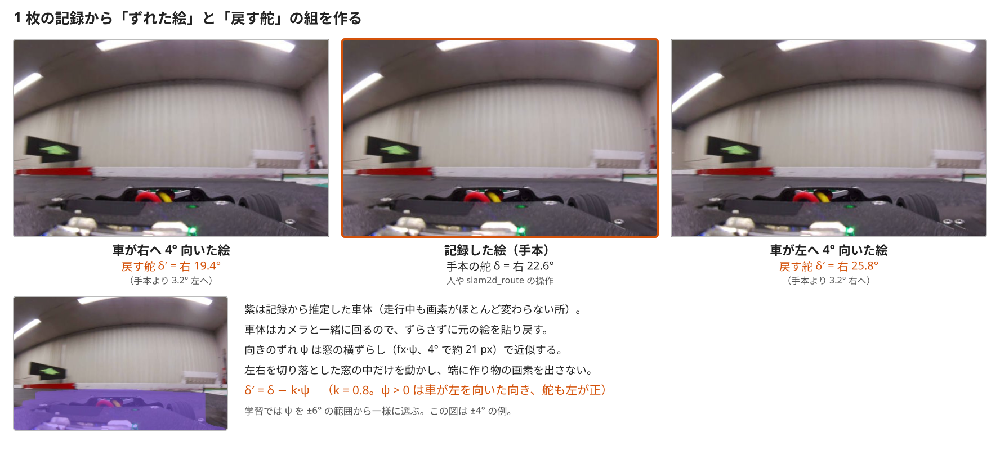

# 模倣学習（カメラ E2E）

!!! summary "要点"
    - **前方カメラの画像 1 枚から、舵角を直接出す**ニューラルネットワークで走るモードです。地面への投影（IPM）も LiDAR も使いません。
    - 手本は、人の手動運転か、**うまく走れている LiDAR の自動運転（地図走行）**です。走行の記録から「画像と、その瞬間の操作」の組を取り出すだけで教師データになります。
    - 手本は同じ線しか走らないので、そのままでは「線から外れたときに戻す舵」を覚えません。そこで**画像を左右にずらし、戻す向きに補正した舵を一緒に教えます**。

!!! info "【実機確認】（周回）＋【シム／ホスト検証】（オフライン評価）"
    対象: 実車側 [`cam_e2e.py`][planner-py]・[`cam_e2e_node.py`][node-py]、学習側 [`ml_cam_e2e/`][ml-dir]。確認した版: 上位 `2d0a44e`。
    実車での結果は開発者の記録（2026-10-29〜30）からの引用です。現在のモデルは v9 です。**このモードは障害物では止まりません**（後述）。

## しくみ

### 全体の流れ

学習は Mac 上で行い、書き出したモデル（ONNX）を実車に配ります。実車では `cam_e2e_node` が前方カメラの画像からモデルで舵角を推論し、走行モードがそれを指令にします。

### なぜ画像から直接舵を出すのか

カメラは車体の低い位置にあり、画像を床の座標に直す IPM では、遠くほど奥行きの誤差が大きくなります。
実車で「奥行きを掴むのが難しい」と分かったので、**幾何の変換を一切通さず、画像と操作の関係を直接学ばせる**ことで、その問題を迂回しました（[カメラで道を見る](camera.md#カメラの取付高さという壁)）。

| | 中身 |
|---|---|
| モデル | MobileNetV3-Small を土台に、全体を平均してから全結合で回帰する軽量なモデル |
| 入力 | 前方カメラの画像（学習の既定は 224 × 128） |
| 出力 | 舵角（−1〜1 に正規化。1 が左いっぱい）と速度（学習の既定では使わない） |
| 教師データ | 走行記録の画像と、その少し後の操作の組 |

### 速度は学ばせない

速度は、モデルが出した舵角から曲率 \(\kappa = \tan\delta / L\) を求め、横加速度の上限 \(v \le \sqrt{a_{\mathrm{lat,max}}/\kappa}\) で決めます。直線では最高速度、舵を切るほど遅くなります。

人の運転から速度を学ばないのは、手本は舵に集中してゆっくり走った方が質が上がり、速度のラベルは「遅い一定値」になって情報が無く、
しかも手本の遅さがそのまま実車の上限になってしまうからです。代わりに、舵が切れてから減速するので、**コーナー手前の減速は遅れます**。

## 学習の操作パネル

データの取り出しから評価まで、ターミナルを使わずに進められる操作パネル（`ml_cam_e2e/app.py`）を作りました。タブは作業の順に 6 枚です。

| タブ | すること |
|---|---|
| ① ペア抽出 | 録った mcap から（画像、操作）の組を取り出す。モデル名を決める |
| ② 確認・選別 | 映像と舵・速度の時系列を見ながら、手本にしない区間を範囲で外す |
| ③ 偏り | 舵・速度の分布と、記録ごとの内訳を見る |
| ④ 学習 | 学習を回し、学習曲線を見る |
| ⑤ エクスポート | 実車が読む ONNX と、前処理の約束を書いたファイルを書き出す |
| ⑥ 評価 | 予測と手本の時系列、誤差の大きい場面、ずれへの応答を見る。場面から②へ飛べる |

**②と⑥を往復するのが基本**です。誤差が大きい場面は、たいてい手本の側が悪い（そこだけ違う操作をしている）からです。

!!! placeholder "画面 S-05：② 確認・選別タブ"
    映像と舵・速度の時系列が並び、除外した範囲が色で分かる状態。

!!! placeholder "画面 S-06：③ 偏りタブ"
    舵の分布のヒストグラム（直進に偏っている様子）と、記録ごとの内訳。

!!! placeholder "画面 S-07：④ 学習タブ"
    学習曲線（学習と検証の誤差）が見える状態。

!!! placeholder "画面 S-08：⑥ 評価タブ"
    予測と手本の舵の時系列が重なり、誤差の大きい場面の一覧と「ずれへの応答 dδ/dψ」が見える状態。

## 設計の詳細

### 悪い手本を機械的に外す

教師データは、人や自動運転がその瞬間に実際に出していた指令そのものなので、**手でラベルを付ける作業が要りません**。
その代わり、質の悪い組を弾く責任が、組を取り出す処理（[`extract_pairs.py`][extract-py]）に集まります。

| 外すもの | 理由 |
|---|---|
| 走行許可（ARM）が無い間 | 待機中は「舵 0」という無意味な信号を混ぜるだけ |
| 自動運転中（既定） | 人を真似たつもりで別の走行モードを真似てしまう。手本にしたいときだけ明示して含める。カメラ E2E 自身の走行は常に外す（自分の誤差を増幅するだけ） |
| トルクモードでの運転 | 目標速度が 0 のままで、速度の手本にならない |
| 画像と指令の時刻が離れすぎた組 | 記録が途切れた区間で、無関係な指令と画像が組になるのを防ぐ |

止まって待つ区間や後退する区間も、学習からは自動で外れます。何枚がどの理由で落ちたかは最後に表示します（全部落ちたのに 0 枚と黙らないため）。

### 手本は LiDAR の自動運転でもよい

うまく走れている**地図走行（`slam2d_route`）の記録を手本にする**と、人より滑らかな運転を、人より多く集められます。
LiDAR で走るモードの運転を、**カメラだけで真似させる**わけです。

### 指令を推論の遅れだけ先にずらす

画像と「同じ瞬間の指令」を組にすると、実車ではモデルの舵が**推論の遅れの分だけ手本より遅れて**出ます（撮影から指令まで約 170 ms、2026-10-30 の実測）。
そこで、**画像の 200 ms 後の指令**を手本にしています。

| 版 | 指令のずらし | 結果（同じ手本・同じ速度、約 1.1 m/s） |
|---|---|---|
| v6 | 0 ms | 切り始めと戻しが約 0.2 秒遅れ、数 m ごとにぶつかった |
| v7 | 200 ms | **約 2 周（約 28 m）を接触なしで走った** |

### 線から外れたときに戻す舵を教える — 画像をずらす拡張

**ここが模倣学習の一番の難所です。** 手本はいつも同じ線を走るので、記録には「線から外れた画像と、そこから戻す舵」の組がありません。
そのまま学習したモデルは、ずれを直す舵をほとんど持たず、実車では数 m で線から外れて戻れなくなりました。
模倣学習でよく知られた**分布シフト**の問題です（Ross ら 2011 の DAgger が扱う問題）。

そこで、NVIDIA の PilotNet（Bojarski ら 2016）と同じ考え方で、**記録の画像を「車が向きを ψ だけ変えた画像」に作り替え、ラベルを「そこから戻る舵」に補正**します。

$$
\delta' = \delta - k\,\psi \qquad (k = 0.8,\ \psi > 0 \text{ は車が左を向いた向き。舵も左が正})
$$

<figure class="sg-wide" markdown>
{ loading=lazy }
<figcaption>実際の走行記録の 1 枚から作った例（学習と同じ関数で作成）。左右の絵は、車が右・左へ 4° 向いたときに見える景色を、画像の横ずらしで作ったもの。車が右を向いたなら左へ、左を向いたなら右へ、手本より多く切る舵を正解にする。左下の紫は推定した車体で、ずらさずに貼り戻す。</figcaption>
</figure>

作り方には 3 つの工夫があります（[`yaw_aug.py`][yaw-py]）。

- **向きの変化を、画像の横ずらしで近似する。** 魚眼レンズでは、地平線付近のずれは「焦点距離 × ψ」の画素でほぼ一様です。上下の端ほど近似が崩れるので、±6° の範囲に留めます。
- **端に作り物の画素を出さない。** 学習でも推論でも左右を少し切り落とした窓を使い、ずらすのは窓の位置だけにします。
  端を引き伸ばして埋めると、その帯がラベルの補正と完全に連動し、モデルが「帯の幅」を手がかりに舵を覚えてしまうからです。
- **車体は動かさない。** カメラは車体に固定なので、車が向きを変えてもボンネットや前輪は同じ所に写ります。
  走行中に画素がほとんど変わらない所を記録から推定して車体とみなし、そこだけ元の画像を貼り戻します。

!!! success "効果（開発記録 2026-10-29〜30）"
    ずれへの応答 dδ/dψ（車が ψ 向いたときに舵をどれだけ変えるか。負で大きいほど戻す力が強い）で比べました。手本の追従は約 −0.8〜−1.5 です。

    | | 拡張なし（v4） | 拡張あり（v5） |
    |---|---|---|
    | 手本の画像で | −0.20 | **−0.81** |
    | 学習に使っていない低速走行の画像で | −0.12〜−0.17 | **−0.54〜−0.58** |
    | 検証データの舵の誤差 | 0.5° | 0.5°（悪化なし） |

    v4 はオフラインの評価では完璧（検証誤差 0.5°、相関 0.999）でしたが、実車では数 m で線を外れました。
    **誤差が小さくても走れるとは限らない**ので、評価タブでは dδ/dψ も必ず表示するようにしています。

!!! note "教えられないこと"
    向きは合っているが壁に寄っている、という**横方向の位置のずれ**は、奥行きの情報が無いと画像から作れません。これは未対策です。

### 舵の正解を変えない外乱も足す

実車で起きているのに、学習の画像には無かった変化を混ぜ、モデルがそれを舵の手がかりにしないようにします（[`photo_aug.py`][photo-py]）。

| 外乱 | 実車で起きていること |
|---|---|
| 横ブレ | 暗い室内で露出が約 33 ms まで伸び、旋回の速さに比例して画像が横に流れる |
| センサのノイズ | ゲインがほぼ最大なので、暗いほどざらつく |
| 色味 | 窓の外光と室内灯が混ざり、時間で色が変わる |
| JPEG | 学習の画像は記録用の JPEG、実車の推論は圧縮前の画像 |

!!! bug "モデルが画像のブレを舵の手がかりにしていた"
    手本（速く走った記録）の画像は旋回でブレており、ゆっくり走らせた実車の画像はくっきりしていました。
    手本より遅く走らせると舵が足りなくなり、画像に横ブレを足すと舵が戻りました。ブレを外乱として学習に混ぜた v8 では、横ブレによる舵の変化が 3.5〜3.7° から 0.6〜1.0° に減りました。
    それでも、**手本は実車で走らせる速度で録る**のが原則です。

### 直進ばかりのデータへの対処

舵 0 付近が大半を占めるデータをそのまま学習すると、「常に直進」と答えるのが誤差を最小にしてしまいます。
枚数を捨てて間引くのではなく、**舵の区間ごとに抽選の重みを変えて**、カーブを多めに見せます。左右反転の水増しも既定で使います（コースが左右非対称なら切れます）。

### 学習と推論で前処理を同じにする

画像の切り出し・縮小・正規化は、学習と推論で**同じ関数**を使います。処理を変えたら版の番号を上げ、版の違うモデルは実車のノードが読み込みを拒否します。
「学習のときと違う絵を見せて走らせていた」という、気づきにくい失敗を防ぐためです。

### このモードは自分では止まらない

LiDAR を見ないので、前に物があってもモデルが「進め」と出せば進みます。学習データに無い場面での振る舞いは、原理的に保証できません。
走らせるときは GUI で **STM32 の自動停止（LiDAR による停止距離）を有効**にし、人が舵・スロットル・ブレーキに触れた瞬間に解除される仕組みと合わせて使います。

## これから

LiDAR だけ、カメラだけの E2E から、**両方を組み合わせた E2E** へ進む予定です（[生まれた理由とこだわり](../../about-car/story.md#これから)）。

隣のしくみへ

- [強化学習（LiDAR E2E）](reinforcement.md)
- [カメラで道を見る](camera.md)

さらに深く

- [地図を作って走る（手本になる走行）](map-driving.md)
- [補助ツール（学習の操作パネル）](../../development/tools.md)

[planner-py]: https://github.com/banbatakumi/AutonomousCar_RasPi/blob/master/surge_mk2/raspi/auto/cam_e2e.py
[node-py]: https://github.com/banbatakumi/AutonomousCar_RasPi/blob/master/surge_mk2/raspi/nodes/cam_e2e_node.py
[ml-dir]: https://github.com/banbatakumi/AutonomousCar_RasPi/tree/master/surge_mk2/ml_cam_e2e
[extract-py]: https://github.com/banbatakumi/AutonomousCar_RasPi/blob/master/surge_mk2/ml_cam_e2e/extract_pairs.py
[yaw-py]: https://github.com/banbatakumi/AutonomousCar_RasPi/blob/master/surge_mk2/ml_cam_e2e/yaw_aug.py
[photo-py]: https://github.com/banbatakumi/AutonomousCar_RasPi/blob/master/surge_mk2/ml_cam_e2e/photo_aug.py
