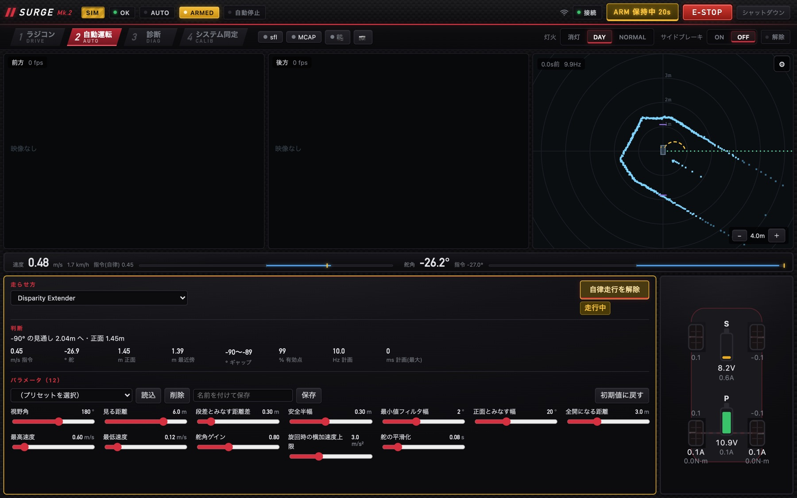

# LiDAR で空いている方向へ（FTG・DE・DP）

!!! summary "要点"
    - 地図も自己位置も使わず、**その瞬間の LiDAR の点群だけ**から「どこへ向かうか」を毎周期決める、反射型の 3 つのモードです。
    - **Follow the Gap（FTG）**は一番広く空いている区間の真ん中へ、**Disparity Extender（DE）**は通れない隙間を先に塞いでから一番遠い方向へ向かいます。
    - **Disparity Pursuit（DP）**は、DE の安全マージンと FTG の舵角の出し方を組み合わせた発展版です。

!!! info "【シム／ホスト検証】＋【実機確認】（動作）"
    対象: [`follow_the_gap.py`][ftg-py]・[`disparity_extender.py`][de-py]・[`gap_pursuit.py`][dp-py]。確認した版: 上位 `2d0a44e`。
    周回時間の数値は**シミュレータ**の値です（コードのコメントと開発記録より）。

## しくみ

### 3 つに共通する流れ


- **前処理は 3 つで同じ関数**（`base.scan_window()`）を使います。欠測は「壁」、飽和（遠すぎて返らない）は「空き」として、**安全側に倒して**読みます。
  1 か所にまとめてあるのは、片方だけ直すともう片方が古い読み方のまま走ってしまうためです。
- **舵角は Pure Pursuit** の式 \(\delta = \arctan(2L\sin\eta / L_d)\) で出します（\(\eta\) は狙う方向、\(L\) はホイールベース、\(L_d\) は前方注視距離）。
  Pure Pursuit は「自分から見た目標点の方位と距離」さえあれば決まるので、地図も経路も無い反射型と相性がよい式です。
- **速度は 2 つの上限の小さい方**です。1 つは前方の見通し、もう 1 つは実際に切る舵角から求めた曲率 \(\kappa = \tan\delta / L\) による横加速度の上限
  \(v \le \sqrt{a_{\mathrm{lat,max}}/\kappa}\) です。緩い旋回は落としすぎず、きつい旋回は物理的な根拠のある分だけ確実に落ちます。
- **固定距離の緊急停止は持ちません。** 近づきすぎたときの停止は STM32 の自動停止（速度に応じて伸びる停止距離）に任せます。
  ただし「どこへも進めない」と分かったときは、計画の失敗として止まります。

<figure class="sg-wide" markdown>
{ loading=lazy }
<figcaption>Disparity Extender で走行中。右上の LiDAR の画面に向かう方向が、下の「判断」に「−90° の見通し 2.04m へ」と理由が出る（シミュレータで撮影）。シミュレータではカメラの映像は出ない。</figcaption>
</figure>

### Follow the Gap

```text
① 前方 ±fov/2 だけを見る → ② 前処理と最小値フィルタ → ③ 最近傍の点のまわりを「侵入禁止」で塗る（安全バブル）
→ ④ gap_min 以上空いている区間のうち一番長いものを選ぶ → ⑤ その区間の真ん中を狙う → ⑥ 速度を決める
```

⑤で「区間の中で一番遠い点」ではなく**真ん中**を狙うのは、一番遠い点を狙うと壁際すれすれを縫う走りになり、車幅に余裕の無いミニカーでは外輪が壁に当たるためです。

!!! bug "前方注視距離をギャップの奥行きにしたら、コーナーで壁に当たった"
    最初は \(L_d\) を「ギャップの奥行き」にしていました。コーナーでは曲がる方向が奥まで開けていることが多く、「奥まで見えるから急がなくてよい」という判断になって、
    その場の通路幅の中で曲がりきれませんでした。**\(L_d = k\,v + L_{\min}\)（速度に比例）**に変えると、壁に近づいて減速するときに \(L_d\) も縮み、
    「減速している＝鋭く曲がりたい瞬間ほど鋭く曲がる」という向きが揃いました。奥行きは、見えている範囲より先を狙わないための上限として残しています。

### Disparity Extender

F1TENTH で広く使われている手法（Nathan Otterness, 2019）です。FTG との違いは**向かう方向の決め方**だけです。

1. 隣り合う測定値が `disparity_m` 以上飛んでいる所を「物の縁（段差）」とみなします。
2. 縁の**遠い側**は手前の物の陰なので、車体の半幅ぶんは通れません。そこを**近い側の距離 \(r\) で塗り潰します**。
   塗る角度は \(\theta = \mathrm{atan2}(\text{safety\_half\_width},\ r)\) で、近い物ほど広く塗ります。
3. 塗り終わったあと、**一番遠くまで進める帯の真ん中**を狙います。

| | Follow the Gap | Disparity Extender |
|---|---|---|
| 隙間の扱い | 一定幅以上が続く**最長の区間** | **通れない隙間を塞いでから**残りを見る |
| 狙う所 | 最長区間の真ん中 | **一番遠い帯**の真ん中 |
| 速度の基礎 | 正面の扇の余裕 | **狙う方向の塗り後の距離** |
| 安全バブル | 最近傍のまわりを塗る | 要らない（段差の塗りが同じ役目） |

!!! example "効いた工夫（シム、circuit コース、180 秒、いずれも衝突 0）"
    | 変更 | 周回時間 |
    |---|---|
    | 塗った後に一番遠い**点**を狙う（平らな帯の端が選ばれ、コーナーの内側を舐める） | 48.7 s |
    | **一番遠い帯の真ん中**を狙う | **16.9 s** |
    | 速度を「正面 ±20° の扇の最小値」で決める（道幅 1.0 m では中央にいても壁が 0.5 m 横にあるので、**直線でも見通しが 1.5 m を超えない**） | 62 s |
    | **速度を「狙う方向の塗り後の距離」で決める** | **17 s** |

    FTG → DE（同条件）: circuit 37.2 s → 16.9 s、oval 36.5 s → 15.8 s。split コースは FTG が 1 周もできず、DE は 40.5 s。

塗るときは上書きではなく `min()` で入れます。上書きだと左から見た段差と右から見た段差が同じ所を取り合い、処理の順番で結果が変わります。
`min()` なら順不同で同じ答えになり、しかも常に安全側にしか動きません。

### Disparity Pursuit

DE と FTG を読み比べると、「安全マージンの取り方・狙う方向の選び方」は DE が優れ、「狙う方向を舵角にする式」は FTG（Pure Pursuit）が優れていました。
**どちらか片方を持ってきても最良にならない**ので、両方を組み合わせ、さらに 2 つを足したのが DP です。

- **狙う方向のヒステリシス**: 同じくらい遠い帯が 2 つあるとき、DE は「正面に近い方」を選びますが、湾曲した通路ではフレームごとに入れ替わって舵が振れることがあります。
  DP は「**前回向いていた方向に近い帯**」を選びます。直進中は DE と同じ答えに収まります。
- **安全半幅を速度に応じて広げる**: 高速ほど、舵の応答遅れの間に進む距離も、旋回で外へ膨らむ量も大きくなります。
  \(L_d\) を速度に比例させるのと対にして、塗る半幅を \(\text{safety\_half\_width} + k\,v\) にしました。\(v = 0\) では DE と同じです。

DP 独自のパラメータ（横加速度の上限・最高速度・速度係数）は、まだシムでも実車でも詰めていない暫定値です（コードのコメントより）。

<div class="sg-next" markdown>
<div markdown>
隣のしくみへ

- [カメラで道を見る](camera.md)
- [強化学習（LiDAR E2E）](reinforcement.md)
</div>
<div markdown>
さらに深く

- [経路追従と速度指令](../tracking.md)
- [安全層（自動停止）](../../control/safety.md#自動停止)
</div>
</div>

[ftg-py]: https://github.com/banbatakumi/AutonomousCar_RasPi/blob/master/surge_mk2/raspi/auto/follow_the_gap.py
[de-py]: https://github.com/banbatakumi/AutonomousCar_RasPi/blob/master/surge_mk2/raspi/auto/disparity_extender.py
[dp-py]: https://github.com/banbatakumi/AutonomousCar_RasPi/blob/master/surge_mk2/raspi/auto/gap_pursuit.py
