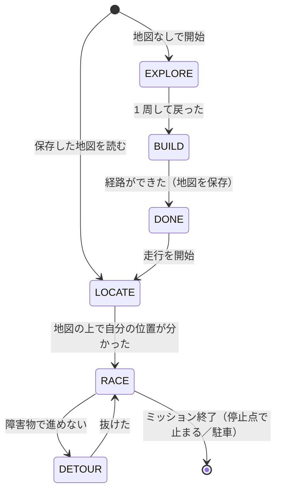

# 地図を作って走る（slam2d_route）

!!! summary "要点"
    - **最初の 1 周で LiDAR の地図を作り**、その地図の上で自分の位置を推定しながら、**計算した走行ラインで周回**する、SURGE Mark.2 の主力のモードです。
    - 分岐のあるコースでは、地図から**道路のつながり（道路グラフ）**を作り、経由点や矢印信号で経路を選びます。経由点が無ければ、見積もったラップタイムが一番短い周回ルートを自動で選びます。
    - 障害物や他の車は、走行ラインからの横ずれを時刻つきで計画して**追い抜き**ます。路面のグリップは走りながら学習します。

!!! info "【実機確認】（周回）＋【シム／ホスト検証】"
    対象: [`slam2d_route.py`][route-py]（[`slam2d_raceline.py`][raceline-py] の派生）、[`raspi/nav/`][nav-dir]、[`slam2d/`][slam-dir]。確認した版: 上位 `2d0a44e`。
    2026-11-09 の変更（解除後に経路に沿って止まる、など）は実機では未確認です（開発記録）。

## しくみ

### 走行の段階

| 段階 | すること |
|---|---|
| **EXPLORE**（地図作成） | 走行を許可していれば Follow the Gap で、していなければ人のラジコンで 1 周し、地図を作る |
| **BUILD**（経路づくり） | ループを閉じて地図を整え、道路グラフ・中心線・道幅・走行ラインを計算する |
| **LOCATE**（自己位置の復元） | 保存した地図の上で、今どこにいるかを探す |
| **RACE**（周回） | 走行ラインを追う。障害物や他の車は追い抜く |
| **DETOUR**（迂回） | 追い抜けない静止物を Hybrid A* で抜ける |

地図の作り方と自己位置の推定は [地図と自己位置推定](../mapping.md)、走行ラインと速度の決め方は [レーシングライン](../raceline.md)、追い方は [経路追従と速度指令](../tracking.md) で詳しく扱っています。
このページでは、**経路の選び方・終わり方・追い抜き**を中心に説明します。

!!! placeholder "画面 S-10：自動運転タブの地図パネル"
    作った地図の上に、走行ライン（速度で色分け）・自分の位置・経由点のグループが重なっている画面。

## 設計の詳細

### 経路を選ぶ — 道路グラフと経由点

地図作成で走った 1 周の軌跡だけを経路にすると、走らなかった分岐は選べません。
`slam2d_route` は**地図全体から道路グラフ**（`nav/roadgraph.py`）を作り、その上で経路を選びます。

| | `slam2d_raceline`（土台） | `slam2d_route`（主力） |
|---|---|---|
| 経路の元 | 地図作成の最後の 1 周の軌跡 | 地図全体の道路グラフ |
| 分岐 | 走った枝しか無い | 経由点で選ぶ |
| 道幅の測り方 | 地図全体で測る | 選んだ経路の回廊だけで測る（分岐の口で測りすぎない） |
| 走行中の切り替え | なし | グループ A〜D（GUI・矢印信号） |
| 終わり方 | 走り続ける | ミッション（n 周、または t 秒）を終えたら停止点で止まる、または駐車する |

- **経由点を置いていなければ自動で選びます。** スタートから出て戻る周回ルートを道路グラフ上で全部挙げ、それぞれに走行ラインを引いて、**見積もったラップタイムが一番短いもの**を選びます。
- ルールで通れない道は「避ける範囲」として地図に壁を塗ってから道路グラフを作ります。
- **走行中に経路を切り替えられます。** 経由点のグループ A〜D と自動経路を、GUI のボタンか、前方カメラで読んだ[矢印信号](camera.md#矢印信号を読む)で選びます。

!!! placeholder "画面 S-11：経路の設定（経由点のグループ）"
    地図の上に経由点を置き、グループ A〜D で色分けした画面。

### 重い計算は別のプロセスで

道路グラフ（Raspberry Pi で約 0.2 秒）や、経路ごとの走行ライン（1 本 0.1〜0.5 秒、仕上げ込みで数秒）を、10 Hz の計画ループの中で計算すると指令が途切れ、
指令の途絶を検知した安全機構が走行許可を外してしまいます。そこで重い計算は**別のプロセスのワーカー**に投げ、計画ループは毎周期出来上がりを確かめるだけにしています。

### 止まり方 — ミッションの終わり

ミッションが終わると、今の位置から停止点までの経路を道路グラフで引き、**終点でちょうど 0 m/s になる速度**で走ります。
最後は低速で這い、残り距離が「今の速度で止まれる距離」を切ったら制動します。
停止点が「駐車」なら、道の上で止まってから[駐車のモード](park.md)に引き継ぎます。静止してから渡すのは、駐車のモードが低速・局所の地図を前提にしているからです。

### 追い抜き — 時刻つきの Frenet 格子

障害物や他の車があると、走行ラインからの**横ずれ \(d(s)\)**（\(s\) は経路に沿った距離）の候補をまとめて作り、
障害物の**その時刻の位置**と重ならないものの中から、**抜ける時間が一番短いもの**を選びます（[`overtake.py`][overtake-py]）。
Werling ら（2010）の Frenet 格子、TUM の graph-based local planner、ForzaETH の Predictive Spliner と同じ考え方です。

$$
d(s) = \begin{cases}
\text{5 次多項式（今の横ずれから目標の横ずれへ）} & \text{入る} \\
d_T & \text{並ぶ} \\
d_T\,\bigl(1 - \mathrm{smoothstep}\bigr) & \text{戻る}
\end{cases}
$$

- **今の横ずれから出発する**ので、避けている途中・戻る途中でも毎周期引き直せます。
- **時刻で判定する**ので、同じ向きに走る遅い車は「抜く間に相手が進む」ぶんだけ並ぶ区間が伸び、抜く前に追いつかない候補は塞がれません。
- **形を決め打ちにしない。** 入る長さ・並ぶ長さ・戻る長さを格子状に振り、曲がれる限界まで使う短い入り方も候補に入れます。
- **避ける間も速度を抑えない。** 速度は曲率と摩擦だけで決め、安全は横と前後の余裕で確保します。

LiDAR に見えるのは物の手前の面だけなので、見えない奥行きを足して扱います（動く物は車 1 台分の長さ）。動く物は、時間とともに位置の不確かさが増えるとして範囲を広げます。
追い抜けない静止物は、DETOUR の段階で Hybrid A* を使って抜けます。

!!! placeholder "画面 S-12：追い抜きの計画"
    地図パネルに障害物（または他の車）と、選ばれた横ずれの経路が重なっている画面。シミュレータの画面でもよい。

### 走りながら路面を学ぶ

床の材質で変わるグリップは、事前に測るのではなく**走行中に学習**して速度に反映します（[レーシングライン](../raceline.md#4-走行中のグリップ学習-実機で悪化修正済み実機未検証)）。

- **横の上限**（どこまで横 G を使えるか）は、ラップタイムを手がかりに学習します。
- **前後の加速・減速の上限**は、横の使い具合ごとの包絡として学習します。
- **アンダーステアの強さ**も推定します。

学習した値は地図ごとに保存し、2 回目からは 1 周目から学習済みの値で走ります。

隣のしくみへ

- [駐車する](park.md)
- [LiDAR で空いている方向へ](lidar-reactive.md)

さらに深く

- [地図と自己位置推定](../mapping.md)
- [レーシングライン](../raceline.md)

[route-py]: https://github.com/banbatakumi/AutonomousCar_RasPi/blob/master/surge_mk2/raspi/auto/slam2d_route.py
[raceline-py]: https://github.com/banbatakumi/AutonomousCar_RasPi/blob/master/surge_mk2/raspi/auto/slam2d_raceline.py
[nav-dir]: https://github.com/banbatakumi/AutonomousCar_RasPi/tree/master/surge_mk2/raspi/nav
[slam-dir]: https://github.com/banbatakumi/AutonomousCar_RasPi/tree/master/surge_mk2/slam2d
[overtake-py]: https://github.com/banbatakumi/AutonomousCar_RasPi/blob/master/surge_mk2/raspi/nav/overtake.py
