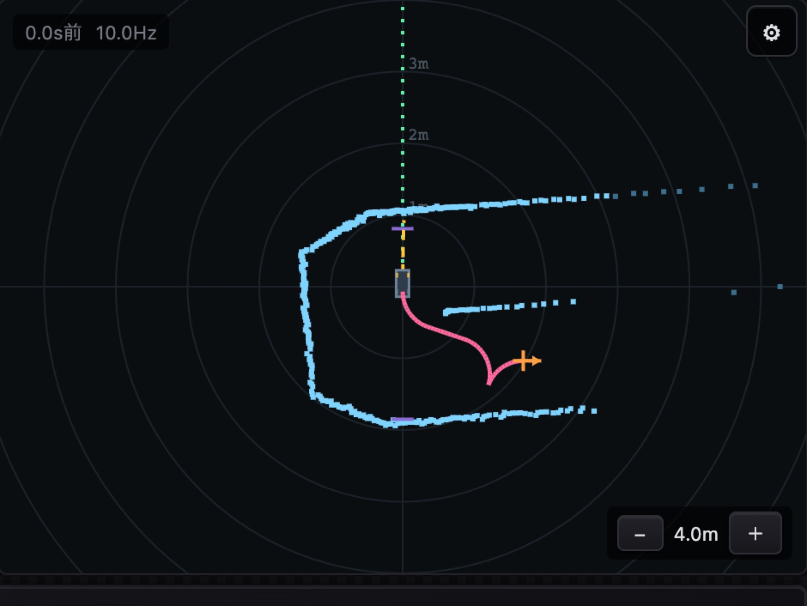

# 駐車する（park_to_point）

!!! summary "要点"
    - GUI の LiDAR の画面で**クリックとドラッグで指定した位置と向き**へ、事前の地図なしで、障害物を避けながら自分で入って止まるモードです。車庫入れも縦列駐車も同じ仕組みで行います。
    - 自分の位置は、クリックした瞬間の点群を基準にした**スキャンアンカ**で保ち、周りは**局所の占有格子**に溜め、経路は **Hybrid A\*** で引きます。
    - 地図を使う走行のミッションの最後に、停止点から引き継いで駐車することもできます。

!!! info "【シム／ホスト検証】"
    対象: [`park_to_point.py`][planner-py]、[`raspi/nav/`][nav-dir] の `scan_anchor.py`・`local_map.py`・`hybrid_astar.py`・`reeds_shepp.py`。確認した版: 上位 `2d0a44e`。
    数値はシミュレータ（`sim.park_bench`）の値です。Hybrid A* と局所地図を [C で書き直して](../../development/performance.md)からは、実機ではまだ走らせていません（開発記録）。

## しくみ

<figure markdown>
{ loading=lazy }
<figcaption>LiDAR の画面で目標（橙の矢印）をドラッグで置くと、後退してから前進で入る経路（桃色）を引く。この例では残り 2.4 cm・向きの誤差 3.6° で到達した（シミュレータで撮影）。</figcaption>
</figure>

## 設計の詳細

### 自分の位置 — 地図ではなくスキャンアンカ

駐車では SLAM の地図を使いません。代わりに、**クリックした瞬間の点群を基準**にして、その後の点群との重ね合わせ（点対線 ICP）で姿勢を保ちます。

壁際をクリックした人の意図は「**あの壁に対して**この位置」です。推定がドリフトすると、駐車枠そのものが実際の壁に対して静かに動き、
間違った場所で「完了」と言ってしまいます。**誤差が誤差として現れず、成功として現れる**のが怖いところです。

| 自己位置の方法（シム、センサ誤差あり） | 成功 | 最終位置の誤差 |
|---|---|---|
| 推測航法だけ | 2/12 | 16.3 cm |
| スキャンアンカ | 7/12 | 6.1 cm |

精度を一番左右したのは、**対応点として認める距離**でした。「1 周期ぶんの移動」を想定した 0.30 m では別の壁と誤って組んでしまい、0.08 m にすると推定誤差が 3.65 cm から 0.96 cm になりました。

### 周り — 一度見た壁を忘れない局所地図

瞬間の点群をそのまま使うのをやめ、**1 cm の格子に溜めます**。

- 点群は物陰と角度の粗さで、**駐車枠の内側が見えていない**ことがありました。車庫入れの配置では、3 割の地点で実際より 3 cm 以上「余裕がある」と誤認していました（最大 21 cm）。
- 格子に溜めれば、後退中に前方が視野から外れても、一度見た壁を覚えています。
- **「見えていない所」を「空いている所」と混ぜません。** 壁は通れない拘束、見えていない所はコストとして扱います。
- 長方形の車体は、障害物までの距離場（ESDF）に対して 5 × 3 個の円で覆って判定します（前後 1.1 cm・左右 1.8 cm だけ安全側にはみ出す）。

### 経路 — Hybrid A*

「Reeds-Shepp の候補を短い順に試して、ぶつからない最初のものを選ぶ」方式では、回避できる形が候補の範囲に限られます。
実測では、車庫入れの 43 %・縦列の 78 % でしか回避経路が見つかりませんでした。**Hybrid A\* では 32/32** で見つかりました。

計画には時間の上限（既定 120 ms）があり、間に合わなければ Reeds-Shepp の候補に落とします。「動かない」より「少し進んで別の姿勢から引き直す」方が、次の機会に解けるからです。
曲率は車の限界の 0.95 倍で計画し、追従の誤差を舵で詰める余地を残します。

### 追従 — 前進も後退も閉ループで

舵を経路の曲率から直接出すだけだと、誤差を直すには区間を全部走り終えてから引き直すしかなく、位置 2〜6 cm・向き 4〜6° の残差で切り返しがもう一巡増えていました。
そこで経路からの横ずれと向きのずれを、曲率にフィードバックします。**後退では向きの項の符号が反転する**ことに注意が要ります。

前進と後退を切り替えるときは必ず止まり、**止まっている間に次の区間の舵を作っておきます**。切り替えた直後に舵が追いつかず、違う曲率で走り出すのを防ぐためです。

### 安全 — 車体が掃く範囲で確かめる

進行方向の扇の中の最近点だけを見る方式では、旋回中に車体の前後が振り出す範囲を見られず、経路にぶつかる障害物の 16 % が衝突まで扇に入りませんでした。
今は、**制動距離ぶん車体が掃く範囲**を、今の点群と溜めた地図の両方に当てて確かめます。塞がれていたら止まるだけでなく、**その場で経路を引き直します**。

!!! bug "計画と安全確認の基準が食い違うと、30 秒以上止まったり動いたりを繰り返した"
    計画が受け入れた経路を、安全確認が別の余裕の値で拒否すると、制動と引き直しが交互に続きました。判定の余裕は、計画と安全確認で同じ値を共有するようにしています。

### 自動停止は切って使う

STM32 の自動停止は「進む方向への接近そのもの」を止める仕組みで、「目的地に意図的に近づいて止まる」駐車とは原理的にぶつかります。
このモードだけは自動停止を切って使い、代わりに上の掃引による安全確認で守ります。

隣のしくみへ

- [地図を作って走る](map-driving.md)
- [対象を追う](follow.md)

さらに深く

- [安全層（自動停止）](../../control/safety.md#自動停止)
- [地図と自己位置推定](../mapping.md)

[planner-py]: https://github.com/banbatakumi/AutonomousCar_RasPi/blob/master/surge_mk2/raspi/auto/park_to_point.py
[nav-dir]: https://github.com/banbatakumi/AutonomousCar_RasPi/tree/master/surge_mk2/raspi/nav
