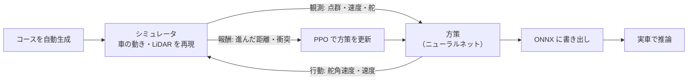

# 強化学習（LiDAR E2E）

!!! summary "要点"
    - LiDAR の点群から**舵と速度を直接出す方策**を、シミュレータの中の試行錯誤（強化学習）で学ばせ、実車で動かすモードです。
    - 手本を真似る模倣学習と違い、「コースに沿って進めたら得点、ぶつかったら減点」だけを頼りに学ぶので、**手本を超えうる**一方、見たことのない場面での振る舞いは保証できません。
    - 学習の大半は「何を罰するか」ではなく、**舵が振動する原因を突き止めること**に費やしました。

!!! info "【シム／ホスト検証】＋【実機確認】（動作）"
    対象: 実車側 [`e2e_lidar.py`][planner-py]、学習側 [`ml_lidar/`][ml-dir]（`env.py`・`train_rl.py`）。確認した版: 上位 `2d0a44e`。
    シミュレータでの新しい学習は、現在は止めています（開発記録）。数値はコードのコメントと開発記録からの引用です。

## しくみ

- **アルゴリズム**: Stable-Baselines3 の PPO。
- **報酬は最小構成**: コースの中心線に沿って進んだ距離（時間あたり）、衝突で減点して終了、完走でボーナスして終了。報酬の正規化やカリキュラム学習は入れていません。
- **コースは毎回自動生成**します（`course_gen.py`）。手描きのコースは観戦専用で、学習には使いません。
- **実車への持ち込み**: 学習した方策を ONNX に書き出し、実車の GUI からモデル名で選びます。読み込みに失敗しても、走行中のモデルを保持したまま続けます。

### シミュレータは実機の LiDAR の読み方まで通す

シミュレータの仮想 LiDAR は、実機と同じ形のデータを作り、**実機と同じ組み立て処理**（裏向き実装による鏡像の反転、欠測の扱い）を通してから方策に渡します。
学習と実車で「点群の意味」がずれないようにするためです。観測・行動の変換も、学習側と実車側で対になる関数にまとめています。

!!! placeholder "画面 S-09：強化学習の操作パネル（ml_lidar）"
    学習タブ（基本パラメータ）と、学習中の方策がコースを走る観戦画面。学習曲線（TensorBoard）も撮れれば並べたい。

## 設計の詳細

### 舵の振動との戦い

最初の課題は、学習した方策の**舵が細かく左右に振れる**ことでした。決定論的に動かしても、隣り合うステップで舵の符号が反転する割合が 8〜11% ありました。

#### 1. 行動を「舵角」から「舵角速度」に変えた

報酬で舵の変化を罰する、探索ノイズの構造を変える、という間接的な方法を尽くしても振動は消えませんでした。
文献（"Is Bang-Bang Control All You Need?"）で、連続値の方策は報酬や探索の設計に関わらず両極端に振れやすい構造的な傾向があると確かめたうえで、
**方策が出すのを「舵角の変化の速さ」にし、1 ステップで動ける量そのものに上限をかけました**。滑らかさを期待するのではなく、構造で縛る方法です。

#### 2. 制御周期を LiDAR の回転（10 Hz）に合わせた

決定的だったのは、**振動がどのステップで起きているか**の内訳でした。

| | 舵の変化の大きさ | 隣り合うステップの符号反転率 |
|---|---|---|
| 点群が前回と同じステップ | 0.056 | **0.2 %** |
| 点群が新しくなったステップ | 0.139 | **13.7 %** |

LiDAR は 1 秒に 10 回転なので、20 Hz で制御すると**半分以上のステップで点群が前回と同じ**です。
方策は、同じ点群の間は滑らかに進み、新しい点群が来るたびに大きく舵を振り直していました。

さらに実車では、走行モードは**新しい点群が来たときだけ**計算されるので、実質 10 Hz で動きます。
20 Hz で学習した方策を 10 Hz で動かすと、1 回の判断で動く舵の量が 2 倍になり、舵の応答の遅れの効き方もずれます。実車で「舵が発散して壁に当たった」ことの有力な説明でした。
制御周期を 10 Hz にすると、点群が前回と同じステップは 54 % から 10 % に減りました。

!!! note "観測ノイズは主因ではなかった"
    先に LiDAR のノイズを疑いましたが、ノイズを完全に切っても舵の変化は 0.116 → 0.102 にしか下がりませんでした。実機相当のノイズが生む舵の振れは、観測された振れの 5 % 程度でした。

### 舵を罰する報酬は入れない

ラップタイムを分解すると、**失っていたのは走行ラインではなく速度**でした。走行距離は理想のライン（最小曲率線）の 0.98〜1.04 倍でほぼ同じなのに、平均速度は理想の 0.80〜0.83 倍でした。
しかも速度が出ないのは報酬の設計のせいではなく、**舵の精度の帰結**でした。スロットルを 10 % 持ち上げるだけで、衝突率が 6 % から 16 % に上がったのです。

そこで、舵を罰する項はすべて外しました。試して外した項は次のとおりです。

| 試した罰則 | 結果 |
|---|---|
| 舵の変化（隣り合うステップの差） | 重み 0.03〜0.2 で単調に悪化 |
| 舵角速度の大きさ | 単独の効果を確認できなかった |
| 理想のラインからの横ずれ | 2 連敗。そもそも走行距離はすでに理想の ±4 % 以内だった |
| 舵角の大きさ | ラップが理想の 1.24 倍 → 1.42 倍と最悪。文献（Evans ら 2021）が報告する「コーナーを非常に下手に曲がる」失敗そのもの |

舵の滑らかさは、報酬ではなく、学習の損失に滑らかさの項を加える方向で攻める方針です。

### モデルの選び方 — 評価の落とし穴

- **評価用のコースを 7 種類に固定**しています（直線主体・コーナー主体・中間・ヘアピン主体・連続シケイン主体・広い・広いうえに急角が続く）。
  広いコースが無いと道幅 1.0〜1.1 m しか評価せず、実機で不安定になった広いコースでの失敗がモデル選びに現れなかったためです。
- ただし、決まった方策を決まったコースで走らせても、同じ軌道を繰り返すだけで、得られる情報は「7 本それぞれの成否」だけです。
  そこで実際のモデル選びは、**毎回違う乱数で作ったランダムなコース**での統計で行います。

!!! bug "乱数の系統を固定して評価すると、結論が逆転した"
    ある乱数の系統（100 本）では v2 の衝突 0 %・v1 の衝突 3 % に見えましたが、別の系統を足して 550 本まで増やすと v1 2.2 %・v2 5.5 % で、**結論が逆転しました**。
    それ以来、評価の乱数は学習の進み具合から毎回作り直しています。

隣のしくみへ

- [模倣学習（カメラ E2E）](imitation.md)
- [LiDAR で空いている方向へ](lidar-reactive.md)

さらに深く

- [検証の仕組み（シミュレータ）](../../development/workflow.md)
- [補助ツール](../../development/tools.md)

[planner-py]: https://github.com/banbatakumi/AutonomousCar_RasPi/blob/master/surge_mk2/raspi/auto/e2e_lidar.py
[ml-dir]: https://github.com/banbatakumi/AutonomousCar_RasPi/tree/master/surge_mk2/ml_lidar
