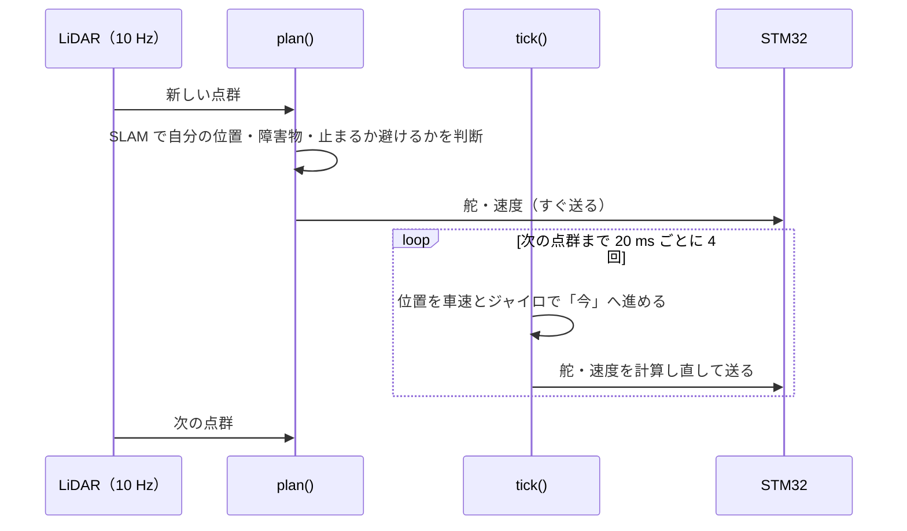

# 経路追従と速度指令

!!! summary "要点"
    - 決まった走行ラインを追うのは、**舵**（Raspberry Pi が計算）と**速度**（STM32 の車速 PI が追う）の 2 つに分かれます。
    - 舵は Pure Pursuit を基本に、指令が効くまでの遅れを見込んで先回りします。MPC による追従も選べます。
    - 速度は、指令が効くころに居る場所のプロファイルを渡し、STM32 の加速度フィードフォワードに加減速を任せます（無効なときは、STM32 側の追従の遅れを見込んで指令を前倒しします）。

!!! info "【シム／ホスト検証】＋【実機確認】（周回で使用）"
    対象: [`purepursuit.py`][pp-py]、[`mpc.py`][mpc-py]、[`speedctl.py`][speedctl-py]、[`understeer.py`][us-py]、[`slam2d_raceline.py`][raceline-py] の追従と速度指令の部分。確認した版: 上位 `2d0a44e`。
    MPC 追従（`ctrl_mode` = 1）は 2026-10-13 の実機走行の解析にも登場します（開発記録: MPC の修正で舵指令の毎周期の反転が 47〜68 % → 20 %）。
    Pure Pursuit との実機での優劣の比較記録は確認できていません。

経路（レーシングライン）と速度プロファイルが決まったら、それを追う側は**舵**と**速度**の 2 つに分かれます。
舵は Pi が計算し、速度は **STM32 の車速 PI が追う**ので、その遅れを Pi 側が見込んで先回りする、という分担です。

## Pure Pursuit

後輪軸中心を原点とした自転車モデルで、目標点への方位 \(\eta\) と前方注視距離 \(L_d\) から舵角を決めます。

$$
\delta = \arctan\!\left(\frac{2L\sin\eta}{L_d}\right),\qquad L_d = k_v\,v + L_{\min}
$$

- \(L\): ホイールベース 0.23 m。基準点を後輪軸に置いているのは、Pure Pursuit の標準式が後輪基準で書かれているからです。
- **\(L_d\) は速度に比例**させます。固定にすると、低速では大回りし、高速では蛇行が発散します。

### 遅延補償

ステアリングは 50〜200 ms 遅れ、UART の往復と Python の処理でさらに 30〜50 ms 乗る、という見積もりがコードにあります
（実測では操舵そのものはほとんど遅れない: [システム構成](../about-car/system.md#時刻と遅延)）。合計 150 ms は 3 m/s で **45 cm 先**です。
現在位置で目標点を選ぶと、その 45 cm ぶん常に手遅れの舵を切ることになります。

そこで、**判断する場所を `t_delay` 秒後の予測位置へ進めます。** 予測は、今の速度と実舵角を使った自転車モデルです（`[dynamics]` が既定値を与える）。

地図を使うモード（`slam2d_raceline`・`slam2d_route`）では、`t_delay` を手で決めず、**校正で測った値から決めます**（`steer_delay`）:
舵のむだ時間 ＋ 舵の 1 次遅れ ＋ ヨーの遅れ \(2\zeta/\omega_n\) ＋ 指令が STM32 に受理されるまでの遅れ（遅延の校正の値）。今の `vehicle.toml` では約 0.04 秒です。
追従に使う姿勢はすでに車速とジャイロで「今」へ進めてある（[点群の合間も 50 Hz で追う](#tick-50hz)）ので、姿勢の古さの手当ては含めません。
手で足せるのは補正 `delay_trim`（既定 0）だけです。

### 速度はすぐ先のプロファイルから読む

舵の注視点（遅延予測 ＋ \(k v + L_{\min}\)）の速度をそのまま指令すると、2 m/s で約 1.5 m・0.75 秒先の速度を今出すことになり、
**コーナーの手前で早く減速しすぎ、立ち上がりでは早く踏みすぎます。** 速度は、遅延予測の位置から `v · speed_preview_s` だけ先の値にします。

### 曲率フィードフォワード

Pure Pursuit は「今の位置から注視点へ届く円弧」の曲率を出すので、経路の上に**ぴったり乗っていても**、注視区間（3 m/s で約 1.6 m）で平均した曲率で曲がります。
曲率が変わり続ける S 字では、これが**内側を切る定常的な偏り**になりました（3 m/s で ±15 cm、横 G を上げると衝突）。
「車が経路の点 \(i\) に経路の向きでいたら Pure Pursuit が出す曲率」\(\kappa_{\mathrm{ideal}}\) を求め、その点の経路の曲率 \(\kappa_{\mathrm{path}}\) との差を足します。

$$
\kappa = \kappa_{pp} + g\,(\kappa_{\mathrm{path}} - \kappa_{\mathrm{ideal}})
$$

経路上にいれば \(\kappa = \kappa_{\mathrm{path}}\)（偏りなし）で、ずれの修正は Pure Pursuit のまま残ります。

### 曲率から舵角へ — 舵の効きとアンダーステア { #steer-map }

Pure Pursuit も MPC も「欲しい曲率」を出し、それを指令の舵角に換算します（`SteerMap`）。換算は 2 段です。

- **舵の効き**: 実際の舵角と、運動学の式 \(\kappa = \tan\delta / L\) で効く舵角の関係を、校正で測った 3 次式で表します（`[dynamics]`）。
  `atan(L·κ)` をそのまま指令すると、経路の上に乗っていても曲率が足りません（コメントの例: 同定値で κ = 2.0 のとき 91 %、半径 0.5 m で外へ 1.5〜6.6 cm）。
- **アンダーステア**: 速く曲がると、同じ舵でも曲がり方が足りなくなります。\(\kappa = \tan\delta / (L + K v^2)\) として、
  アンダーステア勾配 \(K\) のぶん舵を足します。\(K\) は床とタイヤで変わるので、校正ではなく**走りながら推定**します（`nav/understeer.py`、`us_learn` 既定 1）。
  2026-11-02 の実機（\(K\) を入れていない MPC）は、横加速度 3〜5 m/s² のコーナーで経路の外へ中央値で 4〜5 cm 膨らんでいました。

\(K\) の推定は \(\tan\delta - L r/v = c + K\,(v r)\)（\(r\) はヨーレート）の当てはめです。ジャイロの雑音が両辺に入って最小二乗では \(K\) が小さく偏る
（実機の記録で約半分）ので、ジャイロを含まない \(v^2\tan\delta/L\) を操作変数にします。舵が動いている・遅い・前後に加減速している・舵が上限の標本は使いません
（制動中は後輪の横滑りで回り込み、\(K\) を下げ続けた。舵が上限の所は前輪が飽和して \(K\) を引き上げた）。舵が上限の所で実際に出た横加速度は
別に `a_lock` として学び、速度の計画に使います（[レーシングライン](raceline.md#3-速度プロファイル)）。値は地図ごとに保存します。

!!! note "横偏差は「評価」であって「入力」ではない"
    `cross_track` は Pure Pursuit の計算に入りません（目標点への方位だけで決まる）。走りの良し悪しを人間が読むための数字として返しています。
    これが増え続けるなら、前方注視か遅延補償が合っていません。

## 点群の合間も 50 Hz で追う { #tick-50hz }

LiDAR は 1 秒に 10 回転なので、点群が新しくなるのは 100 ms ごとです。走行モードの計算（`plan()`）も、新しい点群が来たときだけ回ります。
一方、指令（`auto/cmd`）は 50 Hz で STM32 へ送っています。以前はその中身が**次の点群まで同じ値の繰り返し**で、3 m/s では次の判断までに 30 cm 進んでいました。

そこで地図を使うモード（`slam2d_raceline`・`slam2d_route`）では、**点群の合間も 50 Hz で追従をやり直します**（`tick()`）。
LiDAR が 50 Hz になるわけではありませんが、追従から見ると、自分の位置が 50 Hz で更新されているのと同じ効果があります。

- **やり直すのは追従（舵と速度）だけ**です。止まる・避ける・自分の位置の判断は、点群が来たときの `plan()` のまま変えません。
- 自分の位置は、直近の SLAM の結果を**車速とジャイロで今の時刻へ進めた**もの（推測航法）です。SLAM と同じ補正（ジャイロのゼロ点・車速の倍率）を掛けます。
  時刻が 0.5 秒以上食い違うときは進めません。
- 働くのは周回中（RACE）に経路を追っているときだけです。制動・停止・発進・Hybrid A* での迂回・経路に乗る前は、点群ごとの 10 Hz のままです。
  障害物の手前などで速度を抑えた判断は、その値を上限として合間にも持ち越します。
- これは、曲がれる限界の近くで横 G を経験則で削らずに済む理由の 1 つでもあります（[レーシングライン](raceline.md#3-速度プロファイル)）。

!!! note "100 Hz にしても変わらなかった"
    合間の更新を 100 Hz にする案も試しましたが、シミュレータではラップが 0.13 % 縮むだけで、効果は見られませんでした。
    シミュレータでは姿勢の古さを実機どおりに再現できないので、試すなら実機での比較が要る、という結論にしています（開発記録）。

## MPC による追従（代替）

Pure Pursuit の代わりに**舵だけ**を決めます（速度は経路の速度プロファイルをそのまま使う）。`follow()` と同じ引数・同じ `Pursuit` を返すので、planner が差し替えるだけで比較できます。

経路に対する横偏差 \(e_y\) と向きの偏差 \(e_\psi\) の線形化自転車モデル

$$
\dot e_y = v\sin e_\psi,\qquad
\dot e_\psi = \frac{v\tan\delta}{L} - \frac{\kappa_{\mathrm{ref}}\, v}{1-\kappa_{\mathrm{ref}}\,e_y}
$$

を、\(\delta_{\mathrm{ref}} = \arctan(L\kappa_{\mathrm{ref}})\)（曲率を丸ごと打ち消す舵角）の周りで線形化します。\(e=0,\ \delta=\delta_{\mathrm{ref}}\) が平衡点なので、フィードフォワードは別に要りません。
むだ時間は、初期状態を `delay_s` 先へ進めて扱います。そのとき、**出したがまだ効いていない自分の指令**を、効き始める時刻の順に当てはめて進めます（Smith 予測器、`_predict_delay`）。
今の舵角のまま進める予測（Pure Pursuit の `_predict`）では、舵が速く動くと予測が外れて振動しました。指令の履歴は時刻で持つので、点群の合間の 50 Hz で呼んでも崩れません。

- 決定変数は各ステップの舵角、コストは \(\sum (q_y e_y^2 + q_\psi e_\psi^2) + r_u\sum(\delta-\delta_{\mathrm{ref}})^2 + r_d\sum(\Delta\delta)^2\)。
- `numpy` だけで N×N の QP にし、箱制約（舵角限界と舵角レート）を**射影ニュートン法**で解きます。
  **FISTA は条件数が悪く 40 反復でも収束せず、舵が振動した**ので使いません。`scipy`・`cvxpy` は Pi の依存に無いので使いません。
- 制約なしの解析解を箱へ射影して初期値にするので、制約が効かない場面（ほとんど）はその場で収束します。

## 速度指令

STM32 は目標車速をランプでならし、PI でトルクにします（[駆動制御](../control/drive.md)）。地図を使うモードの速度指令は、STM32 の
**加速度フィードフォワード**（目標車速の傾きに要るトルクを先に足す、プロトコル v0.21〜）が有効かどうかで 2 通りに分かれます
（`Slam2dRaceLine._speed_cmd`）。有効かは `vehicle.toml` の `[control] speed_ff_nm_per_m_s2` が 0 より大きいかで決まり、今の設定は有効です。

### フィードフォワードが有効なとき — プロファイルをそのまま渡す（`ref_command`）

- 目標速度 = **指令が効くころに居る場所**のプロファイルの速度。先読みの時間は「次の指令までの半周期 ＋ 指令が STM32 に受理されるまで（遅延の校正の値）
  ＋ ファームが目標車速の傾きに掛けるローパスの時定数（`speed_ff_filter_s`）」で、どれも実測か既知の定数です（`_ref_lead`）。
- ランプ（`accel_limit`）= その場所のプロファイルの加速度 × 1.1（下限 0.3 m/s²）。車速がプロファイルからずれていれば、そのずれを速度 PI の時定数で詰められる傾きまで許します。

STM32 の目標がプロファイルと同じ傾きで動き、PI は残ったずれだけを直すので、下の前倒し（経験則の係数・比例項の逆算・ハイパス）は要りません。

**加速のランプは、今の横の使い具合で前へ使える加速度で頭打ちにします**（`_room_cap`。学習した前後の包絡、学習していなければ摩擦円の残り）。
横の使い具合は、線の曲率から出す値と実測（ヨーレート × 車速）の大きい方です。ずれを詰める項があるので、頭打ちが無いと横を使い切っている所でも包絡を超えて加速し、
2026-11-06 の実機の記録ではヘアピンの出口でリアが出た瞬間に 2.3〜3.2 m/s² を送っていました。

車速がプロファイルよりずっと低いとき（迂回の後・走り出し・減速の後）は、どちらの方式でも、先 6 m を「今の車速から摩擦円の中で加速して届く速度」に置き換えてから使います（`catch_up`）。
そのまま追わせると、次のコーナーへ全開で加速しながら入り、外へ膨らんで壁に当たりました（シム）。

### フィードフォワードが無効なとき — 前倒し（`SpeedFF`）

ランプは指定せず（STM32 の既定のランプ）、Pi 側で速度 PI の遅れを見込んで前倒しします。
比例項だけで見ると、加速度 \(a\) を出すには「目標 − 車速」が \(a \times T_v\)（\(T_v = 1/(\text{車体の利得}\times K_p)\)。同定値から決まり、今の `vehicle.toml` で約 0.07 s）だけ必要です。
**経路の速度をそのまま送ると、車速はその分だけ遅れます。** 加速では遅いだけですが、**減速ではコーナーへ速すぎる速度で入ります**
（実車のヘアピン進入で、目標 0.7 m/s に対して 1.2〜1.3 m/s だった）。

$$
v_{\mathrm{cmd}} = v(s') + T_v\cdot \mathrm{HP}\bigl[a(s')\bigr] + k_{fb}\,\bigl(v(s) - v_{\mathrm{meas}}\bigr)
$$

| 項 | 意味 |
|---|---|
| \(v(s'),\ a(s')\) | 経路の速度プロファイルと、その傾きから出した加速度（\(a = v\,dv/ds\)） |
| \(T_v\,a\) | PI の比例項の**逆算**。等加速度で走っている間の遅れを消す |
| \(\mathrm{HP}[\cdot]\) | 時定数 \(K_p/K_i\) のハイパス。長く続く加減速では PI の積分が比例項を引き継ぐので、足したままにすると行き過ぎる（線形の範囲では、これが PI ＋ 車体の厳密な逆モデルになる） |
| \(s'\) | **減速は `lead_s` 秒先、加速は `lead_acc_s` 秒先**の点（2 つの候補のうち**目標が低くなる方**を採る）。減速だけ早めに始め、加速は早めない（コーナー出口で早く踏むと、まだ曲がっている所で速度が出る） |
| \(k_{fb}\) | 車速がプロファイルから外れたぶんを目標に足し戻す（同定値のずれ・TC の介入の保険） |

値は `Vehicle`（`vehicle.toml` の同定値）と指令の遅れから決まり、手で合わせる数字は減速の前倒しの係数 `LEAD_RATIO`（0.65、経験則）だけです。

!!! note "ファームの時定数との突き合わせ"
    STM32 の加速度フィードフォワード（\(\tau = 20\) ms のローパス、Pi の指令周期そのもの）の値は、Pi 側では
    `vehicle.toml` の `[dynamics] speed_ff_filter_s` だけが持ち、planner（`ref_command` の先読み）とシミュレータの両方がそこを読みます
    （[駆動制御](../control/drive.md#車速-pi--加速度フィードフォワード)）。ファームの値とずれていないかは
    `tools/fwsim/tests/test_fw_constants.py` が確かめます。

## 設計の要点

- **下位の遅れを上位が先回りして吸収する。** 下位のモデル（ここでは PI ＋ 車体の逆モデル）を上位に持たせると、ランプや PI を変えたときにここも直す必要が出る。
  そのための同期箇所がコードのコメントで明示されている。
- **ある量を評価に使うか入力に使うかを区別する。** 横偏差は評価専用。
- **安全の判断を速度プロファイルに混ぜない。** 近づきすぎの停止は STM32 の `auto_stop` に任せる。

[pp-py]: https://github.com/banbatakumi/AutonomousCar_RasPi/blob/master/surge_mk2/raspi/nav/purepursuit.py
[mpc-py]: https://github.com/banbatakumi/AutonomousCar_RasPi/blob/master/surge_mk2/raspi/nav/mpc.py
[speedctl-py]: https://github.com/banbatakumi/AutonomousCar_RasPi/blob/master/surge_mk2/raspi/nav/speedctl.py
[us-py]: https://github.com/banbatakumi/AutonomousCar_RasPi/blob/master/surge_mk2/raspi/nav/understeer.py
[raceline-py]: https://github.com/banbatakumi/AutonomousCar_RasPi/blob/master/surge_mk2/raspi/auto/slam2d_raceline.py
