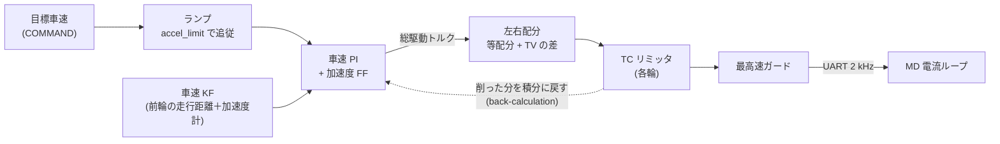
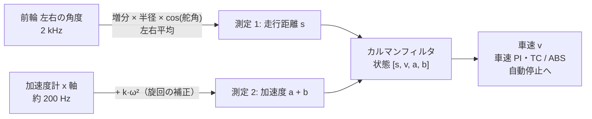

# 駆動制御（車速 PI）

!!! summary "要点"
    - Raspberry Pi は**目標の車速**を送るだけで、車速を合わせる閉ループは STM32 の中で完結します。
    - 車速は**駆動していない前輪**の走行距離と加速度計を、**カルマンフィルタ**で組み合わせて測ります。後輪の周速との差が、そのまま「滑り」として分かります。
    - 車速 PI に加速度のフィードフォワードを足し、止まるときもトルク 0 を送り続けるなど、実機で踏んだ問題への対策を入れています。


!!! note "【設計の説明】"
    対象: [`src/control/drive.c`][drive-c] / [`drive.h`][drive-h]。確認した版: ファーム `2a2e9a8`。
    加速度フィードフォワードとローンチコントロールは **【未検証】**（[検証状況](../development/status.md)）。

後輪 2 輪をトルク指令で動かし、**車速の閉ループを STM32 の中で完結**させています。
Pi は目標車速（と加速度の上限）を送るだけです。

## 全体のカスケード



内側の電流（トルク）ループは MD 側にあり、STM32 はトルク指令だけを出します。

## 車速をどう測るか — 走行距離と加速度計のカルマンフィルタ { #speed-kf }

**車速の基準は、駆動していない前輪**から取ります。駆動輪の速度は空転すると真の車速から離れますが、
前輪は転がっているだけなので、**後輪の周速との差が「滑り」としてそのまま計算できます**。TC と ABS の前提です。

ただし前輪の角度センサ（AS5600 のアナログ出力を 12 bit の ADC で読む）は分解能が粗く、そのまま速度にはできません。
そこで STM32 は、**前輪の走行距離と加速度計をカルマンフィルタで組み合わせて**車速を出しています（[`speed_kf.h`][kf-h]・[`speed_kf.c`][kf-c]）。
車速 PI・TC と ABS のスリップの基準・自動停止の前後の判定は、すべてこの 1 つの車速を使います。

!!! note "確認した版"
    この節はファーム `6b5bdb3` の `speed_kf.h` と `drive.c` のコメントから書いています。

### 微分＋ローパスでは足りなかった

1 LSB は 2π/4095 = 1.53 mrad で、500 µs ごとに微分すると **1 LSB が 0.09 m/s に化けます**。
これをローパスで落とそうとすると、**ノイズを落とす時定数と遅れが両立しません**（時定数 10 ms なら遅れも 10 ms、5 ms にするとノイズが倍）。
遅れた車速は、加速中にスリップ率の偏りになり、TC が「常に空転している」と誤って判断する原因になります。

### しくみ



- **状態は 4 つ**: 走行距離 \(s\)、車速 \(v\)、加速度 \(a\)、加速度計のバイアス \(b\)。
  予測は「加速度がジャークの白色雑音で変わる」等加速度モデルで、バイアスはゆっくり動く（ランダムウォーク）とします。
- **測定 1（毎周期 2 kHz）は速度ではなく走行距離**です。前輪の角度の増分 × 半径 × \(\cos\delta\)（前輪は操舵されているので車体前後へ射影）を左右で平均して積みます。
  微分しないので、量子化ノイズが速度に化けません。
- **測定 2（IMU のサンプルごと）は加速度計の x 軸の生の値**です。重力や取付のずれはバイアス \(b\) が吸収します。加速度計が動きを先読みし、距離が速度の正しさを保証する、という分担です。

!!! example "手押しでの実測（コードのコメントより）"
    加速度 ±6 m/s² の手押しで、前輪の微分＋ローパス（τ 10 ms）と比べると、動いているときの誤差 19 → 4.7 mm/s、遅れ 10 → 1 ms、静止中のノイズ 2.5 → 1.0 mm/s。
    これは調整値が σs = 0.03 mm・σa = 0.3 のときの値で、**今の既定値（σs = 0.8 mm・σa = 0.6）での実機の値はまだ測っていません**（シミュレータで真値と比べた 2〜5 mm/s があるだけです）。

### 実機で踏んだ問題と対策

**旋回中の加速度計の系統誤差。** 加速度計は車体の回転中心より前に付いているので、旋回すると前後の軸に \(-k\,\omega^2\) が乗ります（\(\omega\) はヨーレート）。
走行記録（238 秒）で「加速度計 − 車速の微分」を \(\omega^2\) に回帰すると係数 −0.153 で、速度域によらずほぼ一定でした。
そこで測定に \(+k\,\omega^2\)（\(k\) = 0.15 m）を足してから使います。補正しないと、最大のヨーレートで −3 m/s² の誤差になり、バイアスの状態では追いきれません。

**走行距離の雑音は「水増し」してある。** 静止中に測った走行距離の雑音は 0.022 mm ですが、調整値 σs は **0.8 mm** にしています。
前輪の角度センサには**角度に固定された周期的な誤差**（1 回転に 2 周期、位置にして約 0.2 mm）があり、0.03 mm のままだとこれを「正しい測定」として速度の揺れに通してしまったためです。
σs を大きくすると、高い周波数は加速度計が受け持ち、揺れが抑えられます。**これは理論から出した値ではなく、白色でない誤差を通さないための経験値**です（周期誤差そのものは、エンコーダの校正で角度ごとに補正しています）。

| シミュレータ（真値あり）での車速の誤差 | 周期誤差 0 % | 2 % | 3 % |
|---|---|---|---|
| ローパス | 15.6 mm/s | 20.8 mm/s | 24.7 mm/s |
| KF（σs = 0.03 mm） | 1.3 mm/s | 16.6 mm/s | 24.1 mm/s |
| **KF（σs = 0.8 mm・σa = 0.6）** | **2.0 mm/s** | **4.8 mm/s** | **5.1 mm/s** |

**外れ値と、戻れなくなる事故。** 前輪のロックやスリップ、段差の衝撃で予測と大きく食い違う測定は、差が大きいほど測定の雑音を膨らませて効きを弱めます（6σ のゲート）。
ところが走行距離の残差は累積値なので、車速が一度ずれると残差が毎周期増えてゲートが掛かりっぱなしになり、**二度と戻れなくなります**。
実機では車速が 32.767 m/s（テレメトリの上限）に張り付き、リセットまで戻りませんでした。
今は、ゲートが 20 ms 続いたら、その間の走行距離 ÷ 時間で車速を測り直します。20 m/s を超える車速は物理的にありえないので、それも測り直します。

### 調整値を、真値なしで検定する

カルマンフィルタは測定のたびに「残差 ÷ 自分が主張する標準偏差」\(z\) を作れます。前提（雑音の大きさ）が現実と合っていれば、\(z\) は平均 0・分散 1 の白色雑音になります。

- **NIS**（\(z^2\) の平均）: 1 より大きければ、誤差を小さく見積もりすぎています。1 より小さければ、大きく見積もりすぎています。
- **隣り合う \(z\) の相関**: 0 でなければ、残差に時間的な癖があります（周期誤差やモデルの不足）。

STM32 はこの 2 つを走行距離・加速度の別にテレメトリで送り、Pi 側のツール（`kf_consistency.py`）が記録から検定します。
走行中の走行距離の NIS は 0.4〜0.6、相関は約 0.96 で、**残差が白色でない**ことが数字で分かっています（上の周期誤差）。
調整値は、記録から最尤推定で決め直すツール（`tools/calib/kf.py`）も用意しています（[校正](../development/tools.md#車両の校正)）。

## 目標車速のランプ

Pi が送った目標（`speed_setpoint`）に、実際の目標（`target_speed`）が `accel_limit` の傾きで追従します。

```c
step = accel_limit * dt;
target_speed += clamp(setpoint - target_speed, -step, +step);
```

- Pi が `accel_limit = 0` を送ると、**「無制限」ではなく既定値 3.0 m/s²** になります
  （0 を「制限なし」と読ませないため。下限は 0.01 m/s²）。
- **ファーム側に加速度の上限は無く**、Pi が送った値がそのまま使われます。路面で出せる加速度が変わる
  （フローリングの同定で約 2.8 m/s²、畳はより高い）ので、固定の上限を置くと同定し直してもファームを書き換えるまで使えない、
  という理由です。滑らせない役目は TC、暴走を止める役目はトルク上限と最高速ガードが持ちます。

## 車速 PI ＋ 加速度フィードフォワード

$$
T_{\mathrm{total}} = K_p\,(v^* - v) + K_i \!\int (v^* - v)\,dt \;+\; \underbrace{k_a\,\dot v^* + k_{rr}\,\mathrm{sgn}(v^*)}_{\text{フィードフォワード}}
$$

- \(K_p, K_i\) はファームに焼き込まず、Pi が送る（[`vehicle.toml`][vehicle-toml] の `[dynamics]`）。微分項は使わない（車速は微分ノイズが乗りやすい）。
- ゲインは手で決めず、**位相余裕**から決める（車両の校正 5、`tools/calib/speed.py`・`loop.py`）: 車体を \(\dot v = G\,T\)（\(G\) は校正で測った車体の利得）に、測ったトルクの遅れ（むだ時間 \(d\)・1 次遅れ \(\tau\)）を付けた一巡 \(L = G K_p (s + \omega_z) e^{-sd}/(s^2(1+s\tau))\) について、PI の零点を交差の 1/4 に置き、位相余裕が 60° になる交差 \(\omega_c\)（上限 15 rad/s）から \(K_p\)・\(K_i = K_p \omega_z\) を出す。決めた値は車速指令の閉ループの試験（`calib_speed_check`）で、追従の誤差を予測と比べて確かめる。
- 出力は後輪 2 輪の合計トルクで、±0.30 N·m（1 輪 0.15 N·m ×2）に収める。

### なぜフィードフォワードが要るか

PI だけだと、加速度 \(a\) を出すトルクは「偏差が \(a/(\text{車体の利得}\times K_p)\) だけ溜まるまで」出ません。
**約 0.15 秒の遅れ**です。上位の経路追従では、コーナー手前の減速が遅れて速すぎる速度で入りました（`drive.h` のコメント）。

目標車速のランプの傾きはこのモジュール自身が決めているので、**その傾きはあらかじめ分かっています**。
そこで「その加速に要るトルク」を PI の出力に先に足します。

| パラメータ | 意味 | 現在の値 |
|---|---|---|
| `speed_ff_nm_per_m_s2` | \(k_a\)。車体の利得の逆数 | 0.046 N·m/(m/s²) |
| `speed_ff_rr_nm` | \(k_{rr}\)。転がり抵抗ぶん（進む向きへ） | 0.013 N·m |

- 傾きは上位が 50 Hz で目標を刻むため周期ごとに跳ぶので、その刻みの周期 \(\tau = 20\,\mathrm{ms}\) を時定数にした
  1 次ローパスでならします（`DRIVE_SPEED_FF_TAU_S` = `DRIVE_HOST_COMMAND_PERIOD_S`）。Pi 側は `vehicle.toml` の
  `[dynamics] speed_ff_filter_s` だけが同じ値を持ち（planner とシミュレータが読む）、ファームとの一致は
  `tools/fwsim/tests/test_fw_constants.py` が確かめます。
- 制動・torque_mode・ローンチ・停車中は足しません。2 つとも 0 なら FF なしの PI と同じ動きです。

## アンチウィンドアップ

TC や左右の上限で削られたトルクのぶんだけ、積分を巻き戻します（back-calculation）。

$$
I \mathrel{+}= \frac{T_{\mathrm{applied}} - T_{\mathrm{requested}}}{K_i}\cdot\frac{\Delta t}{T_t},\qquad T_t = 0.1\,\mathrm{s}
$$

PID ライブラリ内蔵のアンチウィンドアップは**自分の出力制限しか見ない**ので、外側で削った分はここで戻す必要があります
（`UnwindIntegral`）。torque_mode とローンチ中は PI を使っていない（毎周期リセット）ので巻き戻しません。

## 停車：トルク 0 を送り続ける

目標も実車速もほぼ 0（< 0.05 m/s）のあいだは、トルク 0 を指令して自由回転させます（惰行）。積分も捨てます
（停止中に溜まった積分が再発進で一気に出るのを防ぐ）。

!!! danger "「送信を止めて惰行させる」は事故のもと"
    **MD は通信が途絶えても、0.5 秒間は直前のトルクを出し続けます。** 減速中の負トルクの最中に送信を止めると、
    停車後もそのトルクが残って**後退**します。`Coast()` は送信停止ではなく「トルク 0 を送り続ける」処理です。
    `BldcMotor_Stop` を「止める」手段に使わない、とファームの `CLAUDE.md` にあります。

## 制動

制動（`Drive_SetBrake`）は **車速 PI を迂回**して、MD の制動モードへ制動トルクを直接渡します。
PI に目標 0 を与えるだけでは、制動力がゲイン任せになり、上位が指定した制動トルクどおりに効かないためです。

- 制動モードでは MD は左右に同じトルクしか出せないので、**TV はこの間、左右差を付けられません**。
- ABS はこの制動トルクに掛かります（[スリップ制御](traction.md#5-abs)）。
- **MD の制動は低速で抜けます。** 20 rad/s（0.6 m/s）以下で弱まり、2 rad/s 未満で 0 になります。
  このため、制動トルクだけでは坂で保持できません。止まったら**後輪を位置制御に切り替える**のがブレーキホールド／サイドブレーキです
  （[安全層](safety.md#ブレーキホールド)）。位置制御は、切り替えの瞬間の機械角度を左右独立にラッチして固定するだけです。

## ローンチコントロール（発進）

【未検証】PI は偏差が溜まるまでトルクが出ないので、停止からの加速で最初の約 0.3 秒を失います。
**上位が要求している間、目標が実車速より 0.5 m/s 以上離れた加速（発進）に限って**、ランプと PI を迂回して全開トルクを要求し、
TC にグリップの限界まで絞らせます。

| 項目 | 条件 |
|---|---|
| 始める | 要求あり、かつ目標が車速より 0.5 m/s 以上速い、かつ目標と逆向きに 0.3 m/s 以上で動いていない、かつ TC が有効 |
| 終わる | 車速が目標の 0.05 m/s 手前に届いた／要求が下りた／制動・torque_mode・サイドブレーキ／3.0 秒経った |
| 回数 | 1 回の要求で 1 回だけ（届かないまま全開を繰り返さないため） |

発進中は目標車速を実車速に合わせ続け、PI に戻すときは**積分を「その車速を保つトルク」（`launch_exit_torque_nm`）から始め**ます
（0 から始めると、積分が溜まるまで車速が落ち込む）。**空転を抑えるのは TC だけ**なので、TC が無効なら始めません。

## トルク上限の決め方

1 輪 0.15 N·m（`DRIVE_MAX_TORQUE_NM`）は、MD に「トルク上限」として送るのと、指令のクランプの両方に使います。
マイコンのバグや通信異常で過大な指令が出ても、最終段で頭打ちになります。

!!! warning "上限は MD の絶対上限を超えてはいけない"
    後輪 MD の絶対上限（Kt × 最大電流 10 A）は約 0.148・0.144 N·m です。**0.15 を設定すると MD が上限を受け入れず**、
    こちらは「指令と完全に一致するまで MD を使えるとみなさない」ので、ARM の 5 秒後に `md_fault` でラッチして走れなくなります。
    MD の絶対上限（Kt×10A）を超えると、ファームは MD を使えないと判断して走らせません。2026-10-18 の MD の自動校正し直しで絶対上限が約 0.2 N·m になり、0.13 から 0.15 に上げました。

## 実装上の注意

- **車輪の符号**（`DRIVE_REAR_LEFT_DIR` など）は、左右が鏡像に取り付くために必要です。
  符号を間違えると車が逆に走るだけでなく、**TC がスリップ率を符号ごと誤読して、滑っていないのにトルクを削る**側に倒れる、
  とヘッダにあります（コメント上は「実機で 1 輪ずつ回して確認すること」）。
- 車輪半径は幾何寸法（直径 60 mm）から入れてあり、ゴムタイヤが荷重で潰れるぶん実際の転がり半径は数 % 小さい。
  この誤差はそのまま車速とオドメトリの倍率誤差になります。精度が要るなら、距離を転がして累積角から逆算します。

[drive-c]: https://github.com/banbatakumi/AutonomousCar/blob/FW/MainBoard_V3/Program/MainF446RE_V3/src/control/drive.c
[drive-h]: https://github.com/banbatakumi/AutonomousCar/blob/FW/MainBoard_V3/Program/MainF446RE_V3/src/control/drive.h
[vehicle-toml]: https://github.com/banbatakumi/AutonomousCar_RasPi/blob/master/surge_mk2/config/vehicle.toml
[kf-h]: https://github.com/banbatakumi/AutonomousCar/blob/FW/MainBoard_V3/Program/MainF446RE_V3/src/control/speed_kf.h
[kf-c]: https://github.com/banbatakumi/AutonomousCar/blob/FW/MainBoard_V3/Program/MainF446RE_V3/src/control/speed_kf.c
