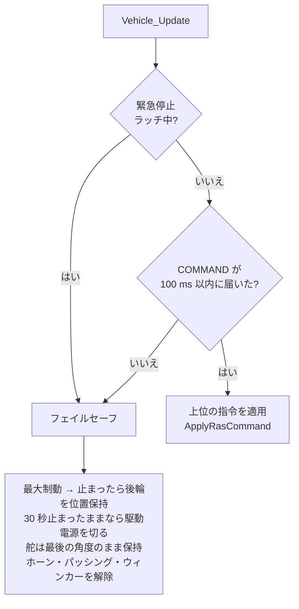
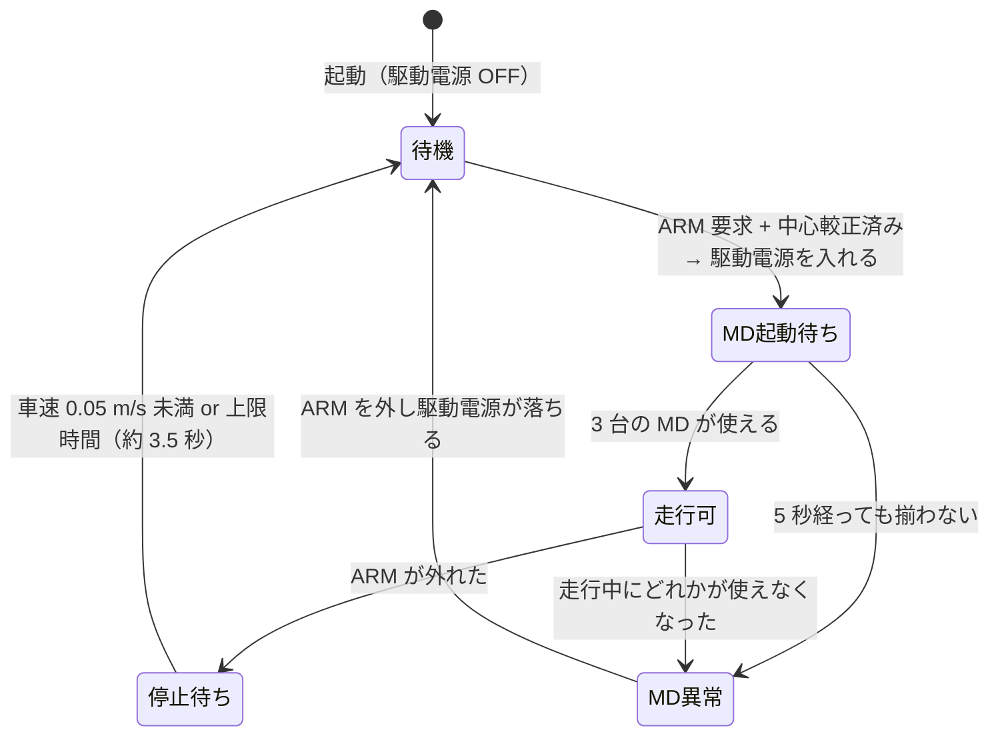

# 安全層とフェイルセーフ

!!! summary "要点"
    - **Raspberry Pi が落ちても、STM32 だけで車を止められる**ことが設計の前提です。
    - 安全層は 4 つあり、緊急停止でも駆動電源は切らずに**最大制動で止めます**（電源を切るとモータで制動できないため）。
    - 走行の許可（ARM）は、ステアの中心の較正・3 台の MD の起動などの条件がそろったときだけ出ます。フェイルセーフを通った後は、上位が ARM を一度下ろして入れ直すまで走りません。前方の障害物で自動停止する機能もあります。


!!! note "【設計の説明】"
    対象: [`vehicle.c`][vehicle-c] / [`vehicle.h`][vehicle-h]、[`heartbeat.c`][heartbeat-c]、[`power.h`][power-h]、[`app.c`][app-c]。
    確認した版: ファーム `6b5bdb3`、上位 `2d0a44e`。自動停止・ブレーキホールド・再 ARM の規則（`rearm_required`）・MD 異常のデバウンスは **【未検証】**
    （ファーム `CLAUDE.md`、[検証状況](../development/status.md)）。自動停止の予想進路（2026-11-02）は書き込みの記録もありません（上位 `PROGRESS.md`）。

**上位（Pi）が落ちても、STM32 単独で車を止められる**のが設計の前提です。ここでは「止め方」を中心に説明します。

## 誰の指令に従うか

`Vehicle_Update()` が毎周期、次の優先順位で決めます。



**Pi が一度も繋がっていない起動直後も「フェイルセーフ」側**です。つまり、Pi が ARM を出さない限り車は押さえ込まれています。
フェイルセーフを一度通ったら（緊急停止・COMMAND 途絶・起動直後）、上位が ARM を一度下ろすまで ARM を受け付けません（[再 ARM の扱い](#再-arm-の扱い)）。

## 4 つの安全層

| 層 | 発動条件 | 動作 | 解除 |
|---|---|---|---|
| ① `DRIVE_POWER` のハード遮断 | 駆動系の過電流 **12 A**（50 ms 継続）。シグナル系の過電流 **6 A**（仮値）では LiDAR と駆動の両方を遮断 | MD への給電を切る | **ラッチ**。マイコンのリセットまで復帰しない |
| ② IWDG（独立ウォッチドッグ） | メインループが 500 ms 止まる | MCU をリセット | — |
| ③ ハートビート断 | Pi の GPIO の **100 Hz 矩形波**が **50 ms** 途切れる | 緊急停止をラッチ（フェイルセーフと同じ制動） | **ラッチ**。ハートビートが戻った状態で**ボタン 2** を押すまで解除しない。解除後も ARM の入れ直しが要る |
| ④ COMMAND 途絶 | UART の COMMAND が **100 ms** 来ない | 自動でブレーキ（フェイルセーフ） | COMMAND が戻れば制動は解ける。走るには ARM の入れ直しが要る |

③のハートビートは UART とは**別経路**です。UART の COMMAND 途絶（100 ms）より速く（50 ms）、
**通信そのものが生きていても Pi のソフトが固まった**場合を拾えます。

- ハートビートは、**少なくとも 10 エッジを一度でも観測するまで**は監視を始めません。
  配線していない単体のベンチ確認で緊急停止させないためです（`HEARTBEAT_MIN_EDGES`）。
  その間は ③ が働かないので、TELEMETRY の `flags` に `NO_HEARTBEAT`（bit25）を立て、上位はこれが立っている間 ARM を通しません。
- 途絶を一度検出したら、次の本物のエッジが来るまで「生きている」に戻しません。経過時間だけで判定すると、
  マイクロ秒の時計が一周する約 71.6 分後に、古いエッジが 50 ms の間だけ生き返るためです（`heartbeat.h`）。
- IMU の I2C が張り付いてメインループが長く止まったあとは、ハートビートの基準時刻をリセットします。
  止まっていた間は判定できていなかっただけなので、直後に偶然エッジを取りこぼして**誤って緊急停止をラッチしない**ための処置です（`app.c`）。
- 電圧低下（8 セル × 1.0 V = 8.0 V、復帰 8.8 V、1 秒継続）は**警告のみ**で何も遮断しません。
  Ni-MH は負荷時のサグが大きいので電圧は長めに平均して判定します。

### 緊急停止でも駆動電源は切らない

!!! danger "電源を切ると止まれない"
    緊急停止がラッチされても、駆動電源は**入れたまま**にします。電源を切ると MD が制動をかけられず惰行に入り、
    かえって止まるまでの距離が伸びるからです。電源を落とすのは過電流のように「流し続けること自体が危険」なときの処置で、
    緊急停止でやるべきなのは**最短で止める**ことです。

ただし、フェイルセーフ（緊急停止・COMMAND 途絶）で**止まってから 30 秒**経ったら駆動電源を切ります（`VEHICLE_FAILSAFE_POWER_OFF_S`）。
電源を入れたまま位置保持を続けると、据え切りと同様にモータが過熱し、電池も減り続けるためです。切ると坂では転がりうるが、
30 秒止まっていれば人が気づく時間は十分にある、とコメントにあります。押されて動き出したら数え直し、戻すには ARM を入れ直します。

## ARM（走行許可）の条件

上位が出す ARM 要求は、次の**すべて**を満たすときだけ「走行してよい」状態（`armed`）になります。

```text
armed = ARM 要求（フェイルセーフの後なら、一度下ろしてから立て直したもの）
        かつ  ステア中心が較正済み  かつ  3 台の MD が起動済み
        かつ  モードが MANUAL または AUTO
```



- **MD の起動待ち**: MD は給電から約 1 秒、指令を受け付けません。その間に車速 PI を回すと、**積分が振り切れた状態で MD が動き出して
  最大トルクが一気に出る**ため、3 台が使える状態になるまで `armed` にしません（上限 5 秒、`VEHICLE_MD_BOOT_TIMEOUT_S`）。
- **ARM が外れたら、すぐには駆動電源を切らない。** 走行中に外れたら、停車（< 0.05 m/s）するまで最大制動を続けてから切ります
  （上限は最高速 5.0 m/s から校正した制動の減速度で止まり切れる時間の 1.5 倍。減速度は上位が `brake_decel_m_s2` で送り、今の 2.165 m/s² なら約 3.5 秒）。上位は通信途絶やデッドマンで「安全側」として DISARM を送ってくるため、
  ARM ビットで即座に電源を切ると惰行になってしまうからです。
- **MD の健全性は毎周期監視**します。走行中にどれかの MD が使えない状態が **20 ms** 続いたら（`VEHICLE_MD_FAULT_DEBOUNCE_S`）、両後輪を最大制動して `md_fault` をラッチします
  （片側の後輪 MD が止まって反対側だけが駆動を続けると、ヨーモーメントが出るため）。強制制動中は、上位のサイドブレーキ要求を聞きません
  （位置保持は制動より優先されるので、走行中に入ると最大制動が効かなくなる）。
  1 フレームで決めないのは、状態フレームの CRC は 8 bit で化けたフレームの 1/256 は通るので、化けて異常ビットが立って見えただけ・
  電圧のサグが一瞬掛かっただけで走行中に最大制動へ入り、ARM を外すまで戻らなくなるためです。
- **ステアの中心が未較正の間は、駆動電源を入れません。** 絶対角が信用できないためです。

### 舵の扱い

- 上位の舵角指令は**舵角速度の上限でレート制限**してから渡します（既定 0.5 rad/s。COMMAND が値を載せればそれを使う。
  Pi は 7.0 rad/s を毎回載せています）。急な舵の変化で据え切りの負荷をかけないためです。
- `armed` でない間は舵角を進めず、**最後に送った角度を MD に保持させ続けます。**
  指令フレームを送らないと、ステア MD がトルク上限を適用しないので「MD が揃うまで armed にしない」条件が永久に解けなくなります。
- フェイルセーフでも舵は**最後の角度のまま保持**します（直進に戻すと車体が予期しない方向へ動くため）。

## ブレーキホールド

制動して |車速| が **0.2 m/s 未満** の状態が **0.3 秒**続いたら、後輪を**位置制御**に切り替えて保持します
（サイドブレーキと同じ仕組み）。上位の brake・自動停止・フェイルセーフのどの制動でも同じです。
上位から `CONFIG_SET`（`BRAKE_HOLD_ENABLE`、0x0090）で切れます（既定は有効）。

!!! info "しきい値を「ほぼ 0」にしない理由"
    MD の制動は低速で抜けます（0.6 m/s 以下で弱まり、2 rad/s 未満で 0）。坂ではトルクの釣り合う速度でずるずる動き続けるので、
    しきい値が低いと永久に保持へ移れません。0.2 m/s なら勾配約 12° まで拾えます（0.1 m/s だと約 6°）。
    保持中にこの車速を超えたら（押された・保持し切れない）制動トルクからやり直します。【未検証】

## 自動停止

【未検証】COMMAND の `auto_stop` フラグを立てている間、**走行方向にある障害物を STM32 自身が検出して制動**します。
上位の計画がミスしても、速度に応じて伸びる距離で止まる最後の砦です。

$$
d_{\mathrm{stop}} = v \cdot t_d + \frac{v^2}{2a} + m
$$

| 項目 | 値 | 出どころ |
|---|---|---|
| 遅延 \(t_d\) | LiDAR の 1 回転 0.1 s ＋ 判定の間引き 5 ms ＋ MD のトルクの遅れ | MD の遅れは校正 6 の `md_delay_s + md_tau_s`（今 16 ms）を上位が `md_torque_lag_s` で送る |
| 減速度 \(a\) | 校正 9 の ABS 込みの制動の減速度（今 2.165 m/s²） | 上位が `vehicle.toml` の `abs_brake_decel_m_s2` を `brake_decel_m_s2` で送る（ファームは値を持たない） |
| 余裕 \(m\) | 既定 15 cm（0〜100 cm、Pi が `auto_stop_margin_cm` で送る） | `ras_link.h` |

- **LiDAR**: **今の実舵角のまま止まるまでに車体が掃く範囲（予想進路）**に、直近 300 ms の点が **3 点以上**あれば障害物あり。
  単発のノイズは 1 点しか占めないので、**時間方向のデバウンスではなく空間方向の点密度**で誤検知を弾きます。
  **車体の外形の内側の点は数えません**（車体に立てた支柱や部品の反射。外形の内側に障害物はありません）。
- **超音波**: LiDAR が新鮮なデータを持たないときのフォールバック（\(d_{\mathrm{stop}}\) 以内）。それとは独立に、**5 cm 未満なら常に停止**
  （LiDAR の最短測距距離や取付高さの死角を補う保険）。超音波はセンサが車体の先端より内側にあるので、
  しきい値に**取付オフセット**（前 4 cm・後 3 cm）を足し、「車体の先端から障害物まで」で判定します。
  近づいてくる障害物にはローパスが遅れるので、生の値の方が近ければ生の値で判定します。
- **一度作動したら、止まるまで解除しません。** 停止距離は車速とともに縮むので、判定だけで決めると減速した途端に「範囲外」になり、
  解除→再加速→再作動を繰り返しながら障害物へ寄っていくためです。止まってからは毎周期判定し直すので、障害物が無くなれば
  （または上位が逆方向を指令すれば）動けます。
- ARM 中に LiDAR も前後の超音波も使えない状態が 3 秒続いたら、TELEMETRY の `flags` に `AUTO_STOP_BLIND`（bit26）を立てて上位へ知らせます
  （ARM 直後の LiDAR の起動待ちでは立たないよう 3 秒待つ）。

### 予想進路

舵角から自転車モデルの曲率 \(\kappa = \tan\delta / L\)（\(L\) = 0.23 m）を出し、後車軸の中心が半径 \(R = 1/|\kappa|\) の円弧を進むとします。
車体（左右 ±15 cm = 半車幅 9 cm ＋ 余裕 6 cm）は回転の中心 \(C\) のまわりを回る剛体なので、掃く範囲は \(C\) を中心とする円環

$$
R - w \;\le\; |P - C| \;\le\; \left|\left(x_{\mathrm{end}},\; R + w\right)\right|
$$

のうち、\(C\) から見た角度が「その半径で最も先にある車体の点」から、先端の中心が \(d_{\mathrm{stop}}\) 進むまでに回る角度
\(\Phi = d_{\mathrm{stop}} / |(x_{\mathrm{front}}, R)|\) の範囲です。

- 舵を切っていない（\(|\kappa| < 0.02\) /m）ときは矩形（LiDAR から \(d_{\mathrm{stop}}\) ＋ 23 cm、後ろは 14 cm、±15 cm）。
  真っ直ぐの矩形のままだと、舵を切っているときに**曲がった先の障害物を見落とし、曲がって通らない外側の壁で止まります**。
- 指令ではなく**実舵角**を使います。舵が指令に追いついていない（据え切りの途中・ラックに当たっている）ときに、実際に進む向きを見るためです。
- 後退でも舵が同じなら回転の中心は同じ側です。後退で前端が外へ振り出す分も円環の外径に入れています。
- 2 kHz で 179 点を見るので、点ごとに atan2 は呼ばず、cos・sin の加法定理で比べます。判定は 5 ms ごとに間引きます。
- 舵角どおりに曲がる（横滑りしない）と仮定するので、グリップの限界付近で外へ膨らむ分は余裕 6 cm の内側でしか拾えません。
- 車体を円弧に沿って細かく動かした総当たりと比べ、**当たる点を見落とさない**こと、余分に拾うのは車体の真横か縁から 2 cm 以内だけであることを、
  ホストのテスト（`tools/fwsim/tests/test_auto_stop_path.py`）で確かめています。

??? example "計算例: 2 m/s で直進中"
    今の上位の値（MD の遅れ 16 ms、減速度 2.165 m/s²、余裕は既定の 15 cm）なら、遅延は 0.1 + 0.005 + 0.016 = 0.121 s で
    \(d_{\mathrm{stop}} = (2\times0.121 + 2^2/(2\times2.165))\times100 + 15 \approx 132\,\mathrm{cm}\)。
    LiDAR の判定距離は \(132+23 \approx 155\,\mathrm{cm}\)。

**進行方向は指令ではなく実車速の符号**で決めます。「前進中に後退を指令」した瞬間でも実車はまだ前進しており、
その一瞬に後方センサへ切り替わって前方の障害物を見失う窓ができるためです。ただし**ほぼ静止（< 0.05 m/s）のときは指令した方向**を使います。
静止中は実車速の符号が定まらず常に前方判定に固定され、「前方に障害物・後方は空いているのに後退できない」デッドロックになるからです。

緊急停止（ハートビート断）のフェイルセーフは**LiDAR を使いません**。

## 再 ARM の扱い

フェイルセーフのあと、ARM を立てたままの COMMAND が流れ続けていると、緊急停止を解除した瞬間（車のそばでボタン 2 を押した瞬間）や
通信が戻った瞬間にそのまま走り出します。これを**ファームと Pi の両方**で防いでいます。

- **ファーム**（`vehicle.c` の `rearm_required`）: フェイルセーフ（緊急停止・COMMAND 途絶・起動直後）を一度通ったら、
  COMMAND の ARM が一度 0 になるまで ARM を受け付けません。受け付けない間は ARM が外れているのと同じに扱うので、
  走っていれば停車まで制動します。受け付けなかったときは `LOG`（`ARM ignored: disarm once to re-arm`）で 1 回だけ知らせます。
- **Pi**（`io_node` の `_update_rearm_latch`）: E-Stop・駆動電源ラッチ・STM32 の再起動のあとと、STM32 から上の `ARM ignored` が届いたあとは、
  操縦側の ARM が一度外れるまで ARM を通しません。E-Stop が収まる前に外した ARM は数えません。

どちらか片方だけでも走り出しません。ファーム側の規則は**実機では未検証**です（ファーム `CLAUDE.md`）。

## この設計から学べること

- **上位が落ちたときの動作を、上位の側ではなく下位に持たせる。** 通信・ソフト・電源の 3 経路それぞれに独立した検出がある。
- **止める＝電源を切る、ではない。** 制動できる状態を保ったまま止める。
- **ラッチは「人が確かめて解除する」。** 原因が消えたら自動復帰、にしない。
- **初期化の完了を条件に走行を許可する。** MD の起動待ち、ステア中心の較正。
- **フェイルセーフ側の動作も「何を保持するか」を決める。** 舵は直進に戻さない。

[vehicle-c]: https://github.com/banbatakumi/AutonomousCar/blob/FW/MainBoard_V3/Program/MainF446RE_V3/src/vehicle/vehicle.c
[vehicle-h]: https://github.com/banbatakumi/AutonomousCar/blob/FW/MainBoard_V3/Program/MainF446RE_V3/src/vehicle/vehicle.h
[heartbeat-c]: https://github.com/banbatakumi/AutonomousCar/blob/FW/MainBoard_V3/Program/MainF446RE_V3/src/comm/heartbeat.c
[power-h]: https://github.com/banbatakumi/AutonomousCar/blob/FW/MainBoard_V3/Program/MainF446RE_V3/src/power/power.h
[app-c]: https://github.com/banbatakumi/AutonomousCar/blob/FW/MainBoard_V3/Program/MainF446RE_V3/src/app/app.c
