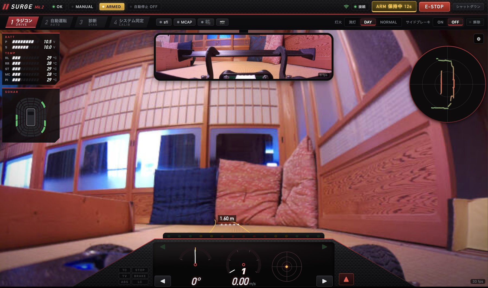
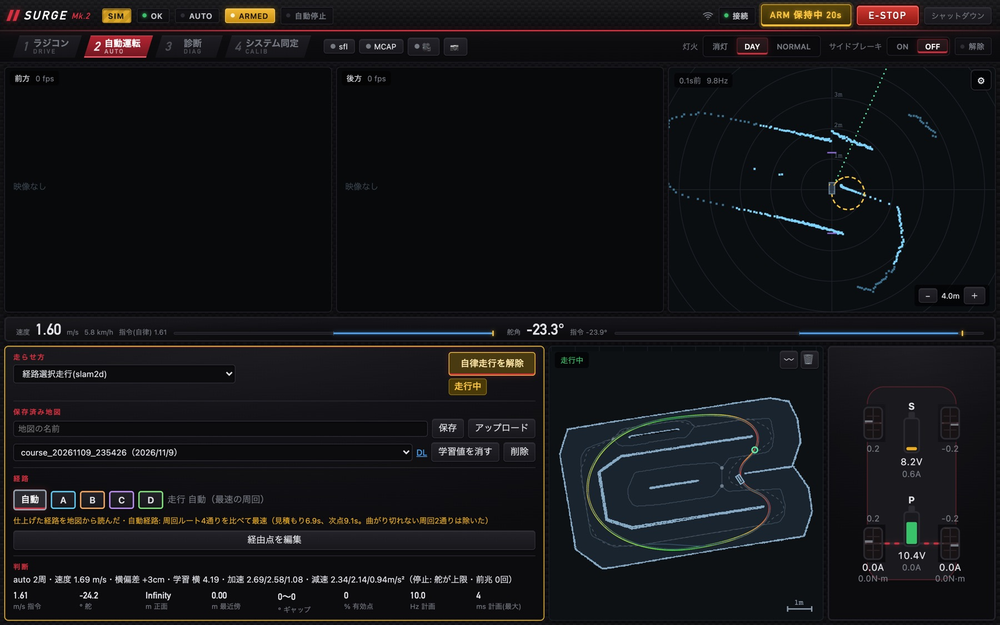
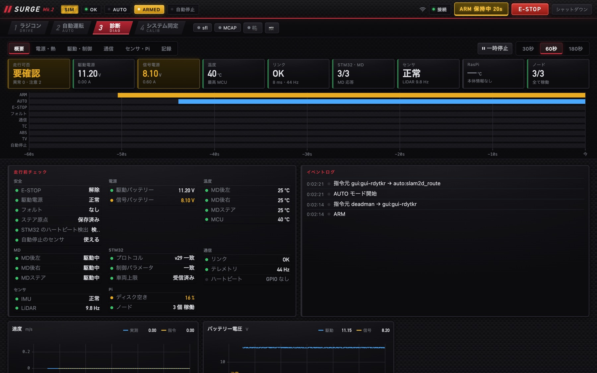
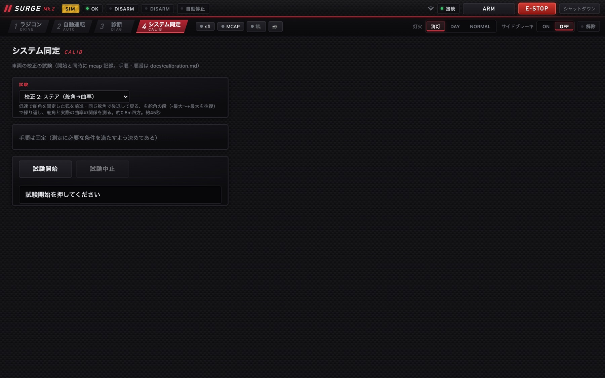

# 操作画面（Web GUI）

!!! summary "要点"
    - SURGE Mark.2 は、**ブラウザで開く操作画面**から運転・自動運転・診断・校正のすべてを行います。PC でも iPad でも動きます。
    - 画面は**「誰が、何のために見るか」で分けた 4 枚のタブ**です。運転する人の画面と、原因を追う人の画面では、同じデータでも出し方が違います。
    - 表示する項目を「人がどれくらいの頻度で見るか」で 4 層に分け、**正常な間は光らせず、注意・異常・作動中だけを目立たせます**。

!!! note "【設計の説明】"
    対象: [`gui/`][gui-dir]（React ＋ TypeScript ＋ Vite）、設計は [`system_overview.md` §10][overview-10]。確認した版: 上位 `2d0a44e`。

## しくみ

### 4 枚のタブ

| タブ | 誰のための画面か | 中身 |
|---|---|---|
| **ラジコン**（既定） | 運転する人 | 前方の映像を全画面に、バックミラー・計器・介入のランプを重ねる |
| **自動運転** | 開発する人 | モードの選択と開始、指令と実測、判断の根拠、地図と経路 |
| **診断** | 点検する人・原因を追う人 | 走行前の点検、電源と熱、通信、時系列のグラフ、記録の一覧 |
| **システム同定** | 車両を校正する人 | 校正の試験の実行と記録 |

タブは数字キーの 1〜4 でも切り替わります。見た目は全タブ共通で、レース用のダッシュボード風（カーボンの地、黒いガラスの液晶風のパネル）にしています。

### ラジコン — 横目で読める画面

<figure class="sg-wide" markdown>
{ loading=lazy }
<figcaption>ラジコンタブ（実機）。前方の映像を全画面に、上中央に後方カメラのバックミラー、右上に LiDAR、左上に電池・温度とクリアランスソナー、下端に計器が重なる。映像の下に出ている「1.60 m」は、今の舵角のまま進んだときに当たる物までの距離。</figcaption>
</figure>

- **前方の映像を全画面**にし、上中央に後方カメラのバックミラー、下端にシフトライト・速度・G・舵角の計器を重ねます。
- 進路上の障害物（LiDAR）を映像に重ね、バックに入れると後方カメラに切り替わります。
- 車体のまわり 16 方向 × 4 段のクリアランスソナー（LiDAR ＋超音波）と、断続音で近さを伝えます。
- 電池と、後輪・ステアリングのモータドライバの温度は、左上に常に出しています。

### 自動運転 — 原因を切り分けられる画面

<figure class="sg-wide" markdown>
{ loading=lazy }
<figcaption>地図を使う走行で周回中の自動運転タブ。速度・舵角の指令と実測、判断の理由、学習中の値、地図と経路が並ぶ（シミュレータで撮影）。カメラの映像はシミュレータでは出ない。</figcaption>
</figure>

- 前方・後方の映像と LiDAR を並べ、**指令と実測を数値で並べて、遅れをそのまま読める**ようにしています。
- モードの選択と開始は**このタブ 1 か所だけ**です。パラメータのスライダは、走行モードの宣言から自動で作られます（[走行モード](../autonomy/modes/index.md)）。
- 地図を使うモードでは、地図パネルと経路パネルが出ます。

### 診断 — 走る前の点検と、止まった理由

<figure class="sg-wide" markdown>
{ loading=lazy }
<figcaption>診断タブの概要ページ。上段に常設のサマリとイベントの帯、下に走行前チェックとイベントログ（シミュレータで撮影）。</figcaption>
</figure>

- 上段に**常設のサマリ**（走ってよいか、電源 2 系統、温度、通信、STM32 とモータドライバ、センサ、Raspberry Pi）と、ARM・自動運転・緊急停止・TC・ABS などの**イベントの帯**を置きます。
- 下段はサブページ 6 枚（概要・電源と熱・駆動と制御・通信・センサと Pi・記録）です。
- **グラフは走行中ずっと裏で記録しています。** 異常に気づいてから開いても、手遅れにならないようにするためです。

### システム同定 — 車を測る

<figure markdown>
{ loading=lazy }
<figcaption>校正 2（ステアの舵角と曲率）を選んだところ。試験の中身と所要時間が出る（シミュレータで撮影）。</figcaption>
</figure>

車両の校正の試験を選んで実行し、記録を取ります。解析は Mac 側の校正ツールで行います（[補助ツール](tools.md#車両の校正)）。

## 設計の詳細

### 表示の 4 層 — 何を出すかではなく、どれくらい見るか

表示したい項目は 20 個以上あり、全部を同じ大きさで並べると何も読めません。項目の重要度ではなく、**人がどれくらいの頻度でそこに視線を置くか**で分けました。

| 層 | 性質 | 扱い | 例 |
|---|---|---|---|
| A. 常に凝視 | 走行中ずっと見ている | 画面の大部分 | 前方カメラ、LiDAR の俯瞰、予定の進路 |
| B. 常に周辺視 | 横目で追う | 小さく固定配置、色で異常を伝える | 速度、舵角、モード、遅延 |
| C. 異常のときだけ | 普段は見ない | **平常時は畳み、しきい値を超えたら前に出す** | 温度、電圧、CPU、通信の取りこぼし |
| D. 診断・設定 | 走行後・調整時 | 別のタブに分ける | パラメータ、グラフ、校正 |

**C の扱いが肝です。** 正常な間の温度や電圧は情報量がゼロです。「今まさに異常」だけを前に出す条件にし、累積の回数は小さなバッジで数字だけ出します
（起動直後に 1 回だけ起きた通信エラーで、パネルが開きっぱなしになるのを防ぐため）。**隠すのは正常な数字だけで、異常は必ず出します。**

### 速いデータを React に通さない

点群・地図・カメラは 20〜30 Hz で届きます。これを React の状態に入れると、再描画で画面がすぐに破綻します。そこで流量で 3 つに分けています。

```text
WebSocket ─┬─▶ 点群・地図・カメラ → 置き場に置き、Canvas が描画のたびに読む（React を通らない）
           ├─▶ 数値の表示         → 間引いて配る（人は 20 Hz で変わる数字を読めない）
           └─▶ 接続状態・設定      → 変わったときだけ状態管理（Zustand）へ
```

時系列のグラフは uPlot、点群と地図は Canvas 2D で描いています。

### 止める手段を必ず残す

運転は「走行許可（ARM）を保持し、無操作が続いたら外れる」方式です。そのうえで、すぐに止める経路を複数残しています。

| 経路 | 応答 |
|---|---|
| Esc キー、画面の緊急停止ボタン、ゲームパッド | すぐに走行許可を外す（**権限も条件も要らない**） |
| ブラウザのタブが裏に回る | すぐに走行許可を外す |
| ブラウザが固まる・Wi-Fi が切れる | 指令が途絶え、車側が走行許可を外す |
| 操縦権を失う（別の端末の緊急停止・切断） | 走行許可の要求を下ろす。自動では取り直さない |

**操縦権は同時に 1 人**です（2 つの画面から舵を切ると「勝手にハンドルが戻る」ため）。**緊急停止だけは、権限を問わず誰でも押せます。**

### 設定の正は車の側

画面は起動時に全設定を車から受け取り、変更は 1 つずつ送って、**車が確定した値で表示を更新します**。
画面の側で先に表示を変える（楽観的な更新）ことはしません。範囲外の値は車側で丸められ、表示と実際が食い違うからです。

<div class="sg-next" markdown>
<div markdown>
隣のしくみへ

- [補助ツール](tools.md)
- [検証の仕組み](workflow.md)
</div>
<div markdown>
さらに深く

- [上位の安全設計](../autonomy/safety.md)
- [走行モード](../autonomy/modes/index.md)
</div>
</div>

[gui-dir]: https://github.com/banbatakumi/AutonomousCar_RasPi/tree/master/surge_mk2/gui
[overview-10]: https://github.com/banbatakumi/AutonomousCar_RasPi/blob/master/surge_mk2/docs/system_overview.md#10-gui
