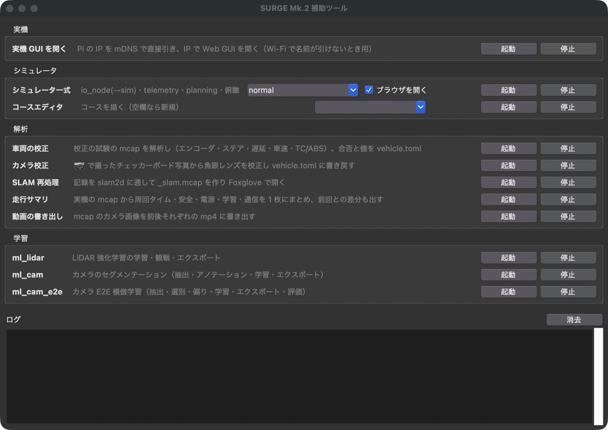
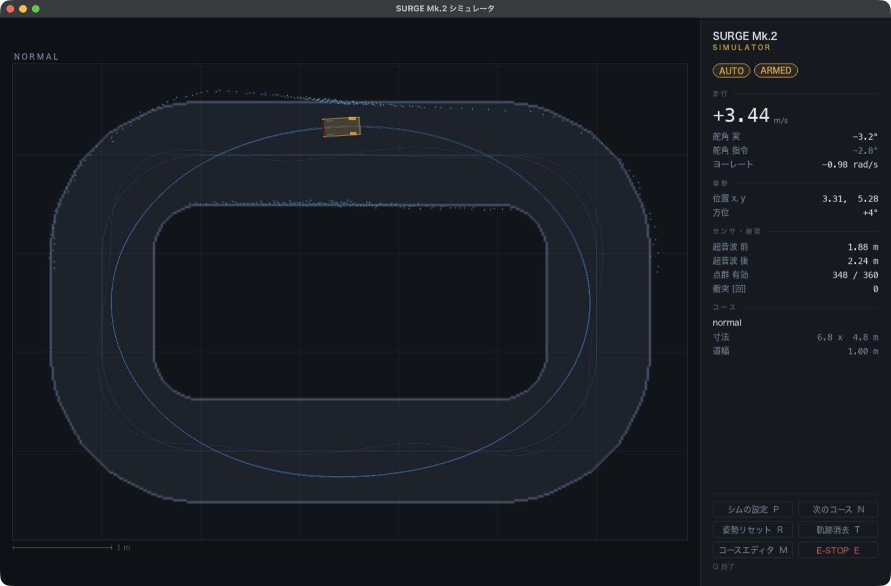
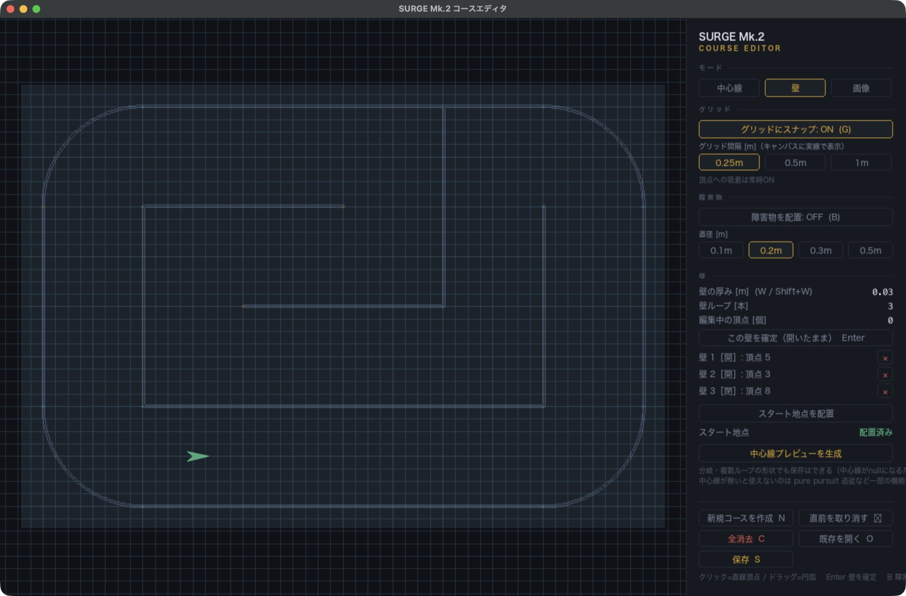
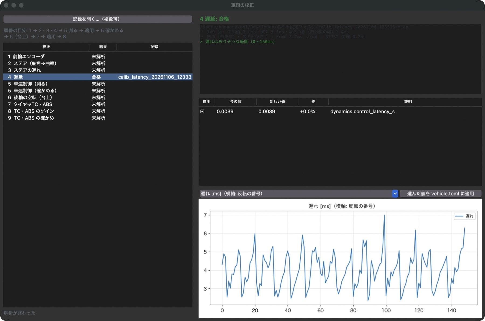
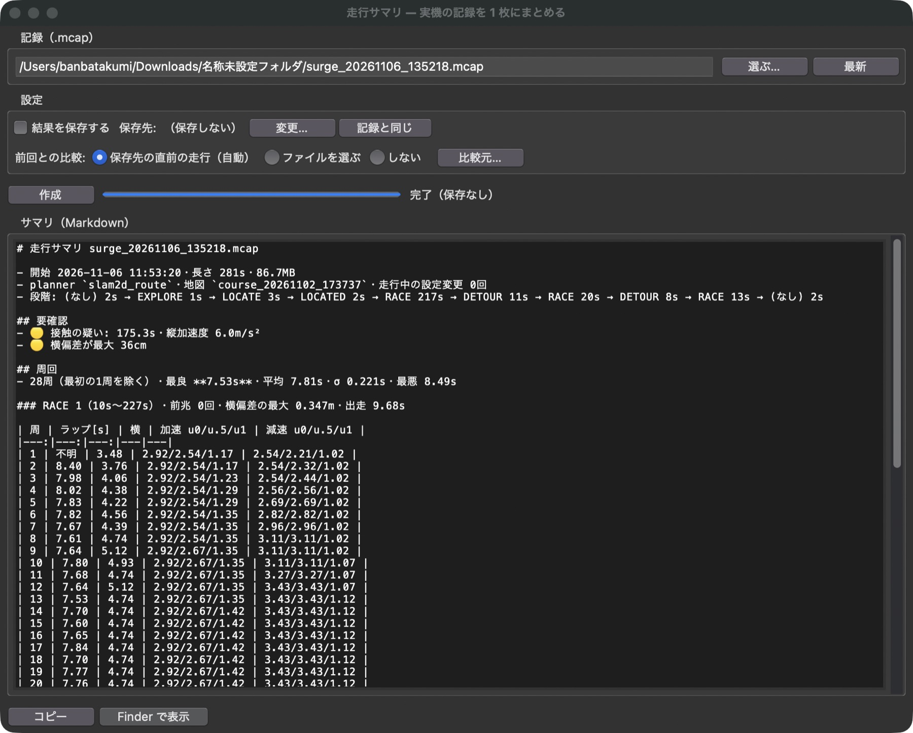
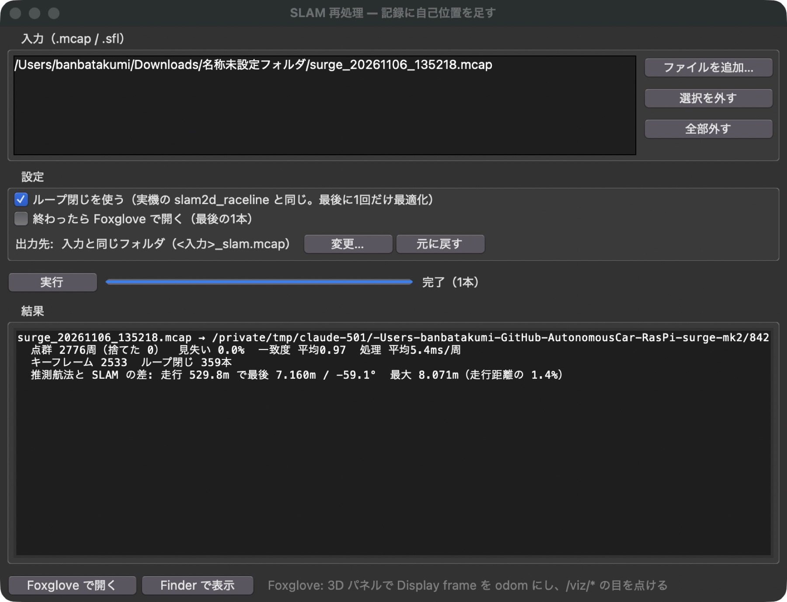

# 補助ツール

!!! summary "要点"
    - 実車の操作画面（Web GUI）のほかに、**シミュレータ・校正・記録の解析・学習**のためのツールを Mac 側に揃えています。
    - どれも**ターミナルを使わずに**、1 つのランチャーの窓から起動・停止できます。
    - 学習のツール（模倣学習・強化学習・セグメンテーション）は、重い処理を別のプロセスに任せる薄い操作パネルで、共通の部品を使い回しています。

!!! note "【設計の説明】"
    対象: [`tools/launcher.py`][launcher-py] とそこから起動する各ツール。確認した版: 上位 `2d0a44e`。

## ランチャー

<figure markdown>
{ loading=lazy }
<figcaption>ランチャー。実機・シミュレータ・解析・学習の区分ごとにツールを起動・停止できる。</figcaption>
</figure>

`launcher.command` をダブルクリックすると開く窓で、次のツールを起動・停止できます。

| 区分 | ツール | すること |
|---|---|---|
| 実機 | 実機 GUI を開く | Raspberry Pi の IP を探し、操作画面をブラウザで開く |
| シミュレータ | シミュレータ一式 | 仮想の STM32・各ノード・俯瞰ビューを立ち上げ、操作画面を開く |
| | コースエディタ | シミュレータのコースを描く |
| 解析 | 車両の校正 | 校正の試験の記録を解析し、合否と値を車両パラメータに書き戻す |
| | カメラ校正 | チェッカーボードの写真から魚眼レンズを校正する |
| | SLAM 再処理 | 記録を SLAM に通し直し、Foxglove で見られる記録を作る |
| | 走行サマリ | 記録から周回タイム・安全・電源・学習・通信を 1 枚にまとめ、前回との差も出す |
| | 動画の書き出し | 記録のカメラ画像を前後それぞれの動画に書き出す |
| 学習 | ml_lidar | LiDAR の強化学習（[強化学習](../autonomy/modes/reinforcement.md)） |
| | ml_cam | カメラのセグメンテーション（[カメラで道を見る](../autonomy/modes/camera.md)） |
| | ml_cam_e2e | カメラの模倣学習（[模倣学習](../autonomy/modes/imitation.md)） |

**1 つの GUI にまとめず、別々のプロセスで起動しています。** シミュレータの描画（pygame）と Tkinter は 1 つのプロセスに同居できず、
学習（PyTorch）と SLAM を同じプロセスに載せると、1 つが落ちたとき全部が落ちるからです。ランチャーを閉じると、起動中のツールも一緒に終わります。

## シミュレータ

<figure class="sg-wide" markdown>
{ loading=lazy }
<figcaption>シミュレータの俯瞰ビュー。地図を使う走行で周回している車と軌跡、LiDAR の点、速度・舵角・超音波の値が見える。</figcaption>
</figure>

実車が無くても、**実機と同じ制御コードのまま**コースを走らせられる 2D シミュレータです。

- **偽装するのは STM32 だけ**です。UART の通信路の位置に仮想の STM32 を差し込むので、Raspberry Pi 側のノードも操作画面も 1 行も変えずに動きます（[検証の仕組み](workflow.md)）。
- **シミュレーションの操作は実機の画面に入れません。** コースの切り替えやノイズの量は実機に対応する物が無いので、それを実機の画面に持たせると、表示の判定を 1 つ間違えた瞬間に実車の画面にシム用のボタンが出ます。
  操作画面はシミュレータの存在を知らない（「SIM」の表示を出すだけ）作りにしています。

<figure markdown>
{ loading=lazy }
<figcaption>コースエディタ。壁を直線と円弧でつなぎ、スタート地点や障害物を置く。</figcaption>
</figure>

## 車両の校正

<figure class="sg-wide" markdown>
{ loading=lazy }
<figcaption>遅延の校正の記録（実機、2026-11-06）を解析したところ。149 回の反転の中央値 3.9 ms で「合格」。値を確かめてから車両パラメータに書き戻せる。</figcaption>
</figure>

実車で校正の試験（操作画面のシステム同定タブ）を走らせて記録を取り、このツールで解析します。
エンコーダ・ステアリング・遅延・車速の制御・TC / ABS について、**測る → 式で値を決める → 閉ループで合否を確かめる**の順に進め、合格した値を車両パラメータに書き戻します。

## 記録の解析

<figure markdown>
{ loading=lazy }
<figcaption>実機の走行記録（2026-11-06）の走行サマリ。段階の移り変わり、要確認の事項、28 周の周回タイムと学習の値が 1 枚にまとまる。</figcaption>
</figure>

<figure markdown>
{ loading=lazy }
<figcaption>同じ記録を SLAM に通し直した結果。2,776 周の点群で見失い 0 %、一致度の平均 0.97、ループ閉じ 359 本。推測航法とのずれは走行距離の 1.4 %。</figcaption>
</figure>

走行は MCAP 形式で記録し、Foxglove でも見られます。走行サマリは 1 回の走行を 1 枚にまとめ、**前回との差**も出すので、変更の効果を走行ごとに比べられます。

## 学習の操作パネルに共通する作り

3 つの学習ツールは、どれも**重い処理（抽出・学習・書き出し・評価）を別のプロセスとして呼び出すだけ**の薄い操作パネルです。
操作パネルのプロセスは PyTorch を読み込まないので、学習が落ちても窓は生き残ります。
ログの表示・子プロセスの実行・モデル名の管理・備考・学習曲線・窓を閉じる処理は、3 つで共通の部品（`ml_common/`）を使っています。

**モデル名 1 つで、フレーム・学習の出力・書き出し先がつながります。** 最初のタブでモデル名を決めれば、後のタブはその名前のフォルダを自動で使います。

隣のしくみへ

- [操作画面（Web GUI）](gui.md)
- [検証の仕組み](workflow.md)

さらに深く

- [模倣学習（カメラ E2E）](../autonomy/modes/imitation.md)
- [強化学習（LiDAR E2E）](../autonomy/modes/reinforcement.md)

[launcher-py]: https://github.com/banbatakumi/AutonomousCar_RasPi/blob/master/surge_mk2/tools/launcher.py
