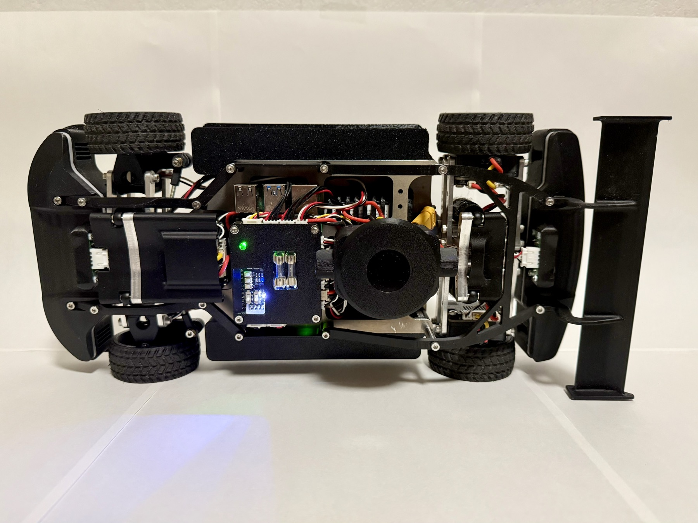
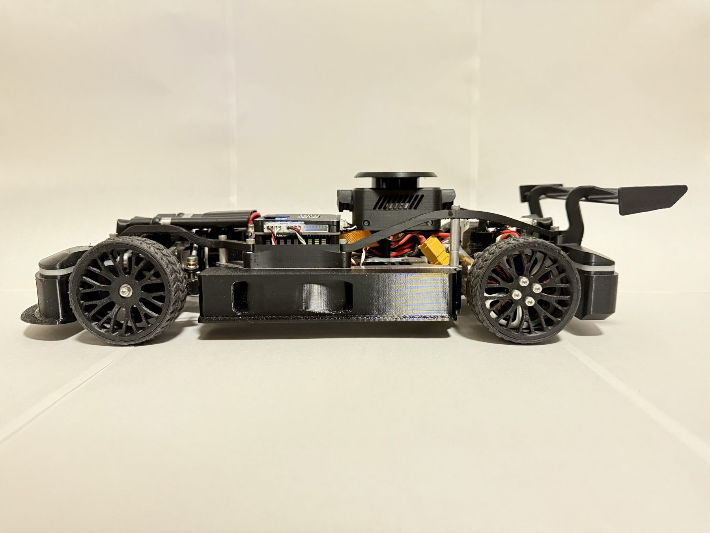
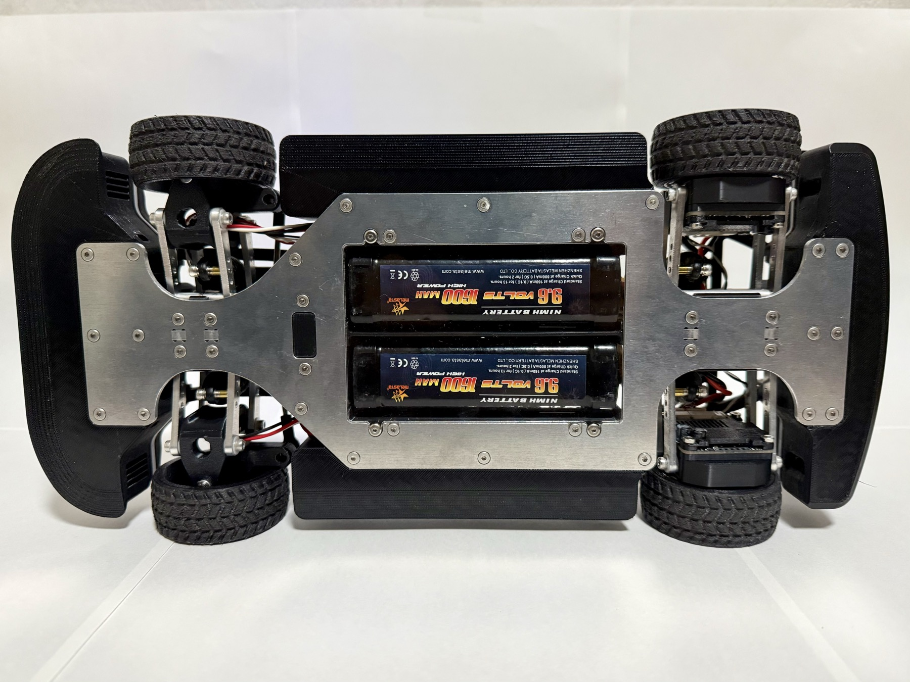
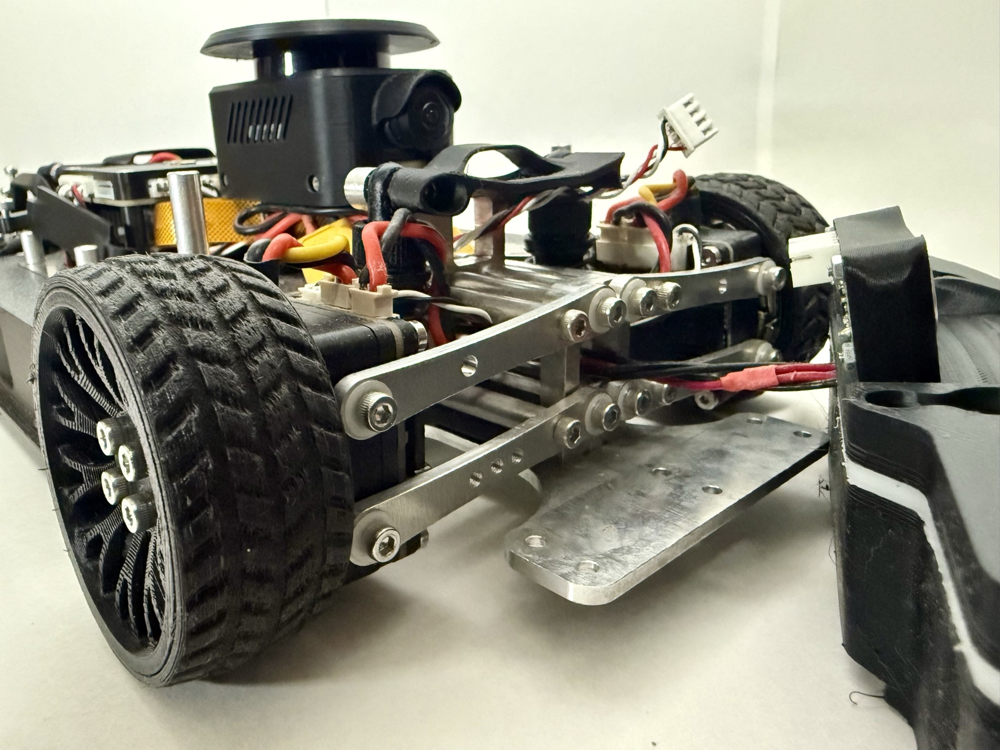
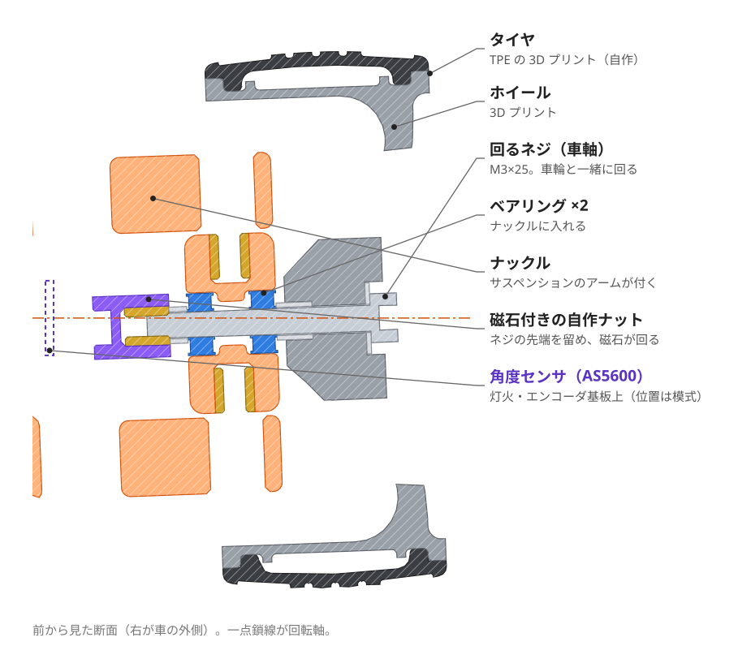
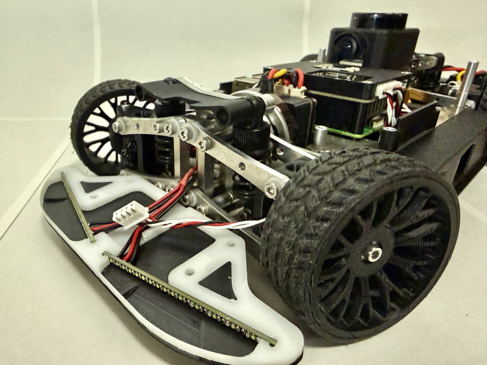

# シャシーと足まわり

!!! summary "要点"
    - シャシーは**厚さ 3 mm のアルミ板（T3）**です。
    - 足まわりは前後とも**ダブルウィッシュボーン**で、**ラジコン用のオイルダンパー**を使っています。
    - 前輪は駆動しない代わりに、**車速を測るセンサ**の役目を持ちます。ネジを車軸にして、ネジごと回る構造です。

## しくみ

### 車体の大きさ

| 量 | 値 |
|---|---|
| 外形（長さ × 幅） | 約 0.37 m × 0.18 m |
| 質量 | 2.0 kg |
| ホイールベース | 0.23 m |
| 後輪トレッド | 0.155 m |
| 車輪半径 | 30 mm |

いずれも [`vehicle.toml`][vehicle-toml] の実測値です（2026-08-20 確定）。

<figure markdown>
{ loading=lazy }
<figcaption>真上から。</figcaption>
</figure>

<figure markdown>
{ loading=lazy }
<figcaption>真横から。</figcaption>
</figure>

### シャシー

主となる板は、厚さ 3 mm のアルミ板です。
その上に、制御基板・Raspberry Pi 5・LiDAR・バッテリーなどを載せています。

<figure markdown>
{ loading=lazy }
<figcaption>車体の裏側。アルミのシャシーと、駆動用・信号用の 2 本のバッテリー。</figcaption>
</figure>

### サスペンション

前後とも**ダブルウィッシュボーン**です。上下 2 本のアームで車輪を支え、**ラジコン用のオイルダンパー**でばねと減衰を受け持たせています。

<figure markdown>
{ loading=lazy }
<figcaption>後輪のサスペンション。</figcaption>
</figure>

## 設計の詳細

### 前輪 — 回るネジが車軸になる

前輪は駆動しません。その代わり、**車速を測るためのセンサ**を兼ねています。
後輪は駆動力で空転することがあるので、空転しない前輪で測るほうが、実際の車速に近い値が取れるためです（[駆動制御](../control/drive.md)）。

前輪の構造は次のとおりです。

- **ナックルにベアリングを 2 個（ダブルベアリング）**入れています。
- **ネジを車軸にして**ホイールを固定します。
- ネジの先端は、**エンコーダ用の磁石を付けた自作のナット**で留めています。

つまり、**ネジそのものが車輪と一緒に回ります**。ネジの先端の磁石が車輪と同じだけ回るので、その回転を磁気式の角度センサ（AS5600）で読めば、車輪の角度が分かります。
角度センサは、灯火と一緒にまとめた自作の基板（OtherBoard）に載っています（[電装と電源](electronics.md#灯火エンコーダ基板otherboard)）。

<figure markdown>
{ loading=lazy }
<figcaption>左前輪を、車軸を通る面で切った断面（3D データから作図）。回るネジがベアリング 2 個を通り、先端の磁石付きナットが車輪と一緒に回ります。角度センサの基板は 3D データに含まれないため、位置を点線で示しています。</figcaption>
</figure>

<figure markdown>
{ loading=lazy }
<figcaption>前輪まわり。上下 2 本のアームで支えるダブルウィッシュボーン。</figcaption>
</figure>

### 前輪の角度センサの使い方

前輪の角度センサはアナログの絶対角エンコーダで、分解能は粗めです。
そのため、STM32 は**加速度センサと組み合わせたカルマンフィルタ**で車速を推定しています。
ここから加速度を微分して使うことはしません（[駆動制御](../control/drive.md#speed-kf)）。

隣のしくみへ

- [センサ](sensors.md)
- [電装と電源](electronics.md)

さらに深く

- [駆動制御（車速 PI）](../control/drive.md)
- [3D データ](3d-model.md)

---

**出典**: シャシー・サスペンション・前輪の構造は開発者への聞き取り（2026-11-09）。寸法と質量は [`vehicle.toml`][vehicle-toml]。

[vehicle-toml]: https://github.com/banbatakumi/AutonomousCar_RasPi/blob/master/surge_mk2/config/vehicle.toml
