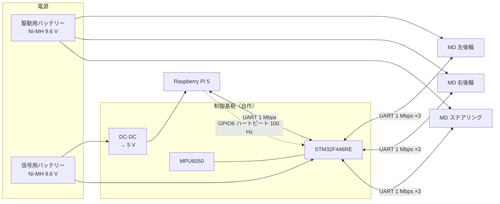

# 電装と電源

!!! summary "要点"
    - 頭脳は 2 つです。**Raspberry Pi 5** が「どこへ、どれくらいの速さで」を決め、**STM32F446RE**（自作の制御基板）が「タイヤにどうトルクを伝えるか」を決めます。
    - 電源は**駆動用と信号用の 2 系統**に分け、それぞれ Ni-MH 電池（9.6 V・1600 mAh）を積んでいます。両方とも**電圧と電流を測り**、**ヒューズ**を入れています。
    - Raspberry Pi から STM32 へは、通信とは別に**「生きている」合図（ハートビート）**を送っています。合図が止まれば STM32 が車を止めます。

## しくみ

### 全体の配線

!!! placeholder "図 F-06：電源と信号の配線図（清書版）"
    上の Mermaid 図を、実際のコネクタ・ヒューズ・電流センサの位置まで入れて描き直したもの。
    駆動系と信号系を色分けすると、「片方だけ落ちる」ことが伝わりやすい。

!!! placeholder "写真 P-13：制御基板（MainBoard）の表"
    STM32・DC-DC・IMU・コネクタ類が見えるように真上から。Raspberry Pi との位置関係が分かる写真もあると良い。

### 2 系統の電源

| 系統 | 電池 | 給電先 |
|---|---|---|
| 駆動用 | Ni-MH 8 セル（9.6 V・1600 mAh） | 3 枚の MD（後輪 2・ステアリング 1） |
| 信号用 | Ni-MH 8 セル（9.6 V・1600 mAh） | 制御基板、DC-DC で 5 V に落として Raspberry Pi 5 |

2 系統に分けてあるので、**片方だけが落ちることがあります**。たとえば駆動用を切っても、Raspberry Pi と STM32 は動き続けます。
過電流などで駆動用の電源が遮断されると、その状態を**ラッチ（保持）**し、電源を入れ直すまで復帰しません（[安全層](../control/safety.md)）。

両方の系統で**電圧と電流**を測っているので、電池の残りや、モータがどれだけ電流を使っているかを走行中に記録できます。

## 設計の詳細

### 制御基板（MainBoard）

STM32 を載せた自作の基板です。KiCad で設計し、JLCPCB に発注しています。
現在載っているのは最新版で、回路図は [`AutonomousCar`][fw-repo] の `Circuit/` にあります。

| 役割 | 部品（回路図 `MainBoard_V3_2` から） |
|---|---|
| マイコン | STM32F446RE |
| IMU | MPU-6050 |
| 5 V の DC-DC | OKL-T/6-W12N-C |
| 3.3 V のレギュレータ | LM1117-3.3 |
| 電流の測定 | 電流アンプ INA180A2 ×2 |
| 保護 | ヒューズ ×2、TVS ダイオード（SMAJ13A ×2・SMAJ5.0A） |
| Raspberry Pi との接続 | 40 ピンのヘッダ |
| その他 | レベル変換用の MOSFET（BSS138）、ブザー、LED、スイッチ |

!!! note "基板の版について"
    リポジトリには `MainBoard_V1`〜`V3_2` があり、上の表は一番新しい `V3_2` の回路図から読み取りました。

### Raspberry Pi と STM32 のつなぎ方

| ピン | 用途 |
|---|---|
| GPIO14 / GPIO15 | UART（1 Mbps）。指令・テレメトリ・LiDAR の中継 |
| **GPIO6** | **ハートビート**。100 Hz の矩形波 |
| GPIO18 / GPIO19 / GPIO13 | ブザー / 緑の LED / 赤の LED |

UART の中身は [UART プロトコル](../control/protocol.md) にあります。

### ハートビート — 通信とは別の「生きている」合図

Raspberry Pi は GPIO6 から 100 Hz の矩形波を出し続けます。STM32 はこの波を監視し、**途切れたら車を止めます**。

単純に「Low なら止まれ」という停止線にしないのは、**断線するとプルアップで High（＝正常）に戻ってしまい、異常に気づけない**ためです。
波が途切れたことを見る方式なら、この 1 本で **Raspberry Pi のフリーズ・電源断・断線・プロセスの停止**をすべて検出できます。
一度止まったら STM32 は停止を保持し、解除には**車体のボタンを人が押す**必要があります（[上位の安全設計](../autonomy/safety.md)、[安全層](../control/safety.md)）。

隣のしくみへ

- [部品表（BOM）](bom.md)
- [センサ](sensors.md)

さらに深く

- [安全層とフェイルセーフ](../control/safety.md)
- [UART プロトコル](../control/protocol.md)

---

**出典**: 電源の構成（DC-DC・電圧と電流の測定・ヒューズ）は開発者への聞き取り（2026-11-09）。電池は `PROTOPEDIA.md` と [`docs/system_overview.md` §2][system-overview]。部品は `Circuit/MainBoard_V3_2` の回路図。ピンは `system_overview.md` §2。

[fw-repo]: https://github.com/banbatakumi/AutonomousCar/tree/FW/MainBoard_V3/Circuit
[system-overview]: https://github.com/banbatakumi/AutonomousCar_RasPi/blob/master/surge_mk2/docs/system_overview.md#2-ハードウェア
