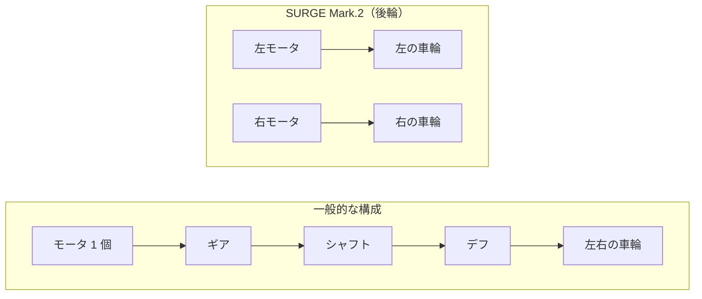
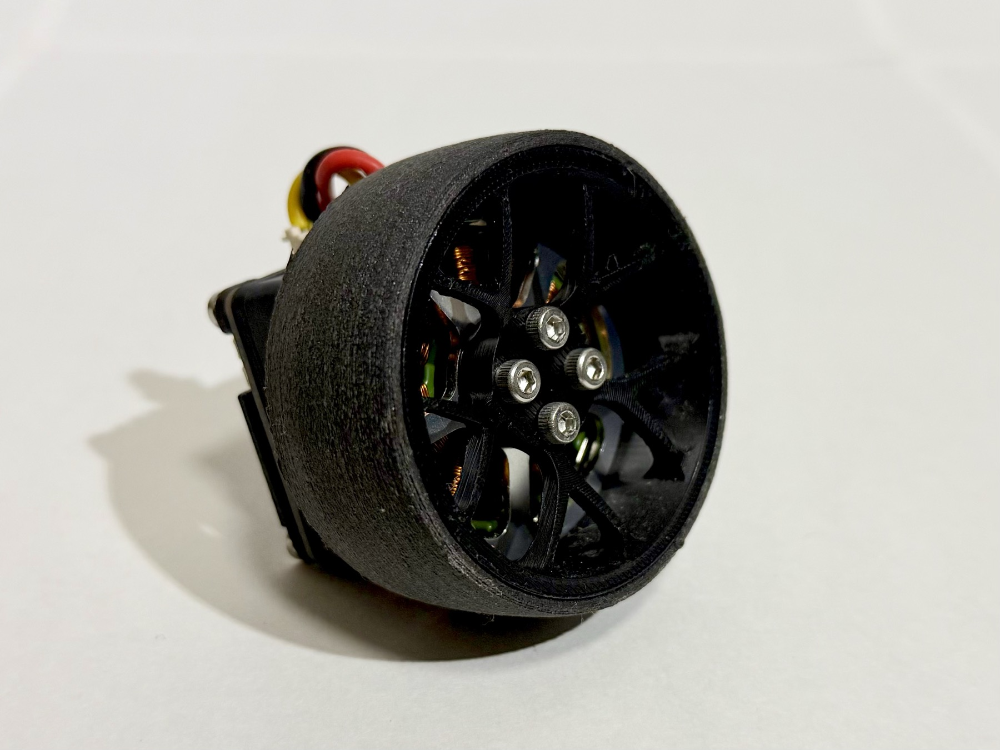
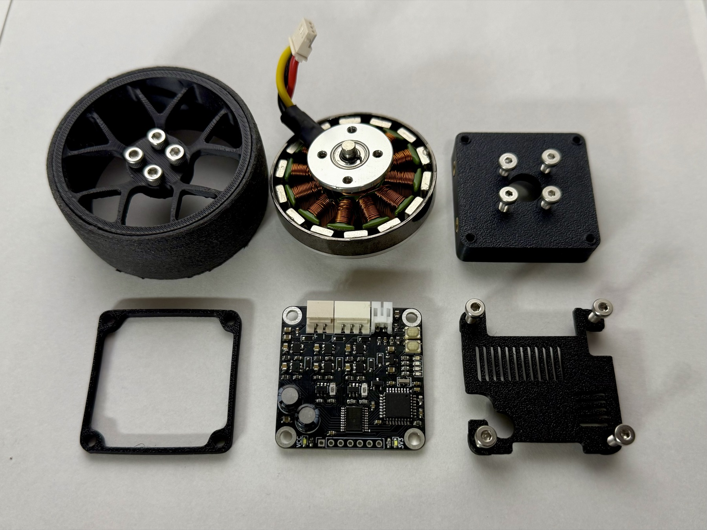
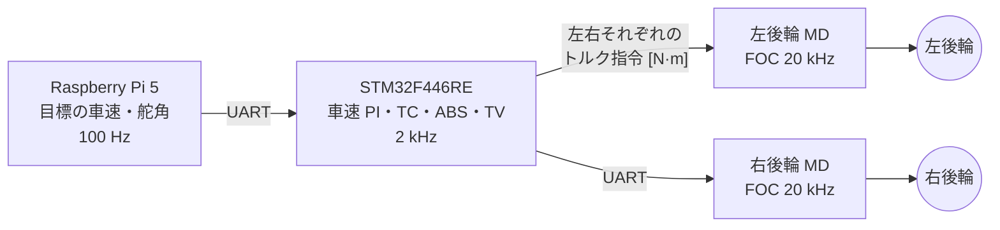

# インホイール・ダイレクトドライブ

!!! summary "要点"
    - 後輪は、**ドローン用のアウターロータ型 BLDC モータのロータにホイールを直接ネジ留め**した構造です。モータはホイールの中に完全に収まり、ギアもベルトもありません。
    - モータの裏には**自作のモータドライバ（MD）基板**を背負わせ、基板中央の角度センサがモータ軸の磁石を直接読みます。
    - MD は相電流を測ってベクトル制御（FOC）を回すので、**左右の後輪に N·m 単位でトルクを指令できます**。ガタも粘りもない駆動系に、この精度の指令を流せることが、トラクションコントロールやトルクベクタリングの土台です。

<model-viewer id="wheel-viewer" src="../assets/3d/wheel.glb" data-src-exploded="../../assets/3d/wheel_exp.glb"
  alt="後輪のインホイールユニットの 3D モデル" camera-controls touch-action="pan-y"
  camera-orbit="60deg 75deg auto" environment-image="neutral" exposure="1.25" shadow-intensity="0.6"></model-viewer>

<button type="button" data-view="assembled" aria-pressed="true">組み立てた状態</button>
<button type="button" data-view="exploded" aria-pressed="false">分解して並べる</button>
分解図は外側から：タイヤとホイール → モータ → モータマウント → MD 基板 → カバー

## しくみ

### ふつうのラジコンとの違い

一般的なラジコンカーは、車体の中央に 1 つのモータを置き、ギアとシャフトとデフを経由して左右の車輪へ力を配ります。
SURGE Mark.2 は、**左右の後輪それぞれの中にモータを入れ**、モータが車輪そのものを回します。

### 1 輪の中身

<figure markdown>
{ loading=lazy }
<figcaption>後輪のインホイールユニット。モータはホイールの中に収まっています。</figcaption>
</figure>

<figure markdown>
{ loading=lazy }
<figcaption>後輪ユニットを分解したところ。上段は左から、ホイール、モータ（アウターロータ型の 5010）、モータマウント。下段は MD 基板と、それを挟む 2 つのカバー。</figcaption>
</figure>

| 部品 | 中身 |
|---|---|
| **モータ** | AliExpress で入手した**ドローン用 5010 サイズ・360 KV の BLDC**（アウターロータ型）。改造せずにそのまま使っています。 |
| **ホイール** | 3D プリント。**モータのロータにネジで固定**します。モータはホイールの中に完全に入ります。 |
| **タイヤ** | **TPE 樹脂を 3D プリンタで印刷した自作品**。車輪半径は 30 mm（[`vehicle.toml`][vehicle-toml]）。 |
| **軸受け** | モータに元から入っているベアリングを、そのまま車輪の支持に使っています。 |
| **角度センサ** | モータの軸に**磁石を直接接着**し、モータの裏に置いた MD 基板の**中央にある磁気式角度センサ AS5600** で読みます。 |
| **モータドライバ** | 自作の MD 基板（4 代目、`CurcuitV4`）をモータの裏に配置。詳細は [自作モータドライバと FOC](motor-driver.md)。 |

### アウターロータ型だからホイールを直接付けられる

このモータは**アウターロータ型**で、磁石の付いたロータがステータ（巻線）の外側を回ります。
外側の回る部分にそのままホイールをネジ留めできるので、軸や継手を足さずに、モータをホイールの中に収められます。

### なぜダイレクトドライブなのか

理由は 1 つで、**制御を素直に効かせるため**です。

ギアを挟むと、歯と歯のすき間（**バックラッシ**）と、ギアやグリスの**粘り**が駆動系に入ります。
バックラッシがあると、トルクの向きを変えた瞬間に「すき間を詰めるまで力が伝わらない」時間ができます。
粘りは回転速度によって変わる抵抗で、モータが出したトルクのうち、どれだけがタイヤに届いたかを曖昧にします。

ダイレクトドライブにはこの 2 つがないので、**MD が出したトルクがほぼそのままタイヤに届きます**。
上位の制御（車速の PI、トラクションコントロール、ABS、トルクベクタリング）は、
「この車輪に何 N·m」という指令がそのまま効く前提で組めます。

この流れの各段は、[駆動制御](../control/drive.md)・[スリップ制御](../control/traction.md)・[トルクベクタリング](../control/torque-vectoring.md) で詳しく扱っています。

## 設計の詳細

### トルクを「測って」出す — 4 代の MD 基板

ダイレクトドライブの利点を活かすには、MD が狙ったトルクを正確に出せなければなりません。
BLDC のトルクは相電流に比例するので、**相電流を測れること**が前提になります。
MD 基板は現在 4 代目で、この版でようやく実用になりました。

| 版 | ゲートドライバ | 電流の測定 | 主な変更（回路図から） |
|---|---|---|---|
| V1 | IR2302 | なし | 最初の版。電流を測れなかった |
| V2 | DRV8300 | なし | ゲートドライバを変更。温度センサ（MCP9700）を追加 |
| V3 | DRV8300 | INA180A2 を追加 | 電流測定の回路を追加 |
| **V4（現行）** | DRV8300 | **INA181（双方向）×2** | 電流測定の回路を変更。電源に TVS ダイオード（SMAJ13A）を追加 |

各版の部品は [`BLDC`][bldc-repo] リポジトリの `CurcuitV1`〜`V4` の回路図から読み取りました。
V4 では 2 相の下側に 5 mΩ のシャント抵抗を入れ、残りの 1 相は「3 相の和は 0」から計算します（[HARDWARE_MAP.md][hw-map]）。

**相電流が測れる → FOC ができる → トルクを N·m 単位で指令できる**、という順につながっています。

### モータ定数はカタログではなく、自分で測る

モータの抵抗やトルク定数などは、カタログの値に頼らず、MD 自身が測ります。
MD には**自動校正**の機能があり、スイッチを押しながら起動すると、モータを付けたまま 1 分以内に次を測って Flash に保存します（[FOC.md][foc-md]）。

| 測るもの | 何に使うか |
|---|---|
| 巻線の抵抗 R・インダクタンス L | 電流制御のゲインを決める |
| 電流制御の応答の速さ | 狙った帯域になっているか確かめる |
| 角度センサの範囲・向き・ずれ | 電気角を正しく求める |
| 慣性とトルク定数の比（J/Kt）・摩擦 | 速度制御のゲインを決める |
| 角度センサの誤差の補正表 | 磁石の偏心などで生じる角度の誤差を消す |
| 磁束鎖交数 ψm・角度の遅れ | 逆起電力の補償、センサの遅れの補償 |

**機構を付けたまま測る**ので、得られる慣性と摩擦は、モータ単体ではなく「ホイールとタイヤ込み」の値になります。
校正値が Flash に無い MD は、トルクの上限を 0 に固定して回しません（既定値を持たない設計）。

### 角度センサを車軸に直接付ける

FOC では、ロータの角度（電気角）を正確に知る必要があります。
このモータは極対数が 7 なので、**機械角の誤差は 7 倍になって電気角の誤差に効きます**。

SURGE Mark.2 では、モータ軸に磁石を接着し、モータの真裏に置いた MD 基板の中央で AS5600 が読みます。
センサとモータの間に余計な機構がないので、読んだ角度がそのままロータの角度です。

一方で、AS5600 のアナログ出力には癖があり、ファームで次の対策をしています（[FOC.md][foc-md]、[OPTIMIZATION.md][opt-md]）。

- **継ぎ目の扱い**: 出力が 0 V 付近と 3.3 V 付近で飽和し、1 周の継ぎ目で値が飛びます。
  角度追従のオブザーバ（2 次 PLL）で、継ぎ目の前後を捨てて追従します。
- **遅れの補償**: AS5600 の内部フィルタ（約 1 ms）と演算の遅れで、読んだ角度は実際より遅れます。
  速度に比例して角度を進めて補います（120 rad/s で電気角のずれ 49° → 約 0°）。
- **誤差の補正表**: 電流を切って惰性で回し、そのときの角度の誤差を 128 点の表にして補正します。

### 数字で見る駆動輪

| 量 | 値 | 出どころ |
|---|---|---|
| 電流制御の周期 | 20 kHz | `config.h` の `PWM_FREQ` |
| 電流の上限（MD） | 10 A | `config.h` の `MAX_CURRENT` |
| 1 輪のトルク上限（STM32 から指令） | 0.15 N·m | [駆動制御](../control/drive.md#トルク上限の決め方) |
| モータの極対数 | 7 | `config.h` の `POLE_PAIRS` |
| 指令できる最高車速（STM32） | 5.0 m/s | [構成と制御周期](../control/index.md) |
| 後輪の周速の最終ガード（STM32） | 7.5 m/s | [スリップ制御](../control/traction.md) |
| 車輪半径 | 30 mm | [`vehicle.toml`][vehicle-toml] |

走行中の後輪は MD のトルクモードで動かしており、車速の上限は STM32 の側で管理しています。
後輪の周速が最終ガードを超えると、スリップの判定とは関係なく、その輪のトルクを 0 にします。

### 同じユニットをステアリングにも使う

前輪のステアリングにも、**同じ 5010 モータと同じ MD 基板**を使っています。
後輪はトルクモード、ステアリングは位置モードと、同じハードを制御モードの違いだけで使い分けています（[ステアリング](steering.md)）。

### 今後の改善点

- **軸受け**: 現在はモータ内蔵のベアリングで車輪を支えています。車輪の荷重を受けるための専用の軸受けではないため、開発者自身も改善したい箇所と考えています。
- **タイヤ**: 現在の TPE の 3D プリントから、コーキング剤で成形する自作タイヤに切り替える予定です。
- **角度センサの読み方**: 現行の基板（V4）は AS5600 の I²C を配線しておらず、アナログ出力だけを使っています。I²C で読めば飽和・盲点・継ぎ目の問題がまとめて消えるので、次の基板の課題としています（[OPTIMIZATION.md][opt-md]）。

隣のしくみへ

- [ステアリング](steering.md)
- [シャシーと足まわり](chassis.md)

さらに深く

- [自作モータドライバと FOC](motor-driver.md)
- [スリップ制御（TC・ABS）](../control/traction.md)

---

**出典**: 構造・部品・設計の理由は開発者への聞き取り（2026-11-09）。MD の数値と校正は [`BLDC`][bldc-repo]（ブランチ `FW/Program_V4`）の `config.h`・`docs/`。MD 基板の各版の部品は `CurcuitV1`〜`V4` の回路図。

[vehicle-toml]: https://github.com/banbatakumi/AutonomousCar_RasPi/blob/master/surge_mk2/config/vehicle.toml
[bldc-repo]: https://github.com/banbatakumi/BLDC/tree/FW/Program_V4
[hw-map]: https://github.com/banbatakumi/BLDC/blob/FW/Program_V4/ProgramV4/docs/HARDWARE_MAP.md
[foc-md]: https://github.com/banbatakumi/BLDC/blob/FW/Program_V4/ProgramV4/docs/FOC.md
[opt-md]: https://github.com/banbatakumi/BLDC/blob/FW/Program_V4/ProgramV4/docs/OPTIMIZATION.md
