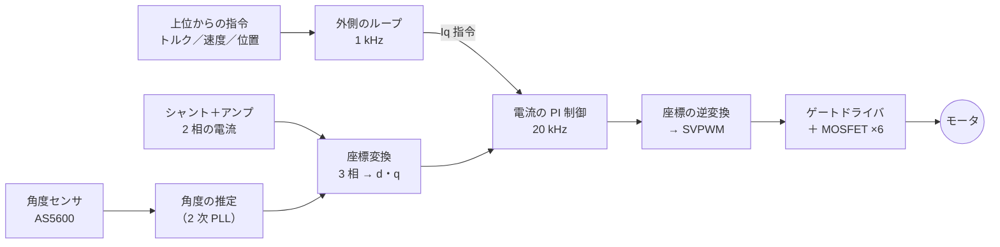

# 自作モータドライバと FOC

!!! summary "要点"
    - モータドライバ（MD）は自作の基板で、**後輪 2 個とステアリング 1 個のモータに 1 枚ずつ**、モータの真裏に付いています。
    - 基板の上の小さなマイコン（STM32F303K8）が、**1 秒に 2 万回**モータの電流を測り、ベクトル制御（FOC）で狙ったトルクを出します。
    - 上位の制御ボード（STM32F446RE）とは UART で 1 秒に 2,000 回やり取りし、通信が切れたり異常があったりすると自分で出力を止めます。

## しくみ

### MD は何をしているのか

BLDC モータは、3 本の線（U・V・W 相）に流す電流の向きと大きさを、ロータの角度に合わせて切り替え続けないと回りません。
MD の仕事は次の 3 つです。

1. **ロータの角度を知る** — モータ軸の磁石を、基板中央の角度センサ AS5600 で読みます。
2. **電流を測る** — 2 相の電流をシャント抵抗とアンプで測り、残り 1 相は計算で求めます。
3. **狙った電流を流す** — 6 個の MOSFET を PWM でオン・オフして、各相の電圧を作ります。

### FOC（ベクトル制御）を一言で

3 相の電流を、ロータの角度を基準にした 2 つの成分に分けて扱う方法です。

- **q 軸電流（Iq）**: トルクを生む成分。**トルクは Iq に比例**します。
- **d 軸電流（Id）**: トルクを生まない成分。ふつうは 0 にします。

Iq だけを狙って流せるので、「何 N·m 出すか」を電流の指令としてそのまま扱えます。
これが、SURGE Mark.2 が左右の後輪のトルクを細かく配分できる理由です。

!!! placeholder "写真 P-04：MD 基板 V4 の表と裏"
    表面（部品面）と裏面を並べて真上から。主要部品（マイコン、ゲートドライバ、MOSFET、電流アンプ、AS5600）に
    引き出し線で名前を付ける注記を後で重ねたい。

!!! placeholder "写真 P-05：モータの裏に MD 基板が付いている様子"
    カバーを外した状態で、モータ・マウント・基板の位置関係が分かる角度から。AS5600 とモータ軸の磁石が向かい合う位置が分かると理想的。

## 設計の詳細

### 基板の構成（CurcuitV4）

部品は [`CurcuitV4`][curcuit-v4] の回路図・部品表と、ファームの [HARDWARE_MAP.md][hw-map] から読み取りました。

| 役割 | 部品 |
|---|---|
| マイコン | STM32F303K8（Cortex-M4、単精度 FPU） |
| ゲートドライバ | DRV8300 |
| MOSFET | SSM6K819R ×6（3 相のハーフブリッジ） |
| 電流センサ | シャント 5 mΩ ×2（2 相の下側）＋ 双方向電流アンプ INA181A1（20 倍）×2 |
| 角度センサ | AS5600（アナログ出力を使用） |
| 温度センサ | MCP9700 |
| 電源まわり | 3.3 V レギュレータ AP7375-3.3、TVS ダイオード SMAJ13A |
| クロック | セラミック発振子 16 MHz（CSTNE16M0V530000R0） |
| 設計・製造 | KiCad で設計し、JLCPCB に発注 |

部品表の上ではシャントが 10 mΩ ですが、実際に実装したのは 5 mΩ です（[HARDWARE_MAP.md][hw-map]）。
電流の分解能は約 0.0081 A/LSB、測れる範囲は約 ±16.5 A です。

### 20 kHz の制御ループ

PWM の周期（20 kHz）に同期して電流を測り、その割り込みの中で 1 周期ぶんの制御を全部済ませます（[FOC.md][foc-md]）。

| 処理 | 周期 |
|---|---|
| 角度の推定（2 次 PLL のオブザーバ） | 20 kHz |
| 電流の PI 制御・逆起電力の補償・SVPWM | 20 kHz |
| 速度・位置の PID、過速度の判定 | 1 kHz |

割り込みの処理時間は平均 22.1 µs・最大 27.8 µs で、周期 50 µs に対して CPU 使用率は約 44% です（2026-10-19 実測）。
電流ループは帯域約 700 Hz、95% 整定 0.50 ms まで詰めています（[OPTIMIZATION.md][opt-md]）。

**20 kHz より上げない理由**: 最高速度でも電気角 1 周期に 120 サンプル取れており、FOC の定石（10〜20 サンプル）を大きく上回っています。
周波数を上げると、スイッチング損失が増えるうえ、下側シャントで電流を測れる時間が縮んで出せる電圧の上限が下がり、最高速度が落ちます。

### 制御モード

| モード | 使いどころ | 内容 |
|---|---|---|
| TORQUE | **後輪（走行中）** | 上位のトルク指令をそのまま Iq の指令にする |
| POSITION | **ステアリング** | 目標角との差を PID に入れる |
| SPEED | 試験・校正 | 速度の PID |
| BRAKE | 制動 | 回転と逆向きのトルクを、低速で滑らかに 0 へ絞る |
| STOP | 停止 | 電流 0 |

どのモードでも、最後の Iq 指令は上位が毎回送る「トルクの上限」で頭打ちにします。

### 上位との通信

STM32F446RE（制御ボード）とは UART 1 Mbps でつなぎ、**2 kHz** で指令（6 バイト）と状態（11 バイト）をやり取りします。
末尾は CRC-8 で、壊れたフレームは捨てます（[SERIAL_PROTOCOL.md][serial-md]）。

**制限値を毎回のフレームに載せる**のが特徴です。MD は起動直後は制限値 0（動かない）で、上位から有効な制限値が届いて初めて出力します。

### 守りの仕組み

| 異常 | MD の動き | しきい値（`config.h`） |
|---|---|---|
| 過電流 | 出力を止める | 15 A（電流上限 10 A の 1.5 倍） |
| 電源電圧の異常 | 出力を止める | 7 V 未満・15 V 超が 0.5 秒続いたとき |
| 過熱 | 出力を止め、5 °C 下がるまで保持 | 60 °C |
| 過速度 | 出力を止める | 速度・位置モードは上限の 1.2 倍、トルク系のモードは 270 rad/s。どちらも 50 ms 続いたとき |
| 通信の途絶 | 制限値を 0 に戻す | 0.5 秒 |
| メインループの停止 | ウォッチドッグでリセット（出力は Hi-Z で惰行） | — |
| 校正値が無い | トルクの上限を 0 に固定 | — |

### モータ定数の自動校正

MD はスイッチを押しながら起動すると、モータを付けたまま 1 分以内に、抵抗・インダクタンス・電流制御の帯域・角度センサの特性・慣性・摩擦・角度の補正表・磁束・角度の遅れを順に測ります。
全部に合格したときだけ Flash に保存します。中身は [インホイール・ダイレクトドライブ](in-wheel-drive.md#モータ定数はカタログではなく自分で測る) と [FOC.md][foc-md] にあります。

### 今後の課題

- **デッドタイムの補償**（未実装）: 低速で、トルクのむら（Vq に約 0.26 V の電圧損）が残っています。
- **角度センサの I²C 化**（次の基板）: V4 は AS5600 の I²C を配線しておらず、アナログ出力の飽和・盲点・継ぎ目の対策をファームで抱えています。

隣のしくみへ

- [ステアリング](steering.md)
- [電装と電源](electronics.md)

さらに深く

- [駆動制御（車速 PI）](../control/drive.md)
- [MD のファーム（GitHub）][bldc-repo]

---

**出典**: [`BLDC`][bldc-repo]（ブランチ `FW/Program_V4`）の `ProgramV4/src/app/config.h`・`app.c`・`docs/FOC.md`・`docs/HARDWARE_MAP.md`・`docs/OPTIMIZATION.md`・`docs/SERIAL_PROTOCOL.md`、`CurcuitV4/production/bom.csv`。設計ツール・発注先は開発者への聞き取り（2026-11-09）。

[bldc-repo]: https://github.com/banbatakumi/BLDC/tree/FW/Program_V4
[curcuit-v4]: https://github.com/banbatakumi/BLDC/tree/FW/Program_V4/CurcuitV4
[hw-map]: https://github.com/banbatakumi/BLDC/blob/FW/Program_V4/ProgramV4/docs/HARDWARE_MAP.md
[foc-md]: https://github.com/banbatakumi/BLDC/blob/FW/Program_V4/ProgramV4/docs/FOC.md
[opt-md]: https://github.com/banbatakumi/BLDC/blob/FW/Program_V4/ProgramV4/docs/OPTIMIZATION.md
[serial-md]: https://github.com/banbatakumi/BLDC/blob/FW/Program_V4/ProgramV4/docs/SERIAL_PROTOCOL.md
