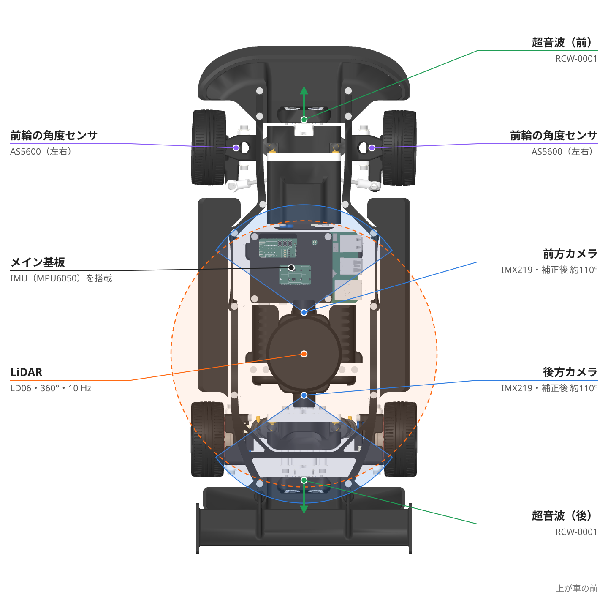
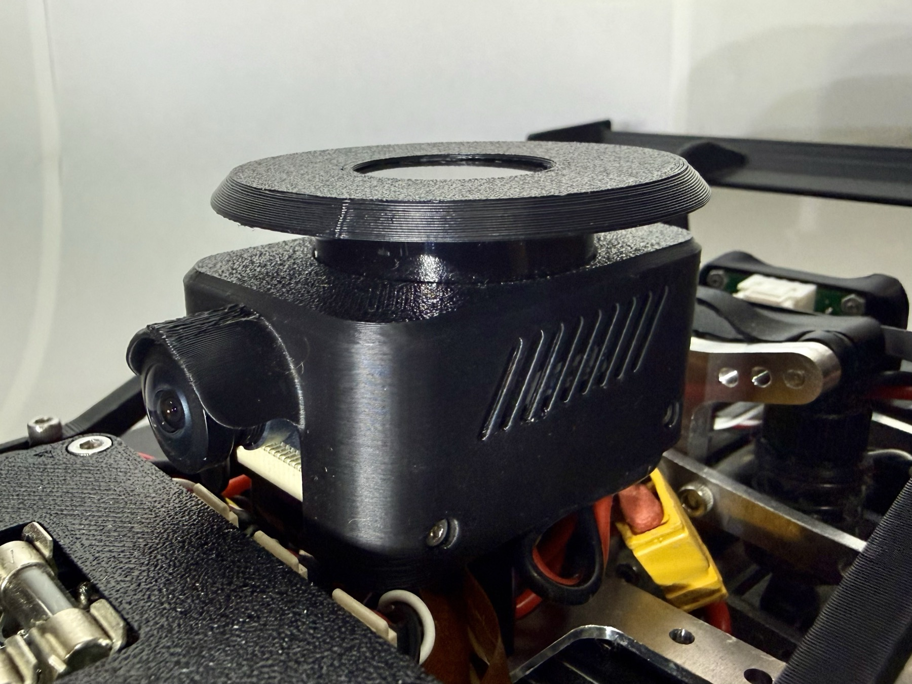

# センサ

!!! summary "要点"
    - 周りを見るのは、**LiDAR（1 台）・カメラ（前後 2 台）・超音波（前後 2 個）**です。
    - 自分の動きを測るのは、**IMU（加速度と角速度）**と、**前輪の角度センサ（車速）**です。
    - どのセンサにも癖があり、その癖を前提にソフトを組んでいます。下の表の「気をつけていること」がその要点です。

## しくみ

### どこに何が付いているか

<figure markdown>
{ loading=lazy }
<figcaption>真上から見たセンサの配置（3D データから作図）。青い扇はカメラの補正後の画角（約 110°）、橙の破線は LiDAR が全周を測ることを表します（円の大きさは模式）。超音波は向きだけを示しています。</figcaption>
</figure>

| センサ | 型番 | 付いている所 | 主な用途 |
|---|---|---|---|
| LiDAR | LD06 | 車体の上（後車軸の中心から前へ 0.07 m、高さ 0.11 m） | 地図の作成、自己位置の推定、障害物の検知 |
| カメラ ×2 | IMX219（160° の広角レンズ） | 前（後車軸から 0.10 m 前、高さ 0.08 m）と後ろ | 走行可能な領域・白線の認識、模倣学習の入力 |
| 超音波 ×2 | RCW-0001 | 前と後ろ | 近くの障害物の検知 |
| IMU | MPU6050 | 制御基板の上 | 角速度・加速度 |
| 角度センサ ×2 | AS5600 | 左右の前輪（灯火・エンコーダ基板） | 車速の計測 |
| 温度センサ ×4 | — | 後輪の MD 左右・ステアリングの MD・STM32 の内蔵 | 過熱の監視 |

取付位置は [`vehicle.toml`][vehicle-toml] の `[sensors.*]`（後車軸の中心が原点、x が前、z が上）です。

<figure markdown>
{ loading=lazy }
<figcaption>車体の上の LiDAR と、その下の前方カメラ。</figcaption>
</figure>

## 設計の詳細

### センサの癖と、気をつけていること

| センサ | 癖 | ソフト側の対処 |
|---|---|---|
| **LiDAR LD06** | 1 秒に 10 回転。**裏向きに付けている**ので点群が鏡像になる | 鏡像を戻してから使う（`ScanAssembler`）。1 周 100 ms の間に車が動いて点群がゆがむので、その補正（脱スキュー）も行う |
| **超音波** | 実質 1 秒に 20 回が上限 | 100 Hz の通信に同じ値が続けて載ることを前提に扱う |
| **IMU MPU6050** | **地磁気センサが無い**ので絶対的な方位は出ない | 向き（ヨー角）は積分でずれていく前提で扱う。地図を使う走行では LiDAR の自己位置推定で補う |
| **前輪の角度センサ** | アナログ出力で分解能が粗い | 加速度センサとのカルマンフィルタで車速を推定。**ここから加速度を微分しない** |
| **カメラ** | 160° の魚眼レンズで大きくゆがむ | レンズのパラメータを校正し、ゆがみを補正してから使う |

出典は [システム概要の §2][system-overview] と各ページです（[地図と自己位置推定](../autonomy/mapping.md)、[駆動制御](../control/drive.md#speed-kf)）。

### つながっている先

| つなぐ先 | センサ |
|---|---|
| STM32F446RE（制御ボード） | LiDAR・超音波・IMU・前輪の角度センサ・温度センサ |
| Raspberry Pi 5 | カメラ ×2（CSI） |

LiDAR は STM32 が受け取り、UART で Raspberry Pi へ中継します（[UART プロトコル](../control/protocol.md)）。

隣のしくみへ

- [電装と電源](electronics.md)
- [部品表（BOM）](bom.md)

さらに深く

- [地図と自己位置推定](../autonomy/mapping.md)
- [システム構成](../about-car/system.md)

---

**出典**: [`docs/system_overview.md` §2][system-overview]、[`vehicle.toml`][vehicle-toml] の `[sensors.*]`、`PROTOPEDIA.md`（型番）。IMU の実装場所は制御基板 `MainBoard_V3_2` の回路図。

[vehicle-toml]: https://github.com/banbatakumi/AutonomousCar_RasPi/blob/master/surge_mk2/config/vehicle.toml
[system-overview]: https://github.com/banbatakumi/AutonomousCar_RasPi/blob/master/surge_mk2/docs/system_overview.md#2-ハードウェア
